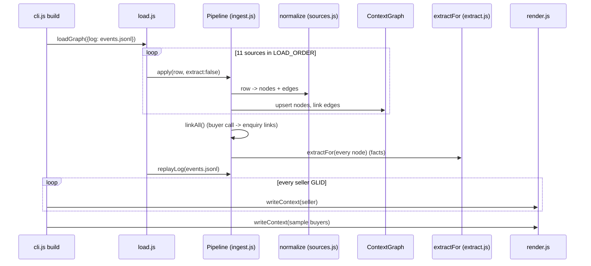
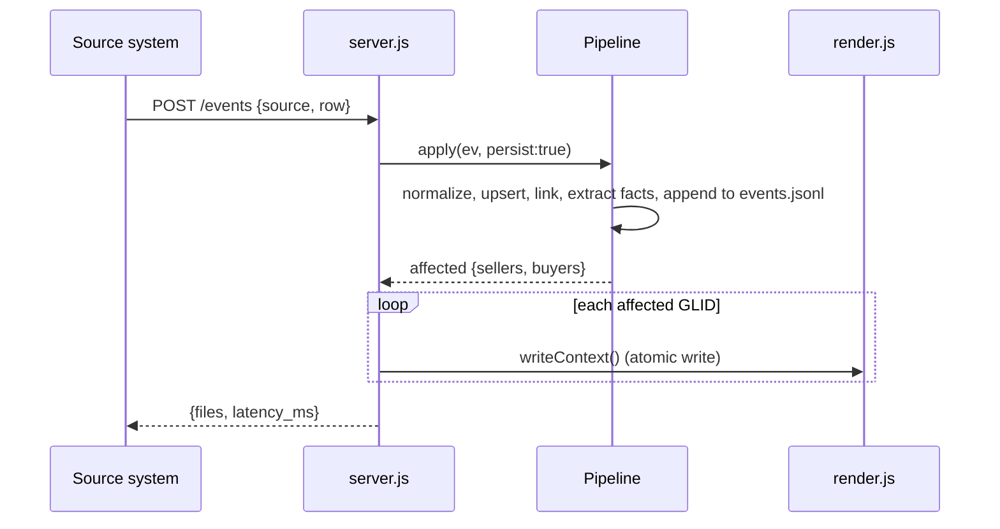
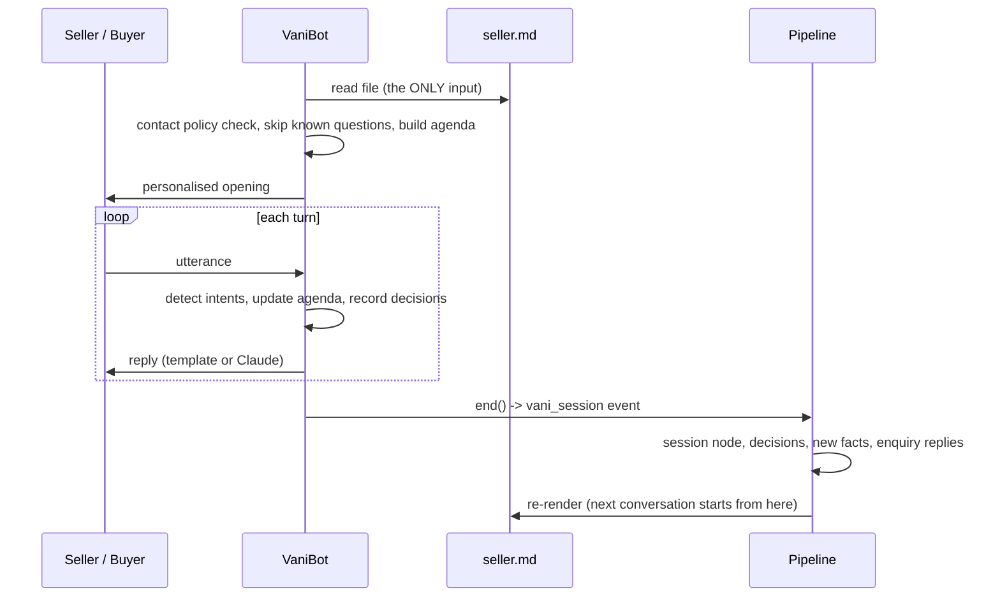

# Context Layer — Complete Technical Guide

This guide explains every part of the context layer: what each piece does, the exact rules it applies, why it was built that way, and how the pieces connect. Read it top to bottom once; after that, use the table of contents as a reference.

`README.md` is the short overview. This file is the deep dive.

---

## Contents

1. [The problem and the idea in one page](#1-the-problem-and-the-idea-in-one-page)
2. [Mental model: the three memory tiers](#2-mental-model-the-three-memory-tiers)
3. [Folder map and what each file does](#3-folder-map-and-what-each-file-does)
4. [The four flows end to end](#4-the-four-flows-end-to-end)
5. [Stage 1 — Reading the data (CSV parser, time, privacy)](#5-stage-1--reading-the-data)
6. [Stage 2 — Normalising sources into nodes and edges](#6-stage-2--normalising-sources-into-nodes-and-edges)
7. [Stage 3 — The graph store](#7-stage-3--the-graph-store)
8. [Stage 4 — The ingest pipeline](#8-stage-4--the-ingest-pipeline)
9. [Stage 5 — Reasoning memory: facts](#9-stage-5--reasoning-memory-facts)
10. [Stage 6 — Rendering seller.md](#10-stage-6--rendering-sellermd)
11. [Stage 7 — Rendering buyer.md](#11-stage-7--rendering-buyermd)
12. [Stage 8 — The VANI bot](#12-stage-8--the-vani-bot)
13. [Stage 9 — Write-back: how the next conversation continues](#13-stage-9--write-back-how-the-next-conversation-continues)
14. [Freshness: mechanism and measurement](#14-freshness-mechanism-and-measurement)
15. [The HTTP service](#15-the-http-service)
16. [Non-bot consumers (reuse)](#16-non-bot-consumers-reuse)
17. [Neo4j export and the graph view](#17-neo4j-export-and-the-graph-view)
18. [Privacy and safety, layer by layer](#18-privacy-and-safety-layer-by-layer)
19. [Worked example: one seller from CSV to conversation](#19-worked-example-one-seller-from-csv-to-conversation)
20. [Configuration reference](#20-configuration-reference)
21. [CLI reference](#21-cli-reference)
22. [How to extend it](#22-how-to-extend-it)
23. [Limits, edge cases and troubleshooting](#23-limits-edge-cases-and-troubleshooting)
24. [Glossary](#24-glossary)

---

## 1. The problem and the idea in one page

**Problem.** Every VANI call or chat starts cold. The bot does not know what the seller received, what was said on WhatsApp yesterday, or what was agreed on the last call. Users repeat themselves, and conversations restart instead of continuing.

**Idea.** Build one memory per user, keyed by GLID, out of every source. Turn that memory into a short, fixed-format file (`seller.md` / `buyer.md`) that the bot reads before speaking. After every conversation, write what happened back into the memory and regenerate the file, so the next conversation on any channel continues from there.

```
 11 CSV files / live events ──► memory graph (per GLID) ──► seller.md / buyer.md ──► VANI
            ▲                                                                         │
            └──────────────────── conversation written back as an event ◄─────────────┘
```

Four properties make this work:

| Property | How it is achieved |
|---|---|
| **Knows the user before speaking** | All sources joined by GLID into one graph; the file summarises it |
| **Never re-asks** | The bot checks every standard question against the file and skips any it can answer |
| **Continues across channels** | The bot's promises ("I'll send it on WhatsApp") are stored and resurface on the next channel |
| **Always fresh** | Each new event re-renders only the affected files, in milliseconds |

---

## 2. Mental model: the three memory tiers

The design follows the "context graph" idea: memory is split by how fast it changes and what question it answers.

| Tier | Changes | Answers | Node types |
|---|---|---|---|
| **Long-term** (knowledge) | Rarely | *Who is this?* | `Seller`, `Buyer`, `Category`, `Product`, `Mcat`, `Employee` |
| **Short-term** (conversation) | Every event | *What happened, where, when?* | `Enquiry`, `EnquiryMessage`, `BuyerCall`, `BuyLead`, `WhatsAppMsg`, `ChatSession`, `ChatTurn`, `PNSCall`, `BotCall`, `BotTurn`, `ExecCall`, `VaniSession` |
| **Reasoning** (decision traces) | When something meaningful is said or decided | *What must we remember, and why did the bot act?* | `Fact`, `Decision` |

Why split it this way:

- Raw interactions (short-term) are too many and too noisy to give the bot directly. Seller 93557756 has 21 VANI calls and 34 WhatsApp rows.
- What the bot actually needs is the *meaning*: "asked us to stop calling on 18 Sep", "already met an executive". Those are **Facts**, distilled from interactions, each pointing back to its source.
- The bot's own choices ("skipped the meeting pitch because of fact X", "promised to send details on WhatsApp") are **Decisions**. They make behaviour explainable, and they are how a promise made on a call survives into the next WhatsApp chat.

Every node lives in one graph and links to the others. A Fact links to the interaction it came from (`DERIVED_FROM`); a Decision links to the Facts it used (`USED`). You can always ask "why does the file say this?" and walk back to the original row.

---

## 3. Folder map and what each file does

```
context_layer/
├── cli.js                 Entry point: every command (build, demo, chat, serve, ...)
├── package.json           Node project; @anthropic-ai/sdk is an optional dependency
├── bot_prompt.md          VANI system prompt (used only in --llm mode)
├── demo/scripts.json      Synthetic user lines for the demo (clearly labelled)
├── README.md              Short overview
├── DOCUMENTATION.md       This guide
├── src/
│   ├── config.js          Paths, lookback windows, token budget, sample GLIDs, env overrides
│   ├── time.js            Timestamp helpers (all IST strings)
│   ├── csv.js             CSV parser and writer
│   ├── pii.js             Scrubbing, buyer pseudonyms, output guard
│   ├── sources.js         One normaliser per source: row -> nodes + edges
│   ├── graph.js           In-memory property graph with GLID indexes
│   ├── ingest.js          Pipeline: bulk load, live events, linking, write-back, event log
│   ├── load.js            Convenience: build a graph from CSVs + replay the log
│   ├── extract.js         Reasoning memory: fact rules, time-to-live, conflict resolution
│   ├── render.js          seller.md and buyer.md, token budget, atomic writes
│   ├── mdparse.js         Reads a context file back (front matter + sections)
│   ├── bot.js             VANI simulator: policy, agenda, replies, decisions
│   ├── llm.js             Optional Claude phrasing layer
│   ├── demo.js            Voice -> write-back -> WhatsApp demo runner
│   ├── freshness.js       Replay benchmark
│   ├── server.js          HTTP context service
│   ├── reuse.js           Exec prep card, campaigns, dashboard
│   ├── export.js          Neo4j CSV + Cypher export
│   └── viz.js             HTML graph view of one seller
├── out/                   Everything generated (safe to delete; `build` recreates it)
│   ├── sellers/<glid>.md  5,000 seller files
│   ├── buyers/<glid>.md   Sample buyer files
│   ├── demo/              Demo transcripts + demo/files/ (demo's own copies)
│   ├── freshness/         report.md, latencies.csv, files/
│   ├── reuse/             Campaign CSVs, suppression list, dashboard, prep cards
│   ├── neo4j/             nodes_*.csv, rels_*.csv, load.cypher, queries.cypher
│   ├── graphs/<glid>.html Graph view
│   └── build_stats.json   Size and timing of the last build
└── store/                 Append-only event logs
    ├── events.jsonl       Live events + real chat sessions (replayed on every start)
    └── demo_events.jsonl  Demo sessions only (reset on each demo run)
```

**Dependency direction** (who imports whom), bottom to top:

```
time, csv, pii, config
      ▲
   sources ◄── extract
      ▲            ▲
    graph       ingest ◄── load
                   ▲
                render ◄── mdparse ◄── bot ◄── llm
                   ▲                    ▲
     demo, freshness, server, reuse, export, viz  ◄── cli
```

---

## 4. The four flows end to end

### 4.1 Build flow (`node cli.js build`)



Facts are extracted *after* all rows are loaded during bulk load. Some rules need a parent that loads later (a transcript turn needs its call's timestamp), so extraction waits until everything is in.

### 4.2 Live event flow (`POST /events`)



Only the GLIDs touched by the event are re-rendered. One event costs a few milliseconds, no matter how big the dataset is.

### 4.3 Conversation flow (`chat`, `demo`, `/bot/*`)



### 4.4 Freshness benchmark flow (`node cli.js freshness`)

The snapshot loads up to a cutoff (default 25 Sep 23:59:59). Every later real event (26 Sep to 2 Oct, 21,738 events) is held back, sorted by time and replayed one at a time through the same `apply` + `writeContext` path the server uses. The time per event is recorded. Details in [§14](#14-freshness-mechanism-and-measurement).

---

## 5. Stage 1 — Reading the data

### 5.1 CSV parser (`src/csv.js`)

A hand-written RFC 4180 parser, because Node has no built-in CSV reader and the data has quoted fields with commas, `""` escapes and **line breaks inside messages**.

How it works: for each field, if it starts with `"`, jump from quote to quote with `indexOf` (fast), treating `""` as a literal quote, until a closing quote. Otherwise read until `,`, `\r` or `\n`. The first row is the header; every later row becomes an object `{column: value}`. A leading byte-order mark is stripped.

It parses all ~60 MB in a few seconds, as a generator (`parseCsv`), so rows stream into the pipeline. `toCsv` writes CSV for exports and quotes cells that contain commas, quotes or newlines.

### 5.2 Time (`src/time.js`)

**Every timestamp in the system is a plain string `"YYYY-MM-DD HH:MM:SS"` in IST.** That makes comparison simple: string comparison equals time comparison.

| Helper | Purpose |
|---|---|
| `norm(s)` | Cleans any input to the standard form, or `null` |
| `utcToIst(s)` | Adds 5h30m. Used **only** for `gc_buyer_call_extractions.call_date`, which is UTC (found in the data analysis: those calls peak at 05–12h vs 09–20h elsewhere) |
| `addMin`, `addDays`, `daysBetween` | Arithmetic (internally treats strings as UTC, which is safe because no real time zones are mixed) |
| `dmy`, `dmyhm` | Display: `"18 Sep"`, `"18 Sep 14:00"` |
| `cmpTs` | Sort comparator by `ts`; nodes without a timestamp sort first |

The dataset's "now" is `AS_OF = "2026-10-02 23:59:59"`. Every lookback window is measured back from that moment, not from today's real date, so results are reproducible.

### 5.3 Privacy at the door (`src/pii.js`)

The dataset claims phone numbers and emails were removed, but message text still contains them ("Call me on 98xxxxxxxx"). So every free-text field passes through `scrub()` on the way in:

| Pattern | Replaced with | Example |
|---|---|---|
| Indian mobile (optional +91/0, 10 digits starting 6–9, spaces/dashes allowed) | `[phone]` | `Call 9211537344` → `Call [phone]` |
| Email | `[email]` | |
| URL (`http…`, `www.…`) | `[link]` | WhatsApp media links |
| Greeting + capitalised name | `Hi [name]` | `Hi Lakshmi Patel, thanks` → `Hi [name], thanks` |
| HTML entities | decoded | `&amp;` → `&` |

`scrub(text, {max, names})` also collapses whitespace and truncates to `max` characters with `…`. VANI call summaries are scrubbed with `names: false`. They mention IndiaMART staff ("in contact with Rahul Teli from IndiaMART"), which is useful for the bot and is not the other party's personal data.

Two more helpers:

- `handle(glid)` → a stable pseudonym such as `B-7689`, made from a SHA-1 hash of the buyer GLID. A seller file can say "Buyer B-7689 (Surat)" without naming the buyer. The same buyer always gets the same handle.
- `guard(text)` → a last check on everything the bot is about to say: phones and emails are removed again, and the bot records a `redact` decision if anything was caught.

---

## 6. Stage 2 — Normalising sources into nodes and edges

`src/sources.js` has one `case` per source. Each takes a row and returns `{nodes, edges}`. **The same function handles bulk CSV rows and live events**, because a live event uses the same column names. That is why freshness works without a separate code path.

### 6.1 Node ID scheme

Every node has a prefixed ID, so IDs from different sources can never collide and you can tell the type from the ID:

| Prefix | Node | Built from | Tier |
|---|---|---|---|
| `S:` | Seller | `fk_glusr_usr_id` | long |
| `B:` | Buyer | `buyer_glid` | long |
| `C:` | Category | top category name (lowercase) | long |
| `P:` | Product | `seller_glid` + product name | long |
| `M:` | Mcat | `mcat_id` | long |
| `E:` | Employee | `fk_employeeid` | long |
| `ENQ:` | Enquiry | `query_id` | short |
| `EM:` | EnquiryMessage | `reply_id` | short |
| `BC:` | BuyerCall | `call_id` | short |
| `BL:` | BuyLead | `purchase_id` | short |
| `WA:` | WhatsAppMsg | `message_id` | short |
| `CS:` | ChatSession | `session_id` (or `chat_id` if empty) | short |
| `CT:` | ChatTurn | `chat_id` | short |
| `PX:` | PNSCall (AI-extracted call) | `file_id` | short |
| `VC:` | BotCall (VANI call) | `attempt_id` | short |
| `VT:` | BotTurn | `attempt_id:turn_no` | short |
| `EX:` | ExecCall | `click_to_call_id` | short |
| `VS:` | VaniSession (our bot's sessions) | session id | short |
| `F:` | Fact | `glid:type:source-ref` | reasoning |
| `D:` | Decision | `session:index` | reasoning |

Every node carries `glid` (the seller who owns it) and/or `buyer` (the buyer involved). An enquiry has both, so it shows up in the seller's file and in the buyer's file.

### 6.2 Per-source rules

| Source file | Creates | Edges | Special handling |
|---|---|---|---|
| `gc_seller_profile` | `Seller` (company, location, business, categories, `paid = is_paid == "-1"`, KYC flags, all `eng_*` values, VANI history) + `Category` per top category | `Seller -LISTS_CATEGORY-> Category` | `is_paid = -1` means **paid** (verified in the data: all CATALOG accounts are -1) |
| `gc_enquiries_received` | `Enquiry` (product, mcat, module, scrubbed message, read flag, buyer location) + `Buyer` (city, state, designation, company, `name_hint`) + `Product` + `Mcat` | `Buyer -SENT-> Enquiry -TO-> Seller`, `Seller -SELLS-> Product`, `Enquiry -ABOUT-> Product`, `Enquiry -IN_MCAT-> Mcat` | `read = read_status != "0"`. `name_hint` is the buyer's first name taken from the subject ("…from Naveen via IndiaMART"); honorifics (Mr, Dr, Sir…) are rejected |
| `gc_enquiry_messages` | `EnquiryMessage` (from, sequence, scrubbed text, read, `boilerplate`) | `Enquiry -HAS_MESSAGE-> Message` | `buyer` = receiver if the seller sent it, sender if the buyer sent it. `boilerplate = true` for "Additional details from Buyer" (3,117 auto-messages that aren't real replies) |
| `gc_buyer_calls_received` | `BuyerCall` (connected, duration, talk ≥ 0, circle, mcat) | `Buyer -CALLED-> Call -TO-> Seller`, `Call -IN_MCAT-> Mcat` | Negative `talk_sec` is clamped to 0 (2 bad rows) |
| `gc_buyleads_bought` | `BuyLead` (lead id, `sentinel`, credits, mode, keyword…) | `Seller -BOUGHT-> BuyLead -FROM_BUYER-> Buyer` | `sentinel = buylead_id starts with "-"`: the 5,362 rows with −1/−3/−4/−5 have no buyer and are excluded from counts |
| `gc_whatsapp_messages` | `WhatsAppMsg` (number, sender, campaign, status lowercase, delivered/read times) | `Msg -TO-> Seller` | Duplicate `message_id`s are status snapshots; see the status-rank rule in §8 |
| `gc_whatsapp_chatbot_conversations` | `ChatSession` + `ChatTurn` (scrubbed user text, cleaned bot reply, intent, action) | `Session -HAS_TURN-> Turn`, `Session -WITH-> Seller` | Bot replies that are JSON cards become `[card]`. The raw reply (first 300 chars) is kept to detect "Enquiry for \*X\* has been sent" |
| `gc_buyer_call_extractions` | `PNSCall` (role, intent, languages list, products, prices, specs, stock) | `Seller -ON_CALL-> PNSCall` | Timestamp converted UTC → IST. Languages parsed from `"['Hindi','English']"` |
| `gc_bot_calls` | `BotCall` (disposition, duration, scrubbed summary, attempt number, bucket, version, transcript flag) | `Call -TO-> Seller` | |
| `gc_bot_call_turns` | `BotTurn` (speaker, turn number, start second, text) | `BotCall -HAS_TURN-> Turn` | Has no timestamp; inherits the parent call's in §8 |
| `gc_executive_calls` | `ExecCall` (module, answered, duration, customer seconds, employee) + `Employee` | `Employee -CALLED-> ExecCall -TO-> Seller` | |
| `vani_session` (runtime, not a CSV) | `VaniSession` (channel, direction, summary, outcome, all turns) + one `Decision` per bot decision | `Session -WITH-> Seller/Buyer`, `Decision -IN-> Session`, `Decision -FOR-> Seller/Buyer` | Written by the bot at the end of every conversation (§13) |

### 6.3 Load order

```
profile → bot_calls → bot_call_turns → exec_calls → buyer_calls → enquiries
        → enquiry_messages → buyleads → whatsapp → chatbot → pns_calls
```

Two rules drive this order. Parents come before children (calls before their turns, enquiries before their messages), and **buyer calls come before enquiries**, because the call→enquiry link is checked when the enquiry arrives.

---

## 7. Stage 3 — The graph store

`src/graph.js` is a small in-memory property graph. Neo4j wasn't available (it needs Java) and Node 20 has no built-in database. The same model exports to Neo4j unchanged (§17).

### 7.1 Data structures

| Structure | Shape | Used for |
|---|---|---|
| `nodes` | `Map<id, node>` where node = `{id, label, tier, glid, buyer, ts, props}` | Lookup by ID |
| `out` / `in` | `Map<id, Map<relType, Set<id>>>` | Walk edges both ways |
| `byGlid` | `Map<sellerGlid, Map<label, id[]>>` | "All enquiries of seller X" in one lookup |
| `byBuyer` | `Map<buyerGlid, Map<label, id[]>>` | Same for buyers |

The two owner indexes are the key to speed. Rendering a seller never scans the 432k nodes; it asks `owned(glid, "Enquiry")` and gets that seller's enquiries directly. That is why a render takes ~0.4 ms.

### 7.2 Upsert rules (`upsert`)

When a node with the same ID arrives again:

- `glid` / `buyer` are set only the first time, and the node is added to the owner index then.
- `ts` keeps the **earliest** value (a chat session's start is its first turn).
- `props` are merged: new non-empty values overwrite, empty values (`""`, `null`, `undefined`) never erase existing ones. A later enquiry from the same buyer with a blank company does not wipe the company already known.

`link(src, rel, dst)` ignores duplicates, so replaying the same event is harmless.

### 7.3 Query helpers

`get(id)`, `outN(id, rel)` / `inN(id, rel)` (neighbour nodes), `owned(glid, label)`, `ofBuyer(buyer, label)`, `labelsOf(glid)`, `edges()` (iterate everything, for export), `stats()`.

### 7.4 What's in it after a build

431,955 nodes and 536,121 edges, including 130,238 WhatsApp messages (after de-duplication), 83,280 chat turns, 48,569 buyers, 33,006 enquiries, 19,238 buyer calls and about 10,300 facts.

---

## 8. Stage 4 — The ingest pipeline

`src/ingest.js`, class `Pipeline`. One method, `apply(event)`, handles every event. Bulk load is just `apply` in a loop.

### 8.1 `apply(ev, {extract, persist})` step by step

1. **Normalise** the row into node specs and edges (§6).
2. **WhatsApp status de-duplication.** If the message already exists with a more advanced status, the new row's status fields are dropped. Rank: `read 4 > delivered 3 > sent 2 > failed 1`. A late "delivered" snapshot can never overwrite "read".
3. **Chat session end time.** `last_ts` keeps the latest turn time seen.
4. **Upsert** nodes and **link** edges.
5. **Transcript timestamps.** A `BotTurn` takes its parent call's timestamp; when a call arrives, any turns already loaded get its timestamp.
6. **Call→enquiry linking** (live mode only; bulk mode does it once at the end with `linkAll`). See 8.2.
7. **Affected set.** Collect the seller and buyer GLIDs of every touched node, skipping shared knowledge nodes (Category, Mcat, Employee, Product). These are the files to re-render.
8. **Bot session extras** (only for `vani_session`): link decisions to facts (8.3) and turn the bot's actions into real enquiry replies (8.4). Their affected GLIDs are merged in, so the buyer's file also refreshes.
9. **Extract facts** from every touched node (§9), if `extract` is on.
10. **Persist** the event to the log, if `persist` is on (§8.5).
11. Return the affected set.

### 8.2 Buyer call ↔ enquiry links (`linkPair`)

For one seller + buyer pair, compare every call with every enquiry:

| Time gap (enquiry time − call time) | Edge | Meaning |
|---|---|---|
| 0 to +60 min | `BuyerCall -LED_TO-> Enquiry` | The enquiry was created from the call (true for 98% of `PNSBLENQ` enquiries) |
| −60 to 0 min | `Enquiry -FOLLOWED_BY-> BuyerCall` | The buyer called after enquiring |

The rule comes from the data analysis: 1,016 of 1,038 `PNSBLENQ` enquiries were created 5–60 minutes after a call from the same buyer.

### 8.3 Decision → fact links (`linkDecisions`)

A bot decision names the fact types it relied on (`facts: ["do_not_call"]`). This step finds the latest Fact node of each type for that user, as of the decision time, and adds `Decision -USED-> Fact`. That gives full explainability: decision → fact → interaction → original CSV row.

### 8.4 Turning bot actions into real events (`applyActions`)

When the bot forwards something inside a conversation (seller quotes a price, buyer answers a seller's question), the decision is `action: "act"` with a `quote` and a `key` such as `ENQ:3185539669`. `applyActions` converts that into a genuine `enquiry_messages` event:

```
reply_id   = vani-<session>-<index>
query_id   = the enquiry
sequence   = last message sequence + 1
from       = seller (or buyer, if the buyer spoke)
reply_text = the quote
template   = "vani"
```

That event goes through `apply` like any other. Effects:

- the enquiry thread now has a seller reply, so the seller's "no reply yet" loop disappears *from data*, not from a special flag;
- the buyer's file is re-rendered too and shows the seller's reply.

### 8.5 Event log and replay

`persist: true` appends `{source, row, received_at}` as one JSON line to `store/events.jsonl` (or the file in `GC_EVENT_LOG`). On every start, `replayLog()` re-applies all logged events after the CSV load.

This makes the system **event-sourced**: state = CSV snapshot + log. Consequences:

- Restarting loses nothing.
- Deleting the log returns you to the pure snapshot.
- Any file can be traced back to the exact events behind it.

The demo uses its own log (`store/demo_events.jsonl`), wiped at the start of every demo run, so demos never pollute the real state.

### 8.6 Bulk load (`loadAll`)

`loadAll({dataDir, until})` streams the 11 CSVs in load order with fact extraction off. With `until` set (the freshness benchmark), events newer than the cutoff are not applied; they are collected and returned sorted by time, ready to be replayed as a live stream. After loading come `linkAll()` and a single pass of `extractFor` over every node.

---

## 9. Stage 5 — Reasoning memory: facts

`src/extract.js`. This is the "brain" layer: it decides what is worth remembering.

### 9.1 The fact catalogue

Each fact type has a time-to-live (TTL: days it stays active after it was last said), a priority (lower = shown first), and a sentence used in the file.

| Type | TTL (days) | Priority | Shown as | Effect downstream |
|---|---|---|---|---|
| `do_not_call` | 180 | 1 | Asked IndiaMART to stop these calls | `contact_policy: do_not_call`; outbound calls suppressed |
| `wrong_contact` | 180 | 1 | Said this is the wrong number / not the right person | `contact_policy: verify_identity` |
| `already_met_executive` | 45 | 2 | Already met / in touch with an IndiaMART executive | Meeting pitch skipped; resolves `meeting_fixed` |
| `exec_contact` | 30 | 2 | Answered an IndiaMART executive call | Meeting pitch skipped |
| `frustrated` | 30 | 2 | Annoyed by repeated calls | `contact_policy: cooldown` |
| `meeting_fixed` | 21 | 3 | Meeting fixed through VANI | "Confirm the meeting happened" open loop |
| `callback_requested` | 7 | 3 | Asked for a call back | "Call back due" open loop |
| `wants_whatsapp` | 60 | 3 | Wants details on WhatsApp | `channel_pref: whatsapp` |
| `not_interested_paid` | 30 | 4 | Not interested in paid plans right now | Paid pitch skipped |
| `payment_intent` | 30 | 4 | Said they are about to pay / have paid | Paid pitch skipped |
| `asked_if_bot` | 90 | 5 | Asked whether they were talking to a bot | Bot introduces itself as AI |
| `sourcing_interest` | 90 | 9 | Sourcing as a buyer | "As a buyer" section |

**Why TTLs?** A stale fact is worse than none. "About to make a payment" from 31 Jul shouldn't drive a call in October. In this dataset that seller is now a paid account, and the fact has correctly expired.

### 9.2 Where facts come from (`extractFor`)

| Node | Text examined | Rules | Extra logic |
|---|---|---|---|
| `Seller` (profile) | Profile flags | — | `do_not_call_requested`, `showed_frustration`, `already_in_touch_with_executive`, `asked_if_talking_to_bot` = 1 → fact with **no timestamp** (`fromProfile`) |
| `BotCall` | `lead_call_summary` (English, LLM-written) | English rules | Disposition "Meeting Fixed" → `meeting_fixed` (evidence = the sentence mentioning "meeting"). "Call Later / Busy" with duration ≥ 8 s → `callback_requested`. Callback due time parsed from the text |
| `BotTurn` (seller speaking) | Transcript line | Hinglish rules | Uses the **parent call** as its reference, so a fact in both summary and transcript counts once |
| `ChatTurn` | What the seller typed | Hinglish rules | Bot reply "Enquiry for \*X\* has been sent" → `sourcing_interest` = X. Reference = the session |
| `ExecCall` | — | — | Answered and ≥ 20 s with the customer → `exec_contact` (value = employee ID) |
| `PNSCall` | — | — | Role BUYER with products → `sourcing_interest` |
| `VaniSession` | Every non-bot turn of our own bot's sessions | Hinglish + English rules | Due time parsed from the turn |

### 9.3 The rules

Two rule sets, because the data comes in two languages:

**English rules** (VANI summaries, written by an LLM in English). Examples:

| Fact | Matches (simplified) | Real example from data |
|---|---|---|
| `do_not_call` | "stop (further) calls", "not to call", "update their system to stop", "remove his number" | "requested the agent to update their system to stop further calls" |
| `already_met_executive` | "executive … already/visited/met him", "already spoken … someone", "in contact with \<Name\> from IndiaMART" | "an executive from IndiaMART had already visited them" |
| `not_interested_paid` | "not interested / disinterest / declined … paid/plan/services", "asked for free leads" — **unless** the sentence also says "later/eventually agreed" | "expressed disinterest in paid services and asked for free leads" |
| `frustrated` | "frustrat…", "annoy…", "frequent calls", "keeps calling" | "expressed frustration about frequent calls" |
| `wrong_contact` | "wrong number", "not the right person", "no longer associated" | "the lead stated it was a wrong number" (194 such facts; checked by hand, they are genuine) |

**Hinglish rules** (what people actually typed or said):

| Fact | Matches (simplified) |
|---|---|
| `do_not_call` | "call mat karo", "baar baar call", "dobara call mat", "call band karo", Devanagari "कॉल मत" |
| `already_met_executive` | "executive/aadmi/banda/sir … aaye/mil chuke/baat ho gayi", "meeting ho gayi" |
| `wants_whatsapp` | "WhatsApp pe/par bhej/send/share/kar" |
| `callback_requested` | "baad mein call", "kal call", "abhi busy", "gaadi chala raha" — **unless** WhatsApp is mentioned (then it's a channel request, not a callback) |
| `not_interested_paid` | "paid/plan … nahi", "nahi lena", "interest nahi" |
| `frustrated` | "pareshan", "tang aa gaya", "kitni baar" |

**The `unless` pattern.** Each rule can have an exclusion regex. Without it, "initially expressed disinterest in paid services *but later agreed* to a meeting" would wrongly record "not interested".

### 9.4 Evidence quotes (`matchFacts`, `around`)

The text is split into sentences; the first sentence matching the rule (and not its `unless`) becomes the evidence. Long sentences are cut to a ~115-character window around the match, so the quote shows the reason, not the preamble:

```
"…sent by IndiaMART and requested the agent to update their system to stop further calls."
```

### 9.5 Parsing "when" (`parseWhen`)

Turns phrases into an IST timestamp relative to the conversation time:

| Phrase | Result |
|---|---|
| "half an hour", "30 minutes", "aadhe ghante" | +30 min |
| "tomorrow", "next day", "kal" | +1 day |
| "day after tomorrow", "parso" | +2 days |
| "after two days", "do din baad" | +N days |
| "5 PM", "4 baje" | that hour ("baje" with hour < 8 is read as PM) |
| "evening / shaam", "afternoon / dopahar", "morning / subah" | 18:00 / 14:00 / 11:00 |
| day without hour | 11:00 that day |
| nothing recognised | `null` (no due time) |

### 9.6 Fact identity and counting

Fact ID = `F:<glid>:<type>:<source reference>`. Consequences:

- One source can produce a given fact type only once. Saying "stop calling" twice in the same call is one fact.
- Saying it in 6 different calls is 6 facts. The file then shows "· 6× since 25 Jul", a strong signal of repetition.

### 9.7 The active view and conflict resolution (`factView`)

Called by the renderer with a user and an as-of time. For each fact type:

1. Take all facts up to the as-of time; separate event facts (have `ts`) from profile facts (no `ts`).
2. `latest` = newest event fact (or the profile fact if there are no events).
3. `active` = the latest event is within the TTL. Profile-only facts are treated as active.
4. `count` = number of distinct sources; `first` = earliest.

Then the conflict rules:

| Conflict | Resolution |
|---|---|
| Profile flag vs event | Event wins (it has a date and evidence). Profile is used only if no event exists |
| `meeting_fixed`, then later `already_met_executive` | The meeting happened → `meeting_fixed` deactivated ("seller later said the executive already met them") |
| `callback_requested`, then the seller was reached again (VANI call ≥ 10 s, answered exec call, or a voice session with a reply) | Callback fulfilled → deactivated |
| A fact the bot explicitly closed (a `fulfil` decision whose key is that fact's ID) | Deactivated, in `render.js` ("closed by VANI") |

General principle: **newer event > older event > profile snapshot**, and an explicit confirmation closes the item.

---

## 10. Stage 6 — Rendering seller.md

`renderSeller(graph, glid, {asOf, generatedAt, budget})` in `src/render.js`. Deterministic: the same graph and as-of time always give the same file. There is no LLM on this path, which keeps it fast and reproducible.

### 10.1 Inputs gathered (with lookback windows)

| Data | Window | Notes |
|---|---|---|
| Enquiries + their threads | 90 days | Threads sorted by time |
| Buyer calls | 90 days | |
| Buy-leads | 45 days | Sentinel rows excluded |
| WhatsApp log | 30 days | |
| Chat sessions | 60 days | |
| VANI calls | 120 days | |
| Our bot's sessions | all | Already short |
| Exec calls | 60 days | |
| PNS extractions | 90 days | |
| Transcript turns, decisions | all | |
| Fact view | per-type TTL | §9.7 |

Everything is filtered to `ts ≤ asOf`, so you can render the file "as it was" at any moment. The freshness replay uses this.

### 10.2 Open loops — the core of "continue, don't restart"

An open loop is unfinished business the bot should pick up. They are computed in this order:

| Loop | Rule | Window |
|---|---|---|
| `promise` | Bot `promise` decision with no later `fulfil` of the same key | 7 days |
| `buyer_waiting_reply` | Enquiry whose last real (non-boilerplate) message is from the buyer. Max one per buyer | 14 days |
| `unanswered_enquiry` | Enquiry with no seller message at all. Max 2 listed; the rest counted ("+N more"). Skipped if that buyer already has a loop | 14 days |
| `missed_buyer_call` | Call not connected, and no later connected call from the same buyer. One per buyer | 7 days |
| `callback_due` | Active `callback_requested` fact (carries its due time) | TTL 7 days |
| `meeting_check` | Active `meeting_fixed` fact | TTL 21 days |
| `whatsapp_unfinished` | Latest chat session (≤ 7 days) ends on a bot question ("?", "How many", "Share", "Please", "Enter", "Select") with no user reply | 7 days |
| `photo_pending` | Chat intent "Photo uploaded but not added…" | 30 days |

Then:

1. **Remove closed loops**: any loop whose `ref` has a `fulfil` decision.
2. **Sort** by rank, then newest first. Rank: `promise 0 < buyer_waiting_reply 1 < callback_due 2 < meeting_check 3 < missed_buyer_call 4 < unanswered_enquiry 5 < whatsapp_unfinished 6 < photo_pending 7`.

Product names in loops go through `shortProduct()` because the bot speaks them: split at " / ", " - ", "," or "(", cap at 40 characters on a word boundary, and drop a dangling "with/for/and…". So "Air Bra / AIR FOLDER BRA - Women & Ladies" → "Air Bra".

### 10.3 Conversation history

Collected from every channel, newest first:

| Source | Line format |
|---|---|
| VANI call | `disposition — key sentence`. `keySentence()` picks the sentence where the *seller* stated/asked/declined something (not "The agent called…") and rewrites "The lead" → "Seller", "the agent" → "VANI" |
| Our bot sessions | The session summary |
| Exec calls | Grouped per day: "3 answered calls, longest 11 min (employee 122578)" |
| WhatsApp bot | Topic from intent ("posting a buy requirement", "adding product photos"…) + first meaningful thing typed |
| Enquiry replies | Seller's last reply per enquiry |
| PNS calls as seller | Products and prices discussed |

Two clean-ups: consecutive VANI calls under 10 seconds collapse into "13 Aug–20 Aug · VANI call · 6 calls dropped or ended after the greeting", and exact duplicate lines are dropped.

### 10.4 Leads, engagement, "as a buyer"

| Line | Computation |
|---|---|
| Enquiries | count, unique buyers, replied count and %, unread count (`read_status = 0`) |
| Buyer calls | count, connected, average talk seconds of connected calls, missed |
| Buy-leads (paid sellers or if any) | count, total credits, top 3 keywords |
| Recent | latest enquiries / calls / buy-leads merged by time |
| "Buyers ask for" | top 3 enquiry product names with counts |
| VANI | answered calls (rows in the graph) of attempts (profile), disposition counts |
| Reachable | `bestTime()`: hours of answered VANI calls (≥ 15 s), connected buyer calls and answered exec calls, grouped in 2-hour bins; the busiest bin wins. Needs at least 3 samples |
| Speaks | `languages()`: PNS language lists, plus transcript script detection (Devanagari → Hindi ×2, Gujarati script → Gujarati ×2, Hinglish words → Hindi, other Latin → English). Top 2 |
| WhatsApp | IndiaMART messages sent and % read, messages from the seller, in 30 days |
| Last active | latest seller-initiated activity: enquiry reply, WhatsApp message, VANI call ≥ 10 s, connected buyer call, bot session with a reply |
| Catalog | product count and catalog quality score (from `eng_*`), if known |
| As a buyer | products from PNS calls where the seller was the buyer + `sourcing_interest` facts |

### 10.5 Policy fields

```
contact_policy = do_not_call      if do_not_call is active
               = verify_identity  else if wrong_contact is active
               = cooldown         else if frustrated is active OR ≥ 3 VANI calls in the last 7 days
               = ok               otherwise

channel_pref   = whatsapp  if wants_whatsapp is active
                           OR (≥ 3 WhatsApp messages from the seller in 30 days AND ≥ 60% of IndiaMART's messages read)
               = voice     otherwise
```

### 10.6 Next best action

Rules in order, at most 3 shown:

1. `do_not_call` → "Do not place outbound VANI calls…"
2. `verify_identity` → "Confirm you are speaking to the business…"
3. `already_met_executive` or `exec_contact` active → "Do not pitch a meeting…"; otherwise, if `meeting_fixed` is active → "Confirm whether the meeting happened…"
4. Top loop is a promise → "Resume: \<promise\>"; otherwise, if a buyer is waiting → "Help the seller reply to the waiting buyer…"
5. `channel_pref = whatsapp` → "Send details on WhatsApp…"
6. `cooldown` → "Keep it under a minute…"
7. Nothing applied → "Pitch profile improvement with their numbers…"

### 10.7 File anatomy

```markdown
---                                   ← front matter: one JSON value per line (machine interface)
glid: "93557756"
role: "seller"
name: "Visionary Style Enterprise"
city: "Surat, Gujarat"
as_of: "2026-10-02 23:59"             ← the "now" this file describes
watermark: "2026-10-01 18:06"         ← newest event included (freshness check)
generated_at: "2026-10-09T08:08:57Z"  ← when the file was written
cold_start: false                     ← true = no activity in any window
segment: "free"                       ← paid / free
contact_policy: "do_not_call"         ← ok | cooldown | verify_identity | do_not_call
flags: ["do_not_call","already_met_executive","frustrated"]   ← active fact types, by priority
loops: [{"type":"buyer_waiting_reply","on":"1 Oct","product":"Air Bra","city":"Surat","ask":"…","ref":"ENQ:3185463414"}]
resume: null                          ← open cross-channel promise, if any (see §13)
channel_pref: "voice"
lang: ["Hindi","Gujarati"]
best_time: "10:00-12:00"
stats: {"enq_90d":11,"replied_90d":5,"buyer_calls_90d":4,"buyleads_45d":0,"vani_answered":21,"wa_read_30d":0.5}
tokens: 696                           ← size of this file
---
# Seller · Visionary Style Enterprise · Surat, Gujarat
**Who:** …  **Sells:** …               ← identity, KYC, categories, products buyers ask for
## Do not re-ask / handle with care    ← active facts with date, channel, count, evidence quote
## Open loops                          ← unfinished business, most important first
## Leads (last 90 days)
## Conversation history (latest first, all channels)
## Engagement
## As a buyer                          ← only if relevant and space allows
## Next best action
```

The front matter is for programs (bot, campaigns, dashboards): JSON values are easy to parse. The body is for the language model and for humans. Some information appears in both because each audience needs it in its own form.

Front-matter `loops` hold at most 3 loops and leave out `promise` loops (those live in `resume`) and buyer handles. Every key must be valid JSON on one line; `mdparse.js` relies on that.

### 10.8 The token budget (`fit`)

Budget: 700 tokens, estimated as characters ÷ 4. The file is built at the richest level first; if it is too big, the next level is tried:

| Level | Conversation lines | Recent leads | Loops in body | Care lines | Catalog + "As a buyer" |
|---|---|---|---|---|---|
| 1 | 5 | 3 | 4 | 6 | yes |
| 2 | 4 | 2 | 4 | 5 | yes |
| 3 | 3 | 2 | 3 | 5 | no |
| 4 | 2 | 1 | 3 | 4 | no |
| 5 | 1 | 1 | 2 | 3 | no |
| 6 | 1 | 0 | 2 | 2 | no |

The order of what gets cut reflects importance: history depth goes first, "do not re-ask" and open loops go last. Result on all 5,000 sellers: p50 420, p90 599, p99 690, max 699 tokens.

**Why 700.** The file sits in the bot's system prompt on every turn of a voice call, where latency matters. 700 tokens hold everything decision-relevant and add negligible time-to-first-token.

### 10.9 Cold start

- **Seller with a profile but no activity in any window**: a normal file with `cold_start: true`, Who/Sells filled, empty sections ("None.", "No conversations…"). 267 sellers are in this state.
- **Unknown GLID**: a stub file (`cold()`): `cold_start: true`, `name: null`, and the instruction "Use the generic opening, ask the basics once and save the answers."

### 10.10 Writing the file (`writeContext`, `atomicWrite`)

Render → write to `<file>.<pid>.tmp` → rename over the real file. A rename is atomic, so the bot never reads a half-written file. On Windows, antivirus or the search indexer can briefly lock a file rewritten many times a second (`EPERM`), so the rename is retried up to 8 times with growing waits (5, 10, 15… ms), then falls back to a direct write. The retry time is included in measured latency.

---

## 11. Stage 7 — Rendering buyer.md

`renderBuyer(graph, buyerGlid, …)`. Same machinery, different questions. The dataset has no buyer-side files, so the buyer view is rebuilt from the buyer IDs inside the seller data: enquiries they sent, threads, calls they made, leads bought from their requirements.

### 11.1 Buyer open loops (enquiries in the last 28 days, one per seller + product)

| Loop | Rule | What the bot does |
|---|---|---|
| `seller_asked_buyer` | Last real message is from the seller and asks something (contains "?", quantity, price, kitna/kitni, kab, location, requirement, details) | Asks the buyer to answer it and forwards the answer |
| `seller_replied_unread` | Last message from the seller, not yet read by the buyer | Offers to read/forward the reply |
| `waiting_on_seller` | Last message from the buyer, or no seller message at all; records whether the seller has opened it | Tells the buyer the status; offers a reminder or alternatives |
| `promise` | Same as for sellers | Resumes it |

### 11.2 Sections

Who (designation, company, country, KYC), Looking for (top 4 products), Open loops, Enquiries and status (seller read it? replied?), Sellers contacted (enquiries and calls per seller), Conversation history (last 2 messages per thread, calls, bot sessions), Engagement (counts, channels used from `source_module`, last active, requirement picked up by N supplier purchases), Next best action.

### 11.3 Privacy and honesty rules specific to buyers

- **KYC**: "verified via their seller account" only if the buyer GLID is also a seller in the profile. Otherwise it says "unknown — no buyer KYC source in this dataset". It never invents a value.
- **Buy-leads**: the buyer sees only *how many* supplier purchases their requirement got, never *which* suppliers. That purchase is the supplier's private business action.
- **Seller names**: shown, because the buyer contacted those businesses themselves.

---

## 12. Stage 8 — The VANI bot

`src/bot.js`, class `VaniBot`. **The bot reads only the context file, never the graph**, exactly as a production bot that loads `seller.md` before a call would. That proves the file alone carries enough context.

### 12.1 Two layers

| Layer | Decides | Implementation |
|---|---|---|
| **Policy** (always deterministic) | Whether to call at all, which questions not to ask, what to talk about and in what order, what was promised, what to record | Rules in `bot.js` |
| **Phrasing** | The exact words | Hinglish templates by default; Claude with `--llm` |

Keeping policy out of the LLM means the rules that matter (never call a do-not-call seller, never re-ask) can't be talked around and are testable.

### 12.2 Reading the file

`parseMd(md)` → `fm` (front matter, JSON-parsed) and `sections`. The bot uses `fm.flags`, `fm.loops`, `fm.resume`, `fm.contact_policy`, `fm.channel_pref`, `fm.best_time`, `fm.segment`, `fm.stats`, `fm.city`, and the "**Sells:**" line from the body.

### 12.3 The question catalogue (what a cold bot asks)

Each standard question has a `known()` check that returns a reason when the file already answers it.

| Role | Question id | Asked as | Skipped when the file shows |
|---|---|---|---|
| seller | `products` | Aap kaun se products bechte hain? | a "Sells" line |
| seller | `city` | Aap kis city se hain? | a city |
| seller | `meeting_pitch` | Kya main executive ke saath meeting fix kar doon? | `already_met_executive`, `exec_contact`, `meeting_fixed` or `not_interested_paid` |
| seller | `paid_interest` | Kya aap paid plans mein interested hain? | paid segment, `not_interested_paid` or `payment_intent` |
| seller | `best_time` | Aapse baat karne ka sahi time kya hai? | a `best_time` |
| seller | `channel_pref` | Call par bataun ya WhatsApp par bhejun? | `channel_pref: whatsapp` |
| buyer | `requirement` | Aapko kya chahiye? | `looking_for` |
| buyer | `city` | Aap kis city se hain? | a city |
| buyer | `suppliers` | Kya aapne kisi supplier se baat ki hai? | sellers contacted > 0 |

Each skip is recorded as a `skip_question` decision with the reason and the facts behind it.

### 12.4 The agenda (what to talk about, in order)

Built from the file when the bot is created:

1. **Resume item**, if `fm.resume` exists and its `target` is this channel (e.g. a promise made on voice for WhatsApp). If the promise refers to a still-open loop, its details are included; otherwise the promise text is used (for "send me the summary", a Hinglish recap).
2. **One item per open loop** (skipping the one the resume item already covers).
3. **Default item** if there's nothing else: paid seller → check-in; free seller → profile pitch with their own numbers; buyer → "is your requirement for X still open?"

Each item carries what to say (`say`), the follow-up detail (`detail`), what answer it is waiting for (`awaitAfter`: `price` for sellers, `answer` for buyers), and the promise text to use if the user asks for WhatsApp.

### 12.5 `start()` — opening the conversation

1. If the user spoke first (inbound), record their line.
2. **Pre-call policy**: outbound voice + `contact_policy = do_not_call` → record a `suppress_call` decision, end immediately, no opening. The call is never placed.
3. Record `skip_question` for every question the file answers.
4. Take the first agenda item.
5. Build acknowledgements:
   - `do_not_call` (e.g. on WhatsApp): "Aapke kehne par hum ab aapko call nahi kar rahe."
   - executive already engaged: "…meeting ki baat nahi karungi" (not repeated when resuming, to avoid sounding scripted);
   - otherwise `not_interested_paid`: "Paid plan ki baat nahi karungi";
   - `asked_if_bot`: "Main IndiaMART ki AI assistant hoon";
   - `cooldown`: "Bas ek minute lungi".
6. Resume item → record `fulfil` for the promise (it is being kept right now).
7. Record an `opening` decision with the facts used.
8. Opening = greeting with the company name (voice: "Namaste X ji! Main Payal, IndiaMART se."; WhatsApp: "Namaste X ji 🙏") + acknowledgements + the first agenda item.

### 12.6 `reply(text)` — handling each user turn

**Intent detection** (`detectIntents`): every regex that matches is collected, so one utterance can have several intents.

| Intent | Matches (simplified) |
|---|---|
| `stop_calls` | call mat karo, baar baar call, stop calling, don't call |
| `wrong` | galat number, wrong number |
| `already_met` | executive/banda/Rahul … aaye / mil chuke / baat ho gayi; meeting ho gayi |
| `not_paid` | paid/plan … nahi, nahi lena, interest nahi |
| `paid_done` | payment kar di / ho gaya |
| `wants_whatsapp` | WhatsApp |
| `busy` | busy, gaadi, driving, baad mein, later, abhi nahi |
| `price` | ₹/rs/rupees + number, MOQ, "200 piece/pair/kg" |
| `ask_which` | kaunsi, which, details, batao, bhejo |
| `bot_q` | bot ho, robot, machine, real person |
| `affirm` | starts with haan / ji / yes / ok / theek / hi… |
| `deny` | starts with nahi / no / mat |
| `bye` | thank you, dhanyavaad, shukriya, bye |

**Handling order** (earlier rules can end the conversation):

1. `wrong` → apologise, close (the transcript later yields a `wrong_contact` fact).
2. `stop_calls` → apologise, promise WhatsApp-only updates, record `policy_update`, clear the agenda, close.
3. `bot_q` → "Ji, main IndiaMART ki AI assistant hoon."
4. `already_met` → acknowledge, record `policy_update`; if the current item is the meeting check, it is done.
5. `not_paid` → acknowledge. `paid_done` → note.
6. **`price`** → find which open buyer loop the quote belongs to: among the current item and the rest of the agenda waiting for a price/answer, pick the one whose product word stems appear in the text (e.g. "lace" matches "Fancy Laces"), otherwise the first. Quote only the sentence(s) with the price. Record `act` (with the quote) and `fulfil`. If the quote was for a different item, remove that item and return to the current one.
7. `wants_whatsapp` → "Bilkul — main abhi WhatsApp par bhej deti hoon." If not already on WhatsApp, record a **`promise`** decision (target `whatsapp`, key = the item it is about, or `summary`; `said` = the sentence that mentions WhatsApp). If also busy → close; otherwise move on.
8. Otherwise `busy` → promise a voice call-back, close.
9. Meeting check answered with `affirm` → "Badhiya.", record `fulfil` on the meeting fact, move on.
10. Otherwise, when nothing else applied or the user asked for details: give the current item's `detail` (waiting for help + affirm/ask) / handle a denial of the meeting (promise to re-confirm) / "Theek hai." on denial / close on bye / "Ji, samajh gayi." as fallback.
11. **Advance**: take the next agenda item and say it; if none is left, close.

Every reply passes through `#say()`: optional LLM phrasing, then `guard()`.

### 12.7 Decision types

| Action | When | Key fields |
|---|---|---|
| `suppress_call` | Outbound call blocked by policy | reason, facts |
| `skip_question` | A standard question was not asked | question, reason, facts |
| `opening` | Conversation opened | agenda item, facts used |
| `policy_update` | User changed policy mid-conversation | text, facts |
| `promise` | Bot committed to do something on another channel | key, target channel, said, text |
| `fulfil` | Bot kept a promise or closed a loop | key |
| `act` | Bot forwarded something | key, quote, from |
| `redact` | Privacy guard removed data from a reply | reason |

### 12.8 `end()` — producing the session event

1. Any `promise` with key `summary` gets a Hinglish recap of what was done ("aapka "…" buyer ko bhej diya gaya hai.").
2. Summary = the notes collected during the conversation, joined.
3. Returns a `vani_session` event: session id (`<channel>-<glid>-<timestamp digits>`), role, channel, direction, start/end time, summary, outcome, all turns, all decisions.

The bot keeps its own clock: each turn advances 15 s on voice and 45 s on WhatsApp, so turn timestamps are realistic.

### 12.9 Optional LLM phrasing (`src/llm.js`)

Off unless `--llm` or `GC_LLM=1`, and the SDK is installed.

```
system:  [bot_prompt.md (cached)] + [<context_file> seller.md </context_file>]
messages: conversation so far (bot → assistant, user → user),
          + a mid-conversation system message with this turn's policy:
            goal, "Do NOT ask: …" list, and the rule engine's suggested reply
model:   claude-opus-5-5 (GC_MODEL), effort low, max 1024 tokens
         server-side refusal fallback on (fallbacks: "default")
```

The model words the reply; it doesn't decide policy. On a refusal, an API error, missing credentials or no network, the template reply is used. Authentication or connection failures switch the LLM off for the rest of the run with a single warning.

---

## 13. Stage 9 — Write-back: how the next conversation continues

This is what turns a file reader into memory across channels.

### 13.1 What happens when a conversation ends

```
bot.end() ──► vani_session event ──► Pipeline.apply()
   │
   ├─ VaniSession node (+ WITH edge to the seller/buyer)
   ├─ Decision nodes (+ IN, FOR edges)            ── reasoning memory
   ├─ linkDecisions: Decision -USED-> Fact
   ├─ applyActions: "act" quotes ──► enquiry_messages events ──► seller AND buyer files
   ├─ extractFor(VaniSession): new facts from what the user said
   └─ affected GLIDs ──► writeContext() ──► refreshed seller.md / buyer.md
```

### 13.2 The promise lifecycle (cross-channel resume)

1. **Voice call.** The seller says "Abhi gaadi chala raha hoon, WhatsApp pe bhej do."
   - The bot records `promise {key: ENQ:3185539669, target: whatsapp, said: "...", text: "send the Silicone Half Heel Protector enquiry details (buyer from Bhopal)"}`.
   - The same sentence yields a `wants_whatsapp` fact (the callback rule is excluded because WhatsApp is mentioned).
2. **Write-back + re-render.** `openPromises()` finds the promise (no later `fulfil`, under 7 days old). The file gets:
   ```
   resume: {"from":"voice","on":"3 Oct","said":"Abhi gaadi chala raha hoon, WhatsApp pe bhej do.","promise":"send the …","key":"ENQ:3185539669","target":"whatsapp"}
   channel_pref: "whatsapp"
   flags: [... "wants_whatsapp" ...]
   ```
3. **WhatsApp session.** The bot sees `resume.target == whatsapp`, makes it the first agenda item, opens with "3 Oct ko call par aapne kaha tha "…" — jaisa kaha tha, yeh rahi details: …", and records `fulfil`.
4. **Write-back.** The promise now has a later `fulfil` → `resume: null`. If the seller gave a price, the `act` became a real enquiry reply, so the buyer loop disappears too.

The same mechanism covers callbacks (`target: voice`) and buyer-side promises.

### 13.3 Closing loops: three ways

| How | Example | Mechanism |
|---|---|---|
| From data | Seller replies to the buyer (in the app, or through VANI's `act`) | Thread now has a seller message → loop not generated |
| From an explicit `fulfil` | Seller confirms "haan" to "did the meeting happen?" | Loop removed by `closedKeys`; fact deactivated |
| By time | Callback older than 7 days, unanswered enquiry older than 14 days | Outside the window → not generated |

---

## 14. Freshness: mechanism and measurement

### 14.1 Mechanism: hybrid

| Part | Trigger | What it does |
|---|---|---|
| **Event-driven** (main) | Every event (`POST /events`, a bot session) | Re-renders only the affected GLIDs, synchronously, before responding |
| **Scheduled** (complement) | `node cli.js build`, e.g. nightly | Full rebuild; catches time-only changes (a fact expiring, an enquiry leaving the 90-day window) when no new event touches that user |

### 14.2 How the benchmark measures it (`src/freshness.js`)

1. Load the snapshot up to the cutoff, holding back later events.
2. Replay held-back events one by one in time order. For each: start the clock → `apply` (normalise, link, extract) → `writeContext` for every affected seller **and** buyer, with `asOf` = the event's time → stop the clock when the last file is on disk.
3. Write `out/freshness/report.md` (summary by source) and `latencies.csv` (one row per event).

### 14.3 Results (21,738 real events, 26 Sep – 2 Oct)

| | events | p50 | p95 | p99 | max |
|---|---|---|---|---|---|
| all | 21,738 | 3.4 ms | 9.3 ms | 13.6 ms | 54 ms |
| whatsapp | 10,542 | 2.9 | 6.8 | 12.3 | 50 |
| enquiries | 1,579 | 5.9 | 11.5 | 14.9 | 28 |
| enquiry_messages | 890 | 6.4 | 11.8 | 16.4 | 26 |

Enquiry events cost more because they touch two files (seller and buyer) and run call↔enquiry linking. Through HTTP the server reports ~7–42 ms per event. The round trip measured by the `emit` command (~85 ms) is mostly local connection and process-startup overhead, not the context layer.

---

## 15. The HTTP service

`node cli.js serve [--port 8787] [--llm]` (`src/server.js`). On start it loads the graph, replays `store/events.jsonl`, writes all seller files and the sample buyer files, then listens.

The server keeps a **clock**: the newest event time seen (starting at `AS_OF`). Files are rendered "as of" that clock, so lookback windows move forward as events arrive.

| Method & path | Body | Returns |
|---|---|---|
| `GET /health` | — | ok, clock, node/edge counts, open sessions |
| `GET /context/seller/<glid>` | — | the `seller.md` text (rendered on demand if missing) |
| `GET /context/buyer/<glid>` | — | the `buyer.md` text |
| `GET /context/<role>/<glid>?format=json` | — | `{fm, body, sections}` parsed |
| `POST /events` | `{source, row}` or an array | `{files, latency_ms}` — files re-rendered and the time from receipt to all files written |
| `GET /metrics` | — | count, p50, p95, max of `/events` latencies |
| `POST /bot/start` | `{glid, role?, channel?, direction?, text?}` | `{session_id, suppressed, reply, skipped, ended}` |
| `POST /bot/<id>/turn` | `{text}` | `{reply, ended}` |
| `POST /bot/<id>/end` | — | `{summary, files, latency_ms}` — session written back |

Example live event (same columns as the CSV):

```json
{ "source": "enquiries",
  "row": { "query_id": "990000001", "enquiry_date": "2026-10-03 10:05:00",
           "buyer_glid": "900000001", "seller_glid": "245234426",
           "product_name": "Fancy Laces", "message": "Need 500 metre golden lace, price?",
           "source_module": "IMOB", "read_status": "0", "buyer_city": "Pune" } }
```

`node cli.js emit <glid> --type enquiry|whatsapp|botcall` builds such an event for you, posts it, and prints the server latency, the round trip, and the changed front-matter lines.

---

## 16. Non-bot consumers (reuse)

`src/reuse.js`. These tools read **only the `.md` files** (through `mdparse.js`), never the graph. That proves the files work as a shared asset.

| Command | Output | Logic |
|---|---|---|
| `prep <glid>` | `out/reuse/exec_prep_<glid>.md`: a call-prep card for a human executive | "Call or not" from `contact_policy`; best time, language, channel; the "do not re-ask" and "open loops" sections copied as talking points; a "Don't" list from flags (don't pitch a first meeting, don't open with pricing, don't run a long script, don't read details out); their numbers |
| `campaign` | `campaign_buyer_waiting.csv` | Sellers with a `buyer_waiting_reply` / `unanswered_enquiry` loop and policy ≠ `verify_identity`, with a ready-to-send personalised WhatsApp message. **768 sellers** |
| | `dialer_suppression_list.csv` | `contact_policy` = `do_not_call` or `cooldown` → exclude from outbound dialers. **131 sellers** |
| | `campaign_catalog_photos.csv` | Sellers with `photo_pending` → reminder to add their photos. **241 sellers** |
| | `dashboard.md` | Counts across all files: contact policy, active flags, loop types, preferred channel, segment, size percentiles, cold starts |

Sellers who asked not to be called are still in the WhatsApp nudge list, because they asked to stop *calls*, not messages. The suppression list keeps them away from dialers.

---

## 17. Neo4j export and the graph view

### 17.1 Export (`node cli.js export-neo4j [--all]`)

`src/export.js` writes to `out/neo4j/`:

- `nodes_<Label>.csv`: one file per label, columns `id, tier, glid, buyer, ts` + every property (objects as JSON text);
- `rels_<TYPE>.csv`: `src, dst` per relationship type;
- `load.cypher`: creates a uniqueness constraint on `:Node(id)`, then `LOAD CSV … MERGE (n:Node {id}) SET n += row, n:<Label>, n:<Tier>` per label, and `MATCH … MERGE (a)-[:TYPE]->(b)` per relationship, in transactions of 5,000 rows;
- `queries.cypher`: five example queries — active facts with their source, cross-channel timeline, buyers waiting on a seller, calls that became enquiries, and "why did VANI do this" (decision → fact → interaction).

Default scope: the 3 sample sellers and 3 sample buyers, everything they own, and their directly linked knowledge nodes (515 nodes, 628 relationships), small enough for Neo4j Aura Free. `--all` exports the full graph. To load: copy the CSVs into Neo4j's `import/` folder and run `load.cypher`.

### 17.2 Graph view (`node cli.js graph <glid>`)

`src/viz.js` writes `out/graphs/<glid>.html`, an interactive network (vis-network, loaded from unpkg). It shows the seller (star), their latest 45 interactions, latest 30 facts and decisions, and linked buyers, categories, products and employees. Colours by tier: blue long-term, green short-term, red reasoning. Buyers appear only as handles.

---

## 18. Privacy and safety, layer by layer

| Layer | Protection |
|---|---|
| Ingest | `scrub()` removes phones, emails, links and greeting names from all free text (§5.3) |
| Seller files | Buyers appear only as `B-XXXX (city)`; buyer names and companies are never written to a seller file |
| Buyer files | Only sellers the buyer contacted; buy-lead purchases as counts only; no invented KYC |
| Bot policy | Never places a call against `do_not_call`; transparent about being AI when the user asked before |
| Bot output | `guard()` re-checks every reply; a `redact` decision is recorded if anything is caught |
| Bot prompt (LLM mode) | Explicit rule never to reveal the other party's name, phone, email or company, or internal IDs and flags |
| Demo and tests | Synthetic lines are labelled; demo and test events go to separate logs and folders |

What the files deliberately don't contain: phone numbers, emails, buyer personal names in seller files, recording URLs, raw internal scores.

---

## 19. Worked example: one seller from CSV to conversation

Seller **245234426, PT More Enterprises, Indore**.

### Step 1 — Raw rows (examples)

- Profile: free account (`is_paid 0`), categories Embroidered Applique Patches / Fancy Laces / Floral Print Saree, 14 VANI attempts.
- `gc_bot_calls` 29 Jul, disposition **Meeting Fixed**: "…The lead initially expressed disinterest in paid services but later agreed to a meeting…"
- `gc_bot_calls` 18 Sep, disposition **Meeting Fixed**: "…The lead initially expressed disinterest in paid services and asked for free leads…"
- Eight short calls in August labelled "Not Interested", mostly dropped after the greeting.
- `gc_enquiries_received` 1 Oct: buyer from Bhopal, "Silicone Half Heel Protector, FREE SIZE", no seller reply.

### Step 2 — Facts extracted

| Fact | From | Why |
|---|---|---|
| `meeting_fixed` (29 Jul) | 29 Jul call, disposition "Meeting Fixed" | Disposition rule |
| `meeting_fixed` (18 Sep) | 18 Sep call, disposition "Meeting Fixed" | Disposition rule |
| `not_interested_paid` (18 Sep) | 18 Sep **summary**: "…expressed disinterest in paid services and asked for free leads." | English rule |
| `not_interested_paid` (29 Jul) | 29 Jul **transcript**, seller's own words: "Paid service nahi lena hai…" | Hinglish rule. The 29 Jul *summary* sentence ("…disinterest in paid services **but later agreed** to a meeting…") was correctly rejected by the `unless` pattern; the transcript still caught what the seller actually said |
| `callback_requested` (13 Jul) | 13 Jul call, "Call Later / Busy" | Disposition rule; long expired (TTL 7 days), so not shown |
| `sourcing_interest` (19 Aug) | PNS call where the seller was the buyer, about Loofah | PNS rule; shown under "As a buyer" when space allows |

So the file says "Not interested in paid plans … 2× since 29 Jul": one fact from a summary, one from a transcript of a different call. The August dropped calls create no facts; they appear in history only as one collapsed "dropped" line.

### Step 3 — The file (as of 2 Oct)

```
flags: ["meeting_fixed","not_interested_paid"]
loops: [meeting_check (18 Sep), unanswered_enquiry (1 Oct, Silicone Half Heel Protector, Bhopal)]
## Do not re-ask: Meeting fixed through VANI — 18 Sep · 2× since 29 Jul; Not interested in paid plans …
## Next best action: Confirm whether the VANI-fixed meeting happened…; Help the seller reply to the waiting buyer…
```

### Step 4 — Voice call (demo, 3 Oct 11:30)

- Skipped: products, city, meeting_pitch (a meeting is already fixed), paid_interest (declined paid plans), best_time.
- Opening: "Namaste PT More Enterprises ji! Main Payal, IndiaMART se. Paid plan ki baat nahi karungi. 18 Sep ko VANI ke through aapki meeting fix hui thi — kya woh ho gayi?"
- Seller: "Haan ji… Meeting ho gayi thi, executive aaye the." → intent `already_met` → `policy_update`; the meeting item is done; next item: the Bhopal enquiry.
- Seller: "Achha, kaunsi enquiry?" → `ask_which` → detail: "Buyer Bhopal se hain… price aur MOQ bata dijiye."
- Seller: "Abhi gaadi chala raha hoon, WhatsApp pe bhej do." → `wants_whatsapp` + `busy` → **promise** (target WhatsApp, key = the enquiry) → close.

### Step 5 — Write-back (≈ 6–10 ms)

- New facts from the seller's words: `already_met_executive` ("executive aaye the"), `wants_whatsapp` ("WhatsApp pe bhej do").
- `meeting_fixed` is resolved by the newer `already_met_executive`.
- File diff:
  ```diff
  - flags: ["meeting_fixed","not_interested_paid"]
  + flags: ["already_met_executive","wants_whatsapp","not_interested_paid"]
  + resume: {"from":"voice","on":"3 Oct","said":"Abhi gaadi chala raha hoon, WhatsApp pe bhej do.", …,"target":"whatsapp"}
  - channel_pref: "voice"
  + channel_pref: "whatsapp"
  ```

### Step 6 — WhatsApp (3 Oct 13:10)

- Skipped: all 6 standard questions.
- Opening resumes the promise: "3 Oct ko call par aapne kaha tha "Abhi gaadi chala raha hoon, WhatsApp pe bhej do." — jaisa kaha tha, yeh rahi details: Buyer Bhopal se hain, Silicone Half Heel Protector ke liye. Aap price aur MOQ bata dijiye…"
- Seller: "Free size heel protector 45 rupees per pair, MOQ 100 pair" → `price` → `act` (quote) + `fulfil`.

### Step 7 — Write-back again

- `applyActions` posts the quote into enquiry 3185539669 as a seller reply → the buyer's file updates.
- The promise is fulfilled → `resume: null`; the enquiry has a reply → loop gone; `loops: []`.

Every step can be reproduced with `node cli.js demo` (transcript in `out/demo/seller_245234426.md`).

---

## 20. Configuration reference

`src/config.js`. Environment variables override defaults.

| Setting | Env var | Default | Meaning |
|---|---|---|---|
| `DATA_DIR` | `GC_DATA_DIR` | `context_layer/input/` | Where the 11 CSVs are |
| `OUT_DIR` | `GC_OUT_DIR` | `context_layer/out` | Where files are written |
| `EVENT_LOG` | `GC_EVENT_LOG` | `store/events.jsonl` | Live event log |
| `AS_OF` | `GC_AS_OF` | `2026-10-02 23:59:59` | The dataset's "now" |
| `MD_TOKEN_BUDGET` | `GC_TOKEN_BUDGET` | 700 | Max tokens per file |
| `PORT` | `GC_PORT` | 8787 | Server port |
| `LLM_MODEL` | `GC_MODEL` | `claude-opus-5-5` | Model for `--llm` |
| (LLM on) | `GC_LLM=1` | off | Same as `--llm` |
| `LOOKBACK_DAYS` | — | see §10.1 | Windows per source; `open_loops` 14, `resume` 7 |
| `SAMPLE_SELLERS` / `SAMPLE_BUYERS` | — | 3 + 3 GLIDs | Used by build, export, server |
| `AGENT_NAME` | — | Payal | Bot's name |

Fact TTLs live in `FACTS` in `src/extract.js`; trimming levels in `fit()` in `src/render.js`.

---

## 21. CLI reference

Run from `context_layer/`. Commands that load the graph pass `--max-old-space-size=4096` to Node through the npm scripts; add it yourself when calling `node` directly on large runs.

| Command | What it does | Main output |
|---|---|---|
| `node cli.js build` | Load everything, render all sellers and the sample buyers | `out/sellers/`, `out/buyers/`, `out/build_stats.json` |
| `node cli.js show <glid> [--buyer]` | Print a file (renders it if missing) | stdout |
| `node cli.js demo [--llm] [--only <glid>]` | Voice → write-back → WhatsApp for each scripted user | `out/demo/*.md`, `out/demo/README.md` |
| `node cli.js chat <glid> [--buyer] [--channel voice\|whatsapp] [--inbound] [--llm] [--at "<time>"]` | Talk to VANI yourself; empty line ends; the session is written back | refreshed file |
| `node cli.js freshness [--cutoff "<time>"] [--limit N]` | Replay benchmark | `out/freshness/` |
| `node cli.js serve [--port N] [--llm]` | HTTP service | — |
| `node cli.js emit <glid> [--type enquiry\|whatsapp\|botcall] [--text "…"] [--product "…"] [--city "…"] [--port N]` | Send a synthetic live event to a running server | latency printout |
| `node cli.js prep <glid>` | Executive prep card | `out/reuse/exec_prep_<glid>.md` |
| `node cli.js campaign` | Campaign lists, suppression list, dashboard | `out/reuse/` |
| `node cli.js export-neo4j [--all]` | Neo4j CSV + Cypher | `out/neo4j/` |
| `node cli.js graph <glid>` | Graph view | `out/graphs/<glid>.html` |

`chat` writes the real session into `store/events.jsonl`, so it changes the real files. To experiment without that, set `GC_EVENT_LOG` to a scratch file.

---

## 22. How to extend it

### Add a new data source (e.g. a search-history API)
1. `sources.js`: add an entry to `SOURCES` (file name, timestamp function), add it to `LOAD_ORDER`, and add a `case` in `normalize` that returns nodes (pick an ID prefix, tier, owner `glid`/`buyer`) and edges.
2. If it carries meaning the bot should act on, add a case in `extractFor` (`extract.js`).
3. Show it in `render.js` (a loop, a history line, or a stat) and add its window to `LOOKBACK_DAYS`.
4. Live events then work through `POST /events` with `source: "<name>"`.

### Add a new fact type
1. Add it to `FACTS` (ttl, priority, sentence).
2. Add English and/or Hinglish rules (with an `unless` pattern if there are known false positives).
3. Use it: in `contact_policy` / next actions (`render.js`), and/or in a `known()` check or an acknowledgement (`bot.js`).

### Add a new open-loop type
1. Generate it in `renderSeller` / `renderBuyer`, give it a rank in `LOOP_RANK` and a line in `LOOP_TEXT`.
2. Teach the bot to raise it: a case in `#sellerItem` / `#buyerItem` with `say`, `detail`, `awaitAfter`, `promise`.

### Add a new channel (chat, app)
Sessions are channel-agnostic. Pass `channel: "chat"` to `VaniBot` / `/bot/start`. Add the channel to `CH` in `bot.js` for spoken references ("chat par aapne kaha tha…"), and allow it as a promise `target`.

### Swap the in-memory graph for Neo4j
Keep `sources.js`, `extract.js` rules and `render.js` logic. Replace the `ContextGraph` methods (`upsert`, `link`, `owned`, `ofBuyer`, `outN`) with Cypher calls. The export already uses the same schema. Keep the renderer deterministic to protect freshness.

### Use an LLM for fact extraction
Run it off the hot path: on each new conversation, ask a model to emit facts in the same `{type, evidence, ts}` shape and call `addFact`. Rendering stays rule-based and fast.

---

## 23. Limits, edge cases and troubleshooting

### Known limits
- **Rule-based extraction** covers the phrasing in this dataset well, but will miss unusual wording. Example: "Haan batao kaunsi enquiry" is read as "yes, the meeting happened" because it starts with "Haan".
- **The buyer side is reconstructed.** There is no buyer KYC, search history or buyer WhatsApp in this dataset.
- **Simulated actions.** Forwarding a quote writes into our data but sends nothing to a real buyer; the supplier list for buyers is a promise, not real recommendations.
- **Scripted demo users.** Use `chat` for live input.
- **`eng_*` profile metrics** are a separate snapshot. They roughly match the event files (about 87% within 20%), and a blank means unknown, not zero.
- **Time-only changes** (expiry) reach a file only on its next event or the next full `build`.

### Troubleshooting

| Symptom | Cause | Fix |
|---|---|---|
| `JavaScript heap out of memory` | Default Node heap too small | Run with `node --max-old-space-size=4096 …` or use `npm run build` |
| `EPERM … rename` | Windows antivirus/indexer locking a file being rewritten fast | Already handled by retry; if it persists, exclude `out/` from real-time scanning |
| `[llm] Could not resolve authentication method` | No Anthropic credentials | Set `ANTHROPIC_API_KEY`, or ignore (template replies are used) |
| `--llm: @anthropic-ai/sdk is not installed` | SDK missing | `npm install` |
| A file looks out of date | No event touched it since a window rolled over | `node cli.js build` |
| Demo results changed after using `chat` | `chat` wrote a real session into `store/events.jsonl` | Delete that log line (or the file) and rebuild |
| `emit` fails to connect | Server not running or wrong port | Start `node cli.js serve` first; match `--port` |

---

## 24. Glossary

| Term | Meaning |
|---|---|
| **GLID** | IndiaMART user ID; the single key joining everything about a user |
| **AS_OF** | The moment a file describes; the dataset's "now" is 2 Oct 2026 23:59:59 |
| **Watermark** | Time of the newest event included in a file |
| **Tier** | Long-term (who), short-term (what happened), reasoning (what to remember and why) |
| **Fact** | A remembered statement or behaviour with evidence, source, time and TTL |
| **TTL** | Days a fact stays active after it was last asserted |
| **Decision** | A recorded bot choice (skip, suppress, promise, fulfil, act…) |
| **Open loop** | Unfinished business the bot should pick up |
| **Promise / fulfil** | A bot commitment for another channel, and its completion; drives `resume` |
| **Resume** | Front-matter field telling the next session on a channel what to continue |
| **Contact policy** | `ok`, `cooldown`, `verify_identity`, `do_not_call`; set from facts |
| **Handle** | Pseudonym for a buyer in seller files (e.g. `B-7689`) |
| **PNS** | Phone number service: buyer–seller calls through IndiaMART numbers |
| **PNSBLENQ** | Enquiry source module for enquiries created from a PNS call |
| **Sentinel buy-lead** | Purchase row with a negative `buylead_id` and no buyer; excluded |
| **Boilerplate message** | "Additional details from Buyer": automatic, not a real reply |
| **Event sourcing** | State = snapshot + append-only log of events; replayable |
| **Atomic write** | Write to a temporary file, then rename, so readers never see half a file |
| **Cold start** | No history in any window; the bot uses a generic opening and saves what it learns |
