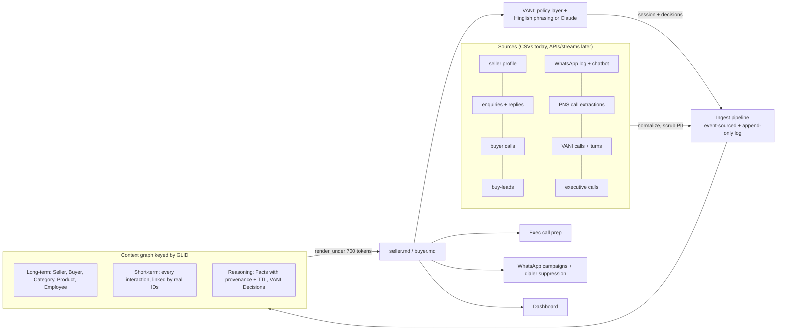

# Global Context: context layer (Problem Statement 02)

A GLID-keyed **context graph** with three memory tiers, built from the 11 seller-dataset CSVs. It renders a short, fixed-structure `seller.md` / `buyer.md` that VANI loads before every call or chat. Every new event refreshes the affected files in a few milliseconds. Every conversation VANI has is written back, so the next channel picks up where the last one stopped.

Node.js 20, no runtime dependencies. `@anthropic-ai/sdk` is optional, used only with `--llm`.

> New to the project? Start with the developer documentation in [`docs/`](docs/README.md) (learning path, architecture, API and CLI reference, security review, debugging and feature-development guides). `DOCUMENTATION.md` remains the long single-file guide.

```
npm install                 # optional: only needed for --llm
node cli.js build           # graph + 5,000 seller.md + sample buyer.md  (~15 s)
node cli.js demo            # voice -> write-back -> WhatsApp resume for the sample users
node cli.js freshness       # replay a week of real events as a live stream, measure event -> file delay
node cli.js serve           # HTTP context service on :8787
node cli.js help            # everything else (chat, emit, prep, campaign, export-neo4j, graph)
```

## Architecture



The three tiers follow the context-graph model (knowledge, conversation, decision traces):

| Tier | Nodes | What it answers |
|---|---|---|
| **Long-term** | Seller (profile, KYC, categories), Buyer, Category, Product, Mcat, Employee | Who is this? |
| **Short-term** | Enquiry, EnquiryMessage, BuyerCall, BuyLead, WhatsAppMsg, ChatSession/ChatTurn, PNSCall, BotCall/BotTurn, ExecCall, VaniSession | What happened, on which channel? |
| **Reasoning** | **Fact**: something the user told us that changes behaviour (`do_not_call`, `already_met_executive`, `wants_whatsapp`, `meeting_fixed`…), with evidence, `DERIVED_FROM` link, timestamp, time-to-live, supersession. **Decision**: what VANI did and why (`skip_question`, `suppress_call`, `promise`, `fulfil`, `act`), with `USED` links to facts | What must the bot remember, and why did it act? |

The joins come from the data analysis in `../analysis/`. They are real IDs where they exist (`query_id`, `attempt_id`), plus verified composite links: a buyer call → enquiry within 60 minutes from the same buyer becomes `LED_TO` (98% of `PNSBLENQ` enquiries); extraction times are shifted UTC→IST; WhatsApp status duplicates are de-duplicated.

## How it maps to the brief

| Brief | Where |
|---|---|
| Context layer keyed to GLID; missing, partial or conflicting data; cold start | `src/graph.js`, `src/ingest.js`. Conflicts: newer event beats older event beats profile snapshot (`factView` in `src/extract.js`). Cold start: 267 sellers get `cold_start: true` and a generic-opening instruction; unknown GLIDs get a stub file. |
| `seller.md` (leads, responses and outcomes, categories and products, conversations across channels, engagement) | `src/render.js` → `out/sellers/*.md` |
| `buyer.md` (enquiries and status, categories, sellers contacted, KYC, conversations, engagement) | `out/buyers/*.md`. Buyers come from the buyer IDs inside the seller files. Buyer KYC exists only when the buyer also has a seller account; otherwise the file says "unknown — no buyer KYC source" rather than inventing it. |
| Personalised opening, no re-asking, cross-channel resume | `src/bot.js` reads only the file. `out/demo/*.md` has cold vs personalised openings, transcripts and decision traces. |
| Freshness, measured | `out/freshness/report.md` and the `POST /events` latency in the server |
| Short, structured, reusable; at least one non-bot use | Fixed sections and JSON front matter. Non-bot uses: `node cli.js prep <glid>` (executive prep card), `node cli.js campaign` (WhatsApp audiences, dialer suppression list, dashboard). These read only the `.md` files. |
| Privacy | `src/pii.js`: phones, emails, links and greeting names are scrubbed on ingest. Buyers appear in `seller.md` only as `B-7F3A (Surat)`; buyer names never reach a seller file. `buyer.md` shows only sellers the buyer contacted themselves, and buy-lead purchases as a count only. `guard()` re-checks every bot reply. The bot prompt forbids revealing the other party. |
| Two channels end to end | Voice and WhatsApp in the demo and in `/bot/*`. Chat and app plug in as further `channel` values of the same session event. |

## Results on this dataset

**Size** (all 5,000 sellers, budget 700 tokens ≈ chars ÷ 4): p50 **420**, p90 **599**, p99 **690**, max **699**. Rendering takes 0.4 ms per seller.

**Freshness**: a snapshot was loaded up to 25 Sep, then **21,738 real events** (26 Sep–2 Oct) were replayed one by one as a live stream. Each event is ingested, facts are extracted, and every affected seller.md and buyer.md is re-rendered and atomically written.

| events | p50 | p95 | p99 | max |
|---|---|---|---|---|
| 21,738 | **3.5 ms** | 9.9 ms | 14.3 ms | 58 ms |

Over HTTP (`POST /events`) the measured delays were 7–42 ms, including the request.

**Demo** (`out/demo/`; user lines are synthetic, bot lines come only from the file and the policy layer):

| User | Story | Cold questions | Skipped | Re-asked | Result |
|---|---|---|---|---|---|
| seller 245234426 | Meeting fixed earlier; a buyer is unanswered; the seller is driving and says "WhatsApp pe bhej do" | 12 | 11 | 0 | WhatsApp opens with the promised details; quote forwarded; loop closed |
| seller 93557756 | Asked on 18 Sep to stop calls; executive already met; a buyer waiting | 6 | 4 | 0 | Outbound call **suppressed**; inbound WhatsApp acknowledges the request and closes the buyer loop |
| seller 272316904 | Paid seller, unanswered enquiry; gives the rate on the call and asks for a summary | 12 | 10 | 0 | WhatsApp sends a Hinglish recap instead of restarting |
| buyer 120622712 | A seller asked them a question they never answered; another enquiry is stuck | 6 | 6 | 0 | Answers the seller's question on the call; WhatsApp resumes the supplier request |

When VANI forwards a quote, it is posted to the enquiry thread as a real `enquiry_messages` event. The seller's file and the buyer's file then both update from data.

## Design choices and why

**Lookback windows** (`src/config.js`):

| Source | Window | Why |
|---|---|---|
| Enquiries, buyer calls, PNS extractions | 90 d | Matches IndiaMART's own `eng_*_90d` metrics, so the numbers agree with what sales already sees. Open loops use only the last 14 d, because older unanswered enquiries are stale. |
| Buy-leads | 45 d | The warehouse keeps only ~45 days. |
| WhatsApp delivery log | 30 d | 130k rows of status only; useful only as a recent read-rate and activity signal. |
| WhatsApp chatbot | 60 d | Sessions for history. "Unfinished flow" resume uses only the last 7 d. |
| VANI calls | 120 d | Calling cycles span months; what matters long-term is captured as Facts with their own time-to-live. |
| Executive calls | 60 d | Covers the available Aug–Sep window. |
| Facts | per type | e.g. `do_not_call` 180 d, `already_met_executive` 45 d, `callback_requested` 7 d (`FACTS` in `src/extract.js`). The 31 Jul "about to pay" fact for 272316904 has correctly expired: the seller is now paid. |
| Cross-channel promise | 7 d | A "send it on WhatsApp" older than a week should not open a conversation. |

**Size, 700 tokens.** The file sits in the bot's system prompt on every turn of a voice call, where latency matters. 700 tokens holds the decision-relevant content (care items, open loops, last conversations, stats) and adds negligible time-to-first-token. Lower-priority detail is trimmed first (conversation depth, then recent leads, then the "as a buyer" section) until the file fits.

**Freshness mechanism: hybrid.** Event-driven re-rendering of only the affected GLIDs (`POST /events` → files), plus a scheduled full rebuild (`node cli.js build`, e.g. nightly) for time-based changes such as fact expiry and window roll-off. The deterministic renderer has no LLM on the hot path, which is why delays are milliseconds.

**LLM.** The policy layer is always deterministic: what not to ask, contact policy, what to resume. Phrasing uses Hinglish templates by default. With `--llm` (and Anthropic credentials) Claude (`claude-opus-5-5`, low effort) phrases the replies. The bot prompt (`bot_prompt.md`, a stand-in until the organisers share theirs) and the context file go in the system prompt, and the per-turn policy goes in a mid-conversation system message. Server-side refusal fallback (`fallbacks: "default"`) is enabled. Any failure falls back to the template reply.

**Neo4j.** The graph runs in-process, because Neo4j needs Java, which isn't installed here. `node cli.js export-neo4j` writes CSV plus `load.cypher` (MERGE by id, tier labels `LongTerm`/`ShortTerm`/`Reasoning`) and `queries.cypher`: active facts with provenance, cross-channel timeline, waiting buyers, call→enquiry links, and "why did VANI skip this question". The default scope is the sample users (515 nodes, fits Aura Free); `--all` exports everything.

## Files

```
cli.js                 commands
bot_prompt.md          VANI system prompt (stand-in)
demo/scripts.json      synthetic user lines for the demo (labelled)
src/sources.js         per-source normalisers -> nodes/edges, tiers
src/ingest.js          pipeline: bulk load, live events, linking, write-back of VANI actions, event log
src/extract.js         reasoning memory: fact rules (English summaries + Hinglish turns), TTL, conflicts
src/render.js          seller.md / buyer.md, token budget, atomic writes
src/bot.js             VANI simulator: policy layer, agenda from open loops, resume, decisions
src/llm.js             optional Claude phrasing
src/server.js          HTTP service: /events, /context, /bot, /metrics
src/freshness.js       replay benchmark
src/reuse.js           exec prep, campaigns, dashboard (read files only)
src/export.js          Neo4j CSV + Cypher
src/viz.js             HTML graph view of one seller
out/                   generated: sellers/, buyers/, demo/, freshness/, reuse/, neo4j/, graphs/
store/                 append-only event logs (events.jsonl from the server and chat, demo_events.jsonl)
```

## Limits

- Fact extraction is rule-based (English summary patterns and Hinglish keywords). It handles the dataset's phrasing well, but an LLM extractor running off the hot path would catch more.
- The buyer side is reconstructed from seller files. Buyer KYC, search history and buyer-side WhatsApp aren't in this dataset.
- "VANI forwarded the quote" and the supplier list are simulated actions; in production they call the reply and recommendation APIs.
- In the demo, user lines are scripted. Use `node cli.js chat <glid>` to talk to VANI yourself.
