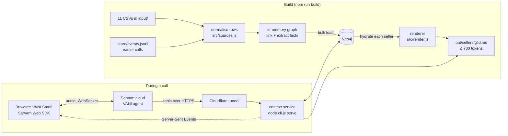

# VANI Smriti: a memory layer for IndiaMART's seller voice agent

*Smriti (स्मृति) means memory.*

**Hackathon problem statement 02: Global Context.**

We build **one memory per seller** from IndiaMART's 11 data sources. The memory is a Neo4j graph that we render into a short Markdown file (`seller.md`, at most 700 tokens). A **Sarvam voice agent (VANI)** reads that file before it speaks. While it talks, it writes the outcome back into the graph, so the file is rebuilt during the call.

The project ships as one local web page, **VANI Smriti** (`http://localhost:8787/`). You call the agent from the browser through Sarvam's Web SDK and watch everything the memory does while you talk:
- the context the agent received
- every tool call
- the `seller.md` diff
- the Neo4j graph diff
- what the next call will open with

| | |
|---|---|
| Main page | **VANI Smriti** at `http://localhost:8787/` (local only) |
| Sarvam agent | `VANI-Seller-6921b562-b28e`, dashboard name "VANI Seller Bot", committed **version 8** |
| Agent on the platform | https://agents.sarvam.ai/samvaad/build/update-agent/VANI-Seller-6921b562-b28e |
| Graph | Neo4j 5.26 Community (Docker): about 432,000 nodes and 536,000 relationships |
| Seller files | 5,000 files in `out/sellers/<glid>.md`, median 420 tokens, max 699 |
| Runtime | Node.js ≥ 20; one optional npm dependency (`neo4j-driver`) |
| Team | _team name, members, emails_ |

> **Does the browser call still need the Cloudflare tunnel?** **Yes.** The Web SDK carries only the audio between your browser and Sarvam. The agent runs in Sarvam's cloud and calls this service's tools over HTTPS: it loads the seller's memory, and writes back during the call. Sarvam's servers cannot reach `localhost`, so the service needs a public URL. Section [4](#4-does-the-sdk-call-need-the-tunnel) explains exactly which traffic goes where. Section [5.9](#59-step-8--start-the-tunnel-and-point-the-agent-at-it) has every step.

---

## Contents

1. [What problem this solves](#1-what-problem-this-solves)
2. [What you will see](#2-what-you-will-see)
3. [Architecture](#3-architecture)
4. [Does the SDK call need the tunnel?](#4-does-the-sdk-call-need-the-tunnel)
5. [Setup, step by step](#5-setup-step-by-step)
6. [The data: 11 sources](#6-the-data-11-sources)
7. [From CSV to graph, step by step](#7-from-csv-to-graph-step-by-step)
8. [How the graph is stored in Neo4j](#8-how-the-graph-is-stored-in-neo4j)
9. [Why Neo4j](#9-why-neo4j)
10. [From graph to `seller.md`](#10-from-graph-to-sellermd)
11. [The Sarvam voice agent](#11-the-sarvam-voice-agent)
12. [VANI Smriti, panel by panel](#12-vani-smriti-panel-by-panel)
13. [One call, end to end](#13-one-call-end-to-end)
14. [HTTP routes](#14-http-routes)
15. [Configuration reference](#15-configuration-reference)
16. [Security and privacy](#16-security-and-privacy)
17. [Verifying it works](#17-verifying-it-works)
18. [Troubleshooting](#18-troubleshooting)
19. [Repository layout](#19-repository-layout)
20. [Results](#20-results)
21. [Limits](#21-limits)
22. [Glossary](#22-glossary)

---

## 1. What problem this solves

IndiaMART's VANI is an AI voice assistant that calls sellers. Before this project every call started **cold**. The agent did not know:
- that a buyer had been waiting days for this seller's reply
- that the seller had asked for a callback, or already met an IndiaMART executive
- that the seller had said "stop calling" on the last call

So sellers repeated themselves, the agent pitched instead of helping, and nothing carried over from one call to the next.

The dataset covers 5,000 sellers from 1 Apr to 2 Oct 2026. It shows what sellers actually need help with:

| Finding | Number |
|---|---|
| Buyer enquiries that never got a seller reply | 26,265 of 33,006 (**80%**) |
| Enquiries never even opened by the seller | 10,427 (32%) |
| Buyer phone calls missed | 7,310 of 19,238 (**38%**) |
| Catalogue quality score | median **16 / 100**; 2,976 of 3,350 scored sellers below 50 |
| Sellers listing fewer than 10 products | 1,279 |
| WhatsApp product photos rejected (smaller than 500×500) | about 9,000 bot turns |
| Most common outcome of a past VANI call | `call_dropped` |

**Our answer has two parts:**
1. **A memory.** Every source is joined on the seller's GLID (IndiaMART's user ID) into one graph. The graph is rendered into a short file the agent can read in one go.
2. **An agent that uses it, and adds to it.** The agent opens with the most useful item in the memory, such as a waiting buyer, a missed call or a weak catalogue. It helps with what the seller needs and records every outcome in the graph while the call is still going. The next call starts from there.

---

## 2. What you will see

Open `http://localhost:8787/`, pick a seller and click **▶ Call VANI**. Talk to the agent in Hindi or English through your microphone.

```text
┌─ seller picker · ▶ Call VANI · mute · state orb · timer · interaction id · store: Neo4j · 💾 ⟲ ─────────────────┐
├──────── Conversation ────────┬────── Agent's memory of this seller ──────┬──────────── What changed ───────────┤
│ tool calls appear live:      │ VANI opens with: "a buyer from Patiala is  │ [seller.md diff] [Graph diff]       │
│  🛠 log_seller_request       │  waiting for the seller's reply about …"  │ [Event] [Full file]                 │
│   sent: enquiry_reply, …     │ open loops, ranked                        │  + green lines added to seller.md   │
│   VANI heard: "Noted for …"  │ cold vs context                           │  graph: new nodes pulse green       │
│   ✓ 48 ms                    │ Write-back pipeline (lights up):          │  table of nodes, props, rels        │
│ full transcript at the end   │  agent → tunnel → route → event →         │  the Cypher that ran                │
│                              │  Neo4j → seller.md   (ms per step)        │  open in Neo4j Browser ↗            │
│                              │ Next call will open with: …               │                                     │
├──────────────────────────────┴───────────────────────────────────────────┴─────────────────────────────────────┤
│ Call report: facts remembered · graph nodes written · file lines changed · write time · next opening · ▶ Call again │
└──────────────────────────────────────────────────────────────────────────────────────────────────────────────────┘
```

A typical demo, with seller `11301189` (Jai Bharat Auto Agencies, New Delhi):
1. **Before the call.** The memory says a buyer from Patiala has waited since 30 September for a reply about a TATA engine control unit. That is the top open loop, so it is VANI's opening.
2. **During the call.** You give a reply: "18,500 rupaye, minimum 2 piece, teen din mein delivery". VANI reads it back and records it. The tool chip appears, the pipeline lights up, and two things change while the call is still going:
   - new lines turn green in the `seller.md` diff
   - a new `VaniSession` node and a `Fact` node pulse green in the graph
3. **After the call.** The report card shows what was remembered. **Next call will open with** now says it will follow up on your request, not on the Patiala buyer.
4. **Call again.** VANI opens with the follow-up.

---

## 3. Architecture

### 3.1 The pieces



| Piece | What it is | Where |
|---|---|---|
| Sources | 11 CSV exports, one row per event or profile | `input/` |
| Normaliser | turns each CSV row into graph nodes and edges, scrubbing PII on the way in | `src/sources.js`, `src/pii.js`, `src/time.js` |
| Pipeline | applies events to a graph, links them, extracts facts, appends to the event log | `src/ingest.js`, `src/load.js`, `src/extract.js` |
| Graph store | Neo4j in production mode, or an in-memory graph (same interface) | `src/store/neo.js`, `src/store/memory.js`, `src/graph.js` |
| Renderer | turns one seller's slice of the graph into `seller.md` | `src/render.js` |
| Context service | HTTP server: the agent's tools, the live feed, the page | `src/server.js`, `src/sarvam.js`, `src/live.js` |
| VANI Smriti | the page at `/`: Web SDK call plus live panels | `src/live.html`, `src/vendor/sarvam-sdk.js`, `src/graphdiff.js`, `src/viz.js` |
| Voice agent | runs on Sarvam's platform, reads the memory, calls the tools | Sarvam workspace; prompt in `sarvam/assistant_prompt.md` |
| Tunnel | public HTTPS URL to the local service, so Sarvam can reach it | `npm run tunnel` (Cloudflare quick tunnel) |

### 3.2 The three network paths in a browser call

There are three separate connections. Knowing which is which makes every setup problem easy to place.

```text
                (1) page + live feed (local)                (2) signed URL (local → Sarvam API)
 Browser  ◄──────────────────────────────────►  context service  ──────────────────────────────►  apps.sarvam.ai
 (VANI Smriti)     http://localhost:8787/                :8787          GET …/apps/{app}/url  + X-API-Key
    │                                                    ▲
    │ (1b) audio: WebSocket straight to Sarvam            │ (3) agent tools: HTTPS from Sarvam's cloud
    └───────────────────────────────────►  Sarvam cloud ──┘     https://<tunnel>/sarvam/context, /request, …
                                            (VANI agent)        through the Cloudflare tunnel, with X-GC-Token
```

| # | From → to | Carries | Needs |
|---|---|---|---|
| 1 | browser → `localhost:8787` | the page, the vendored SDK, the live feed (`/live/events`), seller previews | nothing; local |
| 1b | browser → Sarvam | your voice and the agent's voice (WebSocket) | internet; microphone permission |
| 2 | service → Sarvam API | the request for a signed WebSocket URL, with the **Voice Agents API key** added by the server | `SARVAM_AGENTS_API_KEY` in `.env` |
| 3 | Sarvam cloud → service | the agent's six tools: load the memory at call start, write during the call, save the call at the end | **a public HTTPS URL**: the tunnel, and the tools pointed at it |

---

## 4. Does the SDK call need the tunnel?

**Yes.** In one sentence: the SDK starts the call, but the agent's tools run from Sarvam's cloud and have to reach your service.

What happens on each path in a browser call:
- **Starting the call (paths 1 and 2): no tunnel needed.**
  - The page asks the local server for a signed URL (`GET /sarvam/runtime/…`). The server adds the API key and asks Sarvam.
  - The browser then opens a WebSocket **directly to Sarvam** and streams audio both ways.
- **The agent's tools (path 3): tunnel needed.** The agent is not in your browser; it runs on Sarvam's servers.
  - **Call start:** its `load_seller_context` tool sends `GET https://<public-url>/sarvam/context?glid=…`.
  - **During the call:** `log_seller_request` and the other tools send `POST https://<public-url>/sarvam/…`.
  - **Call end:** `save_call_outcome` posts the transcript.

  All of these come from Sarvam's cloud, so the URL must be public HTTPS.

**What breaks without the tunnel** (or with the tools pointing at an old tunnel URL):

| Moment | With the tunnel | Without it |
|---|---|---|
| Click ▶ Call VANI | connects | connects (paths 1 and 2 still work) |
| Greeting | "Namaste, main IndiaMART se bol rahi hoon" | same |
| Identity question | "Kya meri baat Jai Bharat Auto Agencies se ho rahi hai?" | "…the IndiaMART seller se…", the default, because the context tool timed out after 10 s |
| Opening | the waiting Patiala buyer | the generic default: "a check on how IndiaMART is working for the seller…" |
| Recording a request | "Noted for the IndiaMART team…"; panels update | the tool's failure text: "The request could not be saved right now…"; nothing is written |
| Dashboard panels | context, tool chips, diffs, report | almost empty: no `context`, no tool events, no transcript |

**Tunnel nitty-gritty you must get right:**
1. **The URL changes whenever the tunnel restarts.** The free Cloudflare quick tunnel hands out a new `https://<four-words>.trycloudflare.com` each time. Restarting only the Node server does **not** change it.
2. **The agent stores the URL in six places,** one per tool. When the URL changes, update all six and **commit a new agent version**.
3. **The page calls a specific agent version.** It sends `SARVAM_APP_VERSION` from `.env`. After a commit, set `SARVAM_APP_VERSION` to the new number, **restart the server**, and reload the page. A version from before the change still points at the dead URL.
4. **Every tool sends a shared secret** in the `X-GC-Token` header. It comes from a Sarvam workspace secret. The value must equal `GC_SARVAM_TOKEN` in your `.env`; otherwise the tools get `401`.
5. **The tunnel only lets the agent in.** Requests arriving through it (they carry `cf-connecting-ip` or `x-forwarded-for`) can reach only the six agent routes. The page, the live feed and everything else return `403` through the tunnel. Always open the page at `http://localhost:8787/`.
6. **Port 8787 is fixed in the tunnel script.** `npm run tunnel` forwards to `http://localhost:8787`. If you serve on another port, run `npx -y cloudflared@0.7.3 tunnel --no-autoupdate --url http://localhost:<port>` instead.
7. **Keep the tunnel terminal open.** Closing it ends the URL. Calls then fall back to the cold behaviour above.

The alternative to a quick tunnel is any public HTTPS URL that forwards to port 8787: a named Cloudflare tunnel (a fixed URL), ngrok, or the service deployed on a server. The guard and the token work the same way.

---
## 5. Setup, step by step

This is the complete setup for the main offering: **VANI Smriti with a real voice call, on Neo4j**. Follow the steps in order; each ends with a check. Budget about 30 minutes the first time. Most of that is creating the Sarvam agent if you don't use ours.

All commands run from the `context_layer/` folder. They are written for **bash** (Git Bash on Windows works). Section [5.12](#512-windows-and-powershell) gives the PowerShell forms.

### 5.1 What you need

| Need | Version / detail | Why | Check |
|---|---|---|---|
| Node.js | **20 or newer** (developed on 24) | runs everything | `node -v` |
| npm | comes with Node | installs the Neo4j driver | `npm -v` |
| Docker Desktop (or Docker Engine + compose v2) | running | Neo4j | `docker compose version` |
| The 11 CSVs | in `context_layer/input/` (§6) | the data | `ls input/*.csv \| wc -l` → `11` |
| Free memory | **about 6 GB** during the build (Node up to 4 GB, Neo4j up to 3 GB) | the build holds the full graph in memory before copying it to Neo4j | Task Manager / `free -h` |
| Free disk | about 2 GB | Neo4j data volume, `out/` (45 MB) | |
| Internet | outbound HTTPS and WebSockets | Sarvam, the tunnel, fonts and the graph library on the page | |
| Chrome or Edge | recent | microphone and the Web SDK; tested in Chrome | |
| Microphone | headset recommended | so VANI doesn't hear itself | |
| Sarvam Voice Agents access | a workspace on https://agents.sarvam.ai | the agent | you can log in |

You need **one** of these for the agent:
- **(A)** access to our workspace and agent `VANI-Seller-6921b562-b28e`, or
- **(B)** your own Sarvam workspace, where you create the agent from this repo (§5.8.2).

### 5.2 Step 1 — get the code and the data

```bash
git clone <repo-url> hack2026
cd hack2026/context_layer
ls input/
```

`input/` must contain exactly these 11 files. The names matter; the loader checks them before it starts.

```text
gc_bot_call_turns.csv            gc_buyleads_bought.csv          gc_executive_calls.csv
gc_bot_calls.csv                 gc_enquiries_received.csv       gc_seller_profile.csv
gc_buyer_call_extractions.csv    gc_enquiry_messages.csv         gc_whatsapp_chatbot_conversations.csv
gc_buyer_calls_received.csv      gc_whatsapp_messages.csv
```

**Check:** `ls input/*.csv | wc -l` prints `11`. If a file is missing, the build stops with a message naming it.

`store/events.jsonl` ships with the repo. It holds the events from our own test calls, which are replayed on top of the CSVs. Keep it to see the demo sellers exactly as in the video; delete it to start from the raw CSVs only.

### 5.3 Step 2 — install

```bash
npm install
```

This installs the only package Neo4j mode needs (`neo4j-driver`). Nothing else is required at runtime. The Sarvam Web SDK is already bundled in `src/vendor/sarvam-sdk.js`, and the page loads vis-network for the graph from a CDN.

**Check:** `ls node_modules/neo4j-driver` exists.

### 5.4 Step 3 — create `.env`

```bash
cp .env.example .env
```

Fill it in as below. Every variable is read once at start, so **restart the server after any change**. Real environment variables override `.env`.

```dotenv
# ---- store ----
GC_STORE=neo4j                     # run the graph in Neo4j (recommended; also lets you omit GC_STORE=neo4j on commands)
NEO4J_URI=bolt://localhost:7687
NEO4J_USER=neo4j
NEO4J_PASSWORD=choose-a-password   # at least 8 characters; docker compose uses it to create the database user
NEO4J_DATABASE=neo4j

# ---- the agent's tools -> this service ----
GC_SARVAM_TOKEN=<random secret>    # the agent's tools send it as X-GC-Token; must equal the Sarvam workspace secret
GC_SARVAM_TEST_GLID=11301189       # seller used when a call passes no glid (Sarvam text chat, dashboard Test button)

# ---- the browser call (Web SDK) ----
SARVAM_ORG_ID=<org id>
SARVAM_WORKSPACE_ID=<workspace id>
SARVAM_APP_ID=VANI-Seller-6921b562-b28e   # or your own agent's id
SARVAM_APP_VERSION=8                       # the committed version whose tools point at your tunnel
SARVAM_AGENTS_API_KEY=<voice agents api key>

# ---- optional ----
SARVAM_API_KEY=                    # Sarvam speech key (sk_...). NOT used by VANI Smriti; the agents runtime refuses it
```

Where each value comes from:

| Variable | How to get it |
|---|---|
| `NEO4J_PASSWORD` | Choose one, at least 8 characters. It is set when the container is **first** created. Changing it later needs `npm run neo4j:down` and deleting the volume (`docker volume rm context_layer_neo4j_data`), which erases the graph. |
| `GC_SARVAM_TOKEN` | Generate it: `node -e "console.log(require('crypto').randomBytes(24).toString('hex'))"`. Put the **same value** in a Sarvam workspace secret (§5.8). |
| `SARVAM_ORG_ID`, `SARVAM_WORKSPACE_ID` | Your Sarvam organisation and workspace ids. They appear in the agent's record (Sarvam MCP `agents get include=["config"]` returns `org_id` and `workspace_id`) and in your workspace settings. |
| `SARVAM_APP_ID` | The agent id, the last part of the agent's dashboard URL (`…/update-agent/<app id>`). |
| `SARVAM_APP_VERSION` | The version number you get when you **commit** the agent after pointing its tools at the tunnel (§5.9). |
| `SARVAM_AGENTS_API_KEY` | Sarvam agents dashboard → **Settings → API Key**. It must be a **Voice Agents** key. A speech key starting `sk_` is refused with "Invalid API key format". |

**Check:** `grep -c '=' .env` shows your values, and the file is not committed: `git check-ignore .env` prints `.env`.

### 5.5 Step 4 — start Neo4j

```bash
npm run neo4j:up            # docker compose up -d neo4j
```

- **Image and ports.** `neo4j:5.26-community`, with ports **7474** (Neo4j Browser) and **7687** (bolt).
- **Memory.** Heap 1–2 GB and page cache 1 GB, set in `docker-compose.yml`.
- **Storage.** Data is kept in the named volume `context_layer_neo4j_data`, so it survives restarts.
- **First start.** It takes 20–40 seconds.

**Check:**
```bash
docker ps --format '{{.Names}} {{.Status}}' | grep neo4j     # context_layer-neo4j-1 Up …
curl -s localhost:7474 | head -c 200                          # JSON with "bolt_routing" …
```

Then open http://localhost:7474 and log in as `neo4j` with your `NEO4J_PASSWORD`. The database is empty until the next step.

### 5.6 Step 5 — build the graph and the seller files

```bash
npm run build               # with GC_STORE=neo4j in .env; otherwise: GC_STORE=neo4j npm run build
```

This takes about **2 minutes**. The steps:
1. **Read** the 11 CSVs and build the full graph in memory, then replay `store/events.jsonl` on top.
2. **Wipe Neo4j** and bulk-load about 432,000 nodes and 536,000 relationships in batches of 5,000. This takes about 70 s.
3. **Render** all 5,000 sellers by reading each one back **from Neo4j**, into `out/sellers/<glid>.md`. This takes about 25 s.
4. **Write** `out/build_stats.json`.

The last lines look like:
```text
  wrote 5000 seller.md + 3 buyer.md to out in 26.5s · tokens p50 420, p90 599, max 699
```

**Check:**
```bash
ls out/sellers | wc -l                            # 5000
head -20 out/sellers/11301189.md                  # front matter of Jai Bharat Auto Agencies
cat out/build_stats.json | head -20               # "store": "neo4j", node counts
```

In Neo4j Browser run `MATCH (n:Node) RETURN count(n)`: about 432,000.

> `npm run build` **replaces** everything in Neo4j. Run it again only to start over; the server keeps Neo4j up to date by itself.

### 5.7 Step 6 — start the service

```bash
npm run serve               # node --max-old-space-size=4096 cli.js serve   (port 8787)
```

It prints:
```text
  context service on http://localhost:8787  (clock 2026-10-10 16:06:19)
  VANI Smriti: http://localhost:8787/   ·   console: http://localhost:8787/console
```

In Neo4j mode the server connects and starts in seconds; it does not read the CSVs. If the build has not been run, it refuses to start and tells you to run it.

**Check:**
```bash
curl -s localhost:8787/health          # "ok": true, "store": "neo4j", nodes ≈ 432000
curl -s localhost:8787/sarvam/config   # "ready": true, your org/workspace/app ids and "app_version"
```

`"ready": false` means one of the four Sarvam values (key, org, workspace, app) is missing in `.env`. Fix it, then restart.

Keep this terminal open.

### 5.8 Step 7 — the Sarvam agent

#### 5.8.1 Option A: use our agent

You need to be a member of our Sarvam workspace, with permission to edit the agent. That's because the tool URLs must be changed to **your** tunnel (§5.9).

1. Ask the team for `SARVAM_ORG_ID`, `SARVAM_WORKSPACE_ID` and a Voice Agents API key, and set `SARVAM_APP_ID=VANI-Seller-6921b562-b28e`.
2. Ask for the value of the workspace secret the tools send as `X-GC-Token`, and put it in `GC_SARVAM_TOKEN`.

   The secret is already referenced by all six tools. Only its value has to match your `.env`.
3. Continue with §5.9.

#### 5.8.2 Option B: create the agent in your own workspace

This recreates agent version 8 exactly. You can do it in the Sarvam dashboard, or through the Sarvam MCP server (`configure_agent`, `configure_secret`, `create_api_tool`/`configure_app_tool`, then `agents commit`).

**1. Create a voice agent** (a voice-to-voice agent, not a chat agent) with a single prompt state. Settings:

| Setting | Value |
|---|---|
| Name | anything, e.g. "VANI Seller Bot" |
| Channel | voice (v2v). The page starts a **CALL** session; a chat-only agent fails with "App not found for the interaction type". |
| Prompt | paste **all** of `sarvam/assistant_prompt.md` (14,583 characters) as the single state's instructions |
| Languages | Hindi, English, Telugu; initial language **Hindi**; language identification on |
| Language style | colloquial with code-mixed words (Hinglish); numbers in Indic |
| Voice | a female voice (we use the Hindi female voice "Ishita") at pace 1.15. The prompt says *bol rahi hoon*, so a female voice keeps the grammar right. |
| Intro message | English: `Hello, this is a call from IndiaMART.` · Hindi: `नमस्ते, मैं इंडियामार्ट से बोल रही हूँ।` · Telugu: `నమస్కారం, నేను ఇండియామార్ట్ నుండి మాట్లాడుతున్నాను.` It must **not** name the seller, because it is spoken before the seller's variables arrive. |
| LLM temperature | 0.5 |
| Built-in tools | `end_interaction` (on), `handle_voicemail` (on), `change_output_language` (on, allowed: Hindi, English, Telugu) |
| Inactivity nudges | after 6 s: "Hello, can you hear me?"; after 8 s more: "It seems you may be busy right now. IndiaMART will call you again at a better time." Then the call ends. |
| Max call length | 900 s |

**2. Agent variables.** These are the variables the prompt and the tools use. Create each as a string with the default shown. `load_seller_context` overwrites them at call start.

| Variable | Default | Note |
|---|---|---|
| `glid` | *(empty)* | **Required.** The page passes it as `agent_variables.glid`; the tools send it. Empty means the server's test seller. |
| `bot_name` | `Payal` | the name VANI introduces itself by |
| `seller_company_name` | `the IndiaMART seller` | used in the identity question |
| `seller_city`, `seller_locality`, `seller_state`, `category_name`, `products_total`, `products_missing_photos`, `inquiry_city`, `enquiry_count_30d` | *(empty)* | profile values |
| `seller_context` | *(empty)* | **the `seller.md` body**, inserted into the prompt inside `<seller_context>` |
| `call_reason` | `a check on how IndiaMART is working for the seller and whether anything in the account needs help` | the opening |
| `call_restrictions` | `None.` | the do-not-call or already-met rule, the highest priority |
| `call_datetime` | *(empty)* | the real date and time in India, set by the service |
| `initial_message` | `Hello, this is a call from IndiaMART.` | |
| `lead_bucket` | `profile_review` | |
| `pitch_hook` | `a free review of the seller's IndiaMART profile and catalogue` | |
| `already_in_touch_with_executive`, `do_not_call_requested` | `0` | |
| `last_meeting_date`, `past_objections`, `executive_name` | *(empty)* | |
| `meeting_day_label` | `kal` | |
| `meeting_slot_start`, `meeting_slot_end` | `10:00 AM`, `7:00 PM` | |
| `meeting_blocked_dates` | *(empty)* | |
| `same_day_meeting_allowed`, `phone_meeting_allowed` | `0` | |
| `min_lead_minutes` | `120` | |
| `lead_bot_version` | `context-layer-1` | |

**3. Post-call (output) variables.** Turn on "update post interaction" for these, with the extraction prompts shown. The end-of-call tool sends them; the service stores them on the call.

| Variable | Type | Extraction prompt (short form) |
|---|---|---|
| `disposition_label` | enum: Helped, Request Logged, Meeting Fixed, Call Later / Busy, Not Interested, General (talked) | the call outcome |
| `issues_raised` | string | one sentence: what the seller raised |
| `help_given` | string | one sentence: what the agent did |
| `seller_sentiment` | enum: Positive, Neutral, Negative | the seller's mood |
| `meeting_fixed`, `meeting_datetime`, `meeting_location` | string | a visit booked: `1`, `YYYY-MM-DD HH:MM`, locality and city |
| `callback_datetime` | string | `YYYY-MM-DD HH:MM` if a callback time was given |
| `objection_type` | enum (9 objection classes) | the main objection, if any |
| `do_not_call_requested`, `identity_confirmed` | string | `1` or `0` |
| `meeting_interest` | string | Yes, No or Later |
| `additional_details` | string | notes for the next call |
| `call_summary` | string | one or two lines on what happened |

**4. A workspace secret.** Create a secret (any name, e.g. `gc_token`) whose value equals `GC_SARVAM_TOKEN` in your `.env`. Every tool below authenticates with it.

**5. The six HTTP tools.** For every tool, set:
- **Auth:** API key, sent in a **header** named `X-GC-Token`, with its value taken from the secret above.
- **URL:** `https://<your-tunnel>/sarvam/…` (§5.9). Until the tunnel exists, use a placeholder.

| Tool name | Kind / lifecycle | Method + path | Inputs | Response handling | Timeout |
|---|---|---|---|---|---|
| `load_seller_context` | webhook, **on start** | `GET /sarvam/context` | query `glid` = agent variable `glid` | **save to variables**: one mapping per variable in step 2. The response path equals the variable name: `glid`, `seller_context`, `call_restrictions`, `call_reason`, `seller_company_name`, `initial_message`, `seller_city`, `seller_locality`, `seller_state`, `lead_bucket`, `pitch_hook`, `category_name`, `inquiry_city`, `enquiry_count_30d`, `products_total`, `products_missing_photos`, `already_in_touch_with_executive`, `last_meeting_date`, `do_not_call_requested`, `past_objections`, `bot_name`, `meeting_day_label`, `meeting_slot_start`, `meeting_slot_end`, `meeting_blocked_dates`, `same_day_meeting_allowed`, `min_lead_minutes`, `phone_meeting_allowed`, `lead_bot_version`, `call_datetime` | 10 s |
| `log_seller_request` | webhook, **during the call** | `POST /sarvam/request` | body: `glid` (agent variable); `request_type` (LLM, one of `enquiry_reply`, `catalog_update`, `photo_help`, `account_update`, `buylead_issue`, `payment_query`, `complaint`, `buying_requirement`, `other`); `details` (LLM, text: "One or two English sentences with the specifics confirmed with the seller: product names, values, buyer city, exactly what the seller wants") | response template `{{ message }}`; on failure: "The request could not be saved right now. Tell the seller honestly, say IndiaMART will call back about it, and continue." | 10 s |
| `schedule_meeting_tool` | webhook, during the call | `POST /sarvam/meeting` | `glid` (agent variable); `meeting_date` (LLM, `YYYY-MM-DD`); `meeting_time` (LLM, `HH:MM` 24-hour); `locality`, `city` (LLM, English) | `{{ message }}`; on failure: "The booking system did not respond. Tell the seller the slot could not be booked right now and that IndiaMART will call back to confirm." | 10 s |
| `schedule_callback_tool` | webhook, during the call | `POST /sarvam/callback` | `glid`; `callback_date` (`YYYY-MM-DD`); `callback_time` (`HH:MM`) | `{{ message }}`; on failure: "The callback could not be saved. Tell the seller IndiaMART will call again later." | 10 s |
| `mark_do_not_call_tool` | webhook, during the call | `POST /sarvam/dnc` | `glid`; `reason` (LLM, optional, one English line) | `{{ message }}`; on failure: "The request could not be saved right now. Apologise once and close the call." | 10 s |
| `save_call_outcome` | webhook, **on end** | `POST /sarvam/end` | `glid` (agent variable); system variables `interaction_id`, `interaction_transcript`, `call_duration_seconds` → `duration`, `interaction_start_time` → `start_datetime`, `user_identifier`; agent variables `disposition_label`, `issues_raised`, `help_given`, `seller_sentiment`, `meeting_fixed`, `meeting_datetime`, `meeting_location`, `callback_datetime`, `objection_type`, `do_not_call_requested`, `identity_confirmed`, `meeting_interest`, `additional_details` | none | 15 s |

Make the four mid-call tools available to the prompt state. The prompt refers to them as `tool:log_seller_request`, `tool:schedule_meeting_tool`, `tool:schedule_callback_tool` and `tool:mark_do_not_call_tool`. The names must match exactly.

**6. Evaluation (optional).** Add a rule-based criterion "Seller helped". It passes when `disposition_label` is Helped, Request Logged or Meeting Fixed, or `callback_datetime` is not empty.

**7. Commit** the agent to freeze a version. Then create the Voice Agents API key (Settings → API Key) and put the ids and key in `.env` (§5.4).

**Check:** in the Sarvam dashboard the agent shows the six tools, and a committed version exists.

### 5.9 Step 8 — start the tunnel and point the agent at it

Start the tunnel in a **second terminal** (the server keeps running in the first):

```bash
npm run tunnel              # npx -y cloudflared@0.7.3 tunnel --no-autoupdate --url http://localhost:8787
```

- **First run.** npx downloads `cloudflared` (about 30 MB), which takes a minute.
- **The URL.** After a few seconds the output shows a box with your URL:
  ```text
  |  https://canvas-communicate-alleged-store.trycloudflare.com  |
  ```
- **Copy it** and keep this terminal open.

**Check the tunnel** (in a third terminal):
```bash
TUN=https://<your-words>.trycloudflare.com
T=$(grep '^GC_SARVAM_TOKEN=' .env | cut -d= -f2- | tr -d '\r')
curl -s -o /dev/null -w '%{http_code}\n' -H "X-GC-Token: $T" "$TUN/sarvam/context?glid=11301189"   # 200
curl -s -o /dev/null -w '%{http_code}\n' "$TUN/sarvam/context?glid=11301189"                        # 401 (no token)
curl -s -o /dev/null -w '%{http_code}\n' "$TUN/"                                                    # 403 (page is local only)
```
A fresh quick-tunnel hostname can take up to a minute to resolve. If `curl` says "Could not resolve host", wait and retry.

**Point the six tools at it.** Replace only the host part of each tool URL and keep the paths:

| Tool | New URL |
|---|---|
| `load_seller_context` | `https://<your-words>.trycloudflare.com/sarvam/context` |
| `log_seller_request` | `https://<your-words>.trycloudflare.com/sarvam/request` |
| `schedule_meeting_tool` | `https://<your-words>.trycloudflare.com/sarvam/meeting` |
| `schedule_callback_tool` | `https://<your-words>.trycloudflare.com/sarvam/callback` |
| `mark_do_not_call_tool` | `https://<your-words>.trycloudflare.com/sarvam/dnc` |
| `save_call_outcome` | `https://<your-words>.trycloudflare.com/sarvam/end` |

There are two ways to do it:
- **In the dashboard:** edit each tool's URL in the agent's tools section and save. Then **commit** a new version.
- **With the Sarvam MCP server:**
  1. `agents get id=<app id> include=["tools"]` lists the tool ids.
  2. `configure_app_tool` once per tool, with the new `connector_config.url`.
  3. `agents commit id=<app id>`.

**Then:**
1. Set `SARVAM_APP_VERSION` in `.env` to the version you just committed.
2. **Restart the server**: Ctrl+C in terminal 1, then `npm run serve`.
3. Check that `curl -s localhost:8787/sarvam/config` shows the new `app_version`.

> Every time the tunnel restarts, you repeat this section. Restarting only the server needs none of it.

### 5.10 Step 9 — open VANI Smriti and make the first call

1. Open **http://localhost:8787/** in Chrome. Use `localhost`, not `127.0.0.1` or a LAN IP: browsers allow the microphone on plain HTTP only for `localhost`.
2. The header should show **store: Neo4j**. The pipeline label should read `VANI · v<your version>`.
3. Pick **Jai Bharat Auto · buyer waiting** (`11301189`) in the seller picker. The memory panel shows "VANI opens with: a buyer from Patiala is waiting for the seller's reply about TATA Engine Control Unit".
4. Click **▶ Call VANI** and allow the microphone when Chrome asks.
5. VANI greets you, then asks "Kya meri baat Jai Bharat Auto Agencies se ho rahi hai?". Answer "Haan ji, bol raha hoon".
6. VANI raises the waiting buyer. Give a price, minimum order and delivery time, one per turn, then say "haan, note kar lijiye".
7. A **🛠 log_seller_request** chip appears in the conversation. The pipeline lights up, the **seller.md diff** shows green lines, and the **Graph diff** tab shows new nodes.
8. Say "bas, dhanyavaad". VANI closes the call. The **call report** appears, and the transcript arrives in the conversation column.

**Check:** the report shows at least one fact remembered, and **Next call will open with** mentions your request.

### 5.11 The complete checklist

| # | Check | Expected |
|---|---|---|
| 1 | `node -v` | v20 or newer |
| 2 | `ls input/*.csv \| wc -l` | 11 |
| 3 | `docker ps` | `context_layer-neo4j-1 … Up` |
| 4 | `ls out/sellers \| wc -l` | 5000 |
| 5 | `curl localhost:8787/health` | `"store": "neo4j"` |
| 6 | `curl localhost:8787/sarvam/config` | `"ready": true`, correct `app_version` |
| 7 | tunnel `/sarvam/context` with token | 200 |
| 8 | all six tool URLs use the current tunnel host | yes, in the committed version |
| 9 | `SARVAM_APP_VERSION` | that committed version; server restarted since |
| 10 | http://localhost:8787/ | page loads, store Neo4j, seller brief shows |
| 11 | ▶ Call VANI | VANI says the seller's company name in the identity question |

If check 11 says "the IndiaMART seller" instead of the company name, the agent could not reach your tunnel. Go back to checks 7–9.

### 5.12 Windows and PowerShell

Everything works on Windows 10 and 11 (developed on Windows 11). There are three ways to run the commands:
- **Git Bash.** Every command above works as written.
- **PowerShell.** `npm run …` commands work as written. For the rest:

  | bash | PowerShell |
  |---|---|
  | `cp .env.example .env` | `Copy-Item .env.example .env` |
  | `GC_STORE=neo4j npm run build` | `$env:GC_STORE="neo4j"; npm run build` (or just put `GC_STORE=neo4j` in `.env`) |
  | `T=$(grep '^GC_SARVAM_TOKEN=' .env \| cut -d= -f2-)` | `$T = (Select-String '^GC_SARVAM_TOKEN=' .env).Line.Split('=',2)[1]` |
  | `curl -s -H "X-GC-Token: $T" "$TUN/sarvam/context?glid=11301189"` | `curl.exe -s -H "X-GC-Token: $T" "$TUN/sarvam/context?glid=11301189"` (use `curl.exe`; plain `curl` is an alias for `Invoke-WebRequest`) |
  | `ls out/sellers \| wc -l` | `(Get-ChildItem out/sellers).Count` |

- **Line endings.** `.env` saved with CRLF works; values are trimmed.
- **Docker Desktop** must be running before `npm run neo4j:up`. With WSL 2, give it at least 6 GB of memory.
- **Windows Defender** can briefly lock files in `out/` while they are scanned. The renderer retries its rename, so this is harmless.

### 5.13 Without a Sarvam account

You can still see the whole memory pipeline on the page, in two ways.

**1. Replay a recorded session.**
1. Open http://localhost:8787/ and click **⟲**.
2. Choose `submission/sample_outputs/12_replay_session.json`.

It replays a real `log_seller_request` call on seller `107256507`, in real time: context, tool chip, pipeline, `seller.md` diff, graph diff and next opening. No server writes happen; a replay only redraws the page.

**2. Play the agent yourself with curl.** These are exactly the requests Sarvam would send. Open the page on seller `107256507` first, then run:

```bash
T=$(grep '^GC_SARVAM_TOKEN=' .env | cut -d= -f2- | tr -d '\r')
# what the agent receives at call start
curl -s -H "X-GC-Token: $T" "localhost:8787/sarvam/context?glid=107256507" | head -c 600
# a mid-call tool call: the page shows the chip, pipeline, md diff and graph diff
curl -s -H "X-GC-Token: $T" -H "content-type: application/json" \
  -d '{"glid":"107256507","request_type":"enquiry_reply","details":"Reply for the Lucknow buyer on Pixel LED 5 inch: Rs 450 per piece, MOQ 40, delivery in 4 days."}' \
  localhost:8787/sarvam/request
# the end-of-call save
curl -s -H "X-GC-Token: $T" -H "content-type: application/json" \
  -d '{"glid":"107256507","interaction_id":"manual-1","duration":95,"interaction_transcript":"[{\"role\":\"user\",\"content\":\"Haan ji bol raha hoon\"}]","disposition_label":"Request Logged"}' \
  localhost:8787/sarvam/end
```

These requests **write** to the graph, like a real call. Use the rehearsal seller `107256507` for them, so the demo seller `11301189` stays fresh.

### 5.14 Restarting later: what to redo

| You restarted… | Redo |
|---|---|
| the computer | `npm run neo4j:up` (or just start Docker; the container restarts by itself), `npm run serve`, `npm run tunnel`, then **§5.9** (a new URL) |
| only the server | `npm run serve`; nothing else |
| only the tunnel | §5.9: new URL, six tools, commit, `SARVAM_APP_VERSION`, restart the server |
| Neo4j | nothing; the data is in the volume |
| changed `.env` | restart the server, reload the page |

**You do not need to rebuild.** The server writes every call into Neo4j, and also appends it to `store/events.jsonl`, so a rebuild would reproduce the same state.

### 5.15 Starting clean

- **Return the demo sellers to the CSV state:**
  1. Stop the server.
  2. Move `store/events.jsonl` aside.
  3. Run `npm run build`, then `npm run serve`.
- **Remove only the dashboard's replay buffer:** `curl -X POST localhost:8787/live/clear`.
- **Remove Neo4j completely:** `npm run neo4j:down`, then `docker volume rm context_layer_neo4j_data`.

---
## 6. The data: 11 sources

Every file is a CSV export with a header row. Together they cover **5,000 sellers from 1 April to 2 October 2026**. The seller's GLID is the join key; its column name differs per file (`seller_glid`, `glid`, `fk_glusr_usr_id`).

| File | Rows | What one row is | Key columns used |
|---|---|---|---|
| `gc_seller_profile.csv` | 5,000 | a seller's profile snapshot | `fk_glusr_usr_id` (GLID), company, city/district/state/pincode/locality, business type, turnover, nature of business, GST year, top 3 categories, KYC flags, `eng_*` engagement metrics (product count, catalogue score, activity…), past VANI stats (attempts, answered, dispositions, objections, asked-if-bot, frustration, in-touch-with-executive, do-not-call) |
| `gc_enquiries_received.csv` | 33,006 | a buyer's enquiry to a seller | `query_id`, `enquiry_date`, `buyer_glid`, `seller_glid`, `product_name`, `message`, `mcat_id`, `source_module`, `read_status`, buyer city/state/country/company |
| `gc_enquiry_messages.csv` | 17,633 | one message in an enquiry thread | `reply_id`, `query_id`, `sequence`, sender/receiver GLID, `reply_date`, `reply_text`, `message_from` (buyer/seller), `template_flag` |
| `gc_buyer_calls_received.csv` | 19,238 | a buyer's phone call to a seller | `call_id`, `call_datetime`, `call_status` (Connected or not), `duration_sec`, `talk_sec`, `buyer_glid`, `seller_glid`, `caller_circle`, `mcat_id` |
| `gc_buyer_call_extractions.csv` | 5,417 | what was said on a recorded buyer call | `file_id`, `glid`, `call_date` (UTC), intent, languages, products discussed, prices quoted, specifications, stock status |
| `gc_buyleads_bought.csv` | 14,852 | a buy lead the seller bought | `purchase_id`, `purchase_date`, `buylead_id`, `buyer_glid`, `credits_used`, mode, keyword, `distance_city` |
| `gc_whatsapp_messages.csv` | 130,897 | a WhatsApp message status row | `message_id`, `glid`, `entry_date`, sender, campaign, status, `delivered_at`, `read_at` |
| `gc_whatsapp_chatbot_conversations.csv` | 83,280 | one turn with IndiaMART's WhatsApp bot | `chat_id`, `session_id`, `glid`, `user_message`, `bot_reply`, `intent`, `action_type`, `entry_date` |
| `gc_bot_calls.csv` | 9,657 | one past VANI call attempt | `attempt_id`, `fk_glusr_usr_id`, `call_start_time`, `lead_call_duration`, `lead_call_summary` (English), `disposition_label`, `meeting_fixed` |
| `gc_bot_call_turns.csv` | 4,920 | one spoken turn of a past VANI call | `attempt_id`, `turn_no`, `speaker`, `start_sec`, `text` (Hinglish) |
| `gc_executive_calls.csv` | 2,580 | a sales executive's call to a seller | `click_to_call_id`, `fk_glusr_usr_id`, `fk_employeeid`, `status`, `call_start_time`, durations |

Some of these rows describe the same thing twice, so the graph has fewer nodes than rows:
- **WhatsApp:** the 130,897 status rows collapse into 130,238 `WhatsAppMsg` nodes, because rows with the same `message_id` are one message.
- **VANI turns:** the 4,920 turn rows become 4,662 `BotTurn` nodes, because rows with the same call and turn number are one turn.

---

## 7. From CSV to graph, step by step

The build always constructs the full graph **in memory first**, then copies it into Neo4j in bulk. Doing the joins in memory is fast: the whole load, link and fact pass takes about 4 seconds. Neo4j then receives a finished graph in large batches. The same code (`Pipeline.apply`) also handles every live write during a call, so a call and a rebuild produce identical results.

```text
input/*.csv
   │  1. read rows (src/csv.js), times to IST (src/time.js), PII scrubbed (src/pii.js)
   ▼
event {source, row}
   │  2. normalise: row → node specs + edge specs (src/sources.js)
   ▼
ContextGraph (src/graph.js)
   │  3. apply in a fixed source order: upsert nodes, link edges, index by owner (src/ingest.js)
   │  4. cross-link: LED_TO / FOLLOWED_BY (linkAll)
   │  5. extract facts: the reasoning memory (src/extract.js)
   │  6. replay store/events.jsonl: earlier calls (replayLog)
   ▼
NeoStore.bulkLoad (src/store/neo.js)
   │  7. wipe → CREATE nodes by label → CREATE relationships by type → Meta node
   ▼
Neo4j  →  8. render every seller from Neo4j (section 10)
```

### 7.1 Step 1: read and clean

`src/csv.js` reads each file with a streaming parser that handles quoted fields, embedded newlines and commas. Each row becomes an event `{source, row}`, where `source` names the file (`profile`, `enquiries`, `enquiry_messages`, `buyer_calls`, `buyleads`, `whatsapp`, `chatbot`, `pns_calls`, `bot_calls`, `bot_call_turns`, `exec_calls`).

Three things are cleaned on the way in:
- **Time.**
  - Every timestamp becomes `YYYY-MM-DD HH:MM:SS` in **IST** (`src/time.js`).
  - Call-extraction dates arrive in UTC and are shifted by +5:30.
  - Every event gets one `ts`, from the source's own date column.
- **Personal data** (`src/pii.js`, `scrub()`).
  - Phone numbers, e-mail addresses and links are removed from free text: messages, chat turns, transcripts and summaries.
  - Greeting names are masked ("Hi Ramesh" → "Hi [name]").
  - Buyers are never named anywhere in the output.
- **Length.** Long texts are cut to a fixed size: enquiry messages to 240 characters, chat turns to 160, transcript turns to 300 and call summaries to 700. This keeps nodes small.

### 7.2 Step 2: normalise each row into nodes and edges

`normalize(ev)` in `src/sources.js` holds one rule per source. Every node it produces has the same envelope:

| Field | Meaning |
|---|---|
| `id` | a stable ID built from a prefix and the source's own key, so the same thing always maps to the same node |
| `label` | the node type: `Seller`, `Enquiry`, `Fact`, … |
| `tier` | `long_term`, `short_term` or `reasoning` (§7.4) |
| `glid` | the **owning seller**, if any. This is what "a seller's data" means. |
| `buyer` | the owning buyer, if any |
| `ts` | when it happened (IST) |
| `props` | everything else |

**The ID scheme:**

| Node | ID | Example |
|---|---|---|
| `Seller` | `S:<glid>` | `S:11301189` |
| `Buyer` | `B:<buyer glid>` | `B:104933171` |
| `Category` | `C:<lower-case name>` | `C:car bumper grille guard` |
| `Product` | `P:<glid>:<lower-case product name>` | `P:11301189:tata engine control unit` |
| `Mcat` (IndiaMART micro-category) | `M:<mcat id>` | `M:27828` |
| `Enquiry` | `ENQ:<query_id>` | `ENQ:3185162365` |
| `EnquiryMessage` | `EM:<reply_id>` | |
| `BuyerCall` | `BC:<call_id>` | |
| `PNSCall` (call extraction) | `PX:<file_id>` | |
| `BuyLead` | `BL:<purchase_id>` | |
| `WhatsAppMsg` | `WA:<message_id>` | |
| `ChatSession` / `ChatTurn` | `CS:<session_id>` / `CT:<chat_id>` | |
| `BotCall` / `BotTurn` (past VANI calls) | `VC:<attempt_id>` / `VT:<attempt_id>:<turn_no>` | |
| `ExecCall` / `Employee` | `EX:<click_to_call_id>` / `E:<employee id>` | |
| `VaniSession` (calls made through this project) | `VS:<session_id>` | `VS:sarvam-<interaction id>` |
| `Fact` | `F:<glid>:<type>:<source id>` | `F:107256507:seller_request:VS:…` |
| `Decision` | `D:<session_id>:<n>` | |

**What each source produces:**

| Source | Nodes | Edges |
|---|---|---|
| profile | `Seller` with company, city, district, state, pincode, locality, business type, turnover, nature, GST year, categories, customer type, paid flag, listing status, `kyc{mobile,email,gst,pan}`, `eng{…}` (every `eng_*` column), `vani{attempts, answered, answer_rate, dispositions, objections, asked_if_bot, frustrated, in_touch_exec, dnc}`; one `Category` per top category | `Seller -LISTS_CATEGORY-> Category` |
| enquiries | `Enquiry` (product, message, module, read flag, first read time, buyer city/state/country); `Buyer` (city, state, country, designation, company); `Product`; `Mcat` | `Buyer -SENT-> Enquiry -TO-> Seller`, `Seller -SELLS-> Product`, `Enquiry -ABOUT-> Product`, `Enquiry -IN_MCAT-> Mcat` |
| enquiry_messages | `EnquiryMessage` (from buyer/seller, sequence, text, template flag, read flag, boilerplate flag) | `Enquiry -HAS_MESSAGE-> EnquiryMessage` |
| buyer_calls | `BuyerCall` (connected, duration, talk seconds, caller circle); `Buyer`; `Mcat` | `BuyerCall -TO-> Seller`, `Buyer -CALLED-> BuyerCall`, `BuyerCall -IN_MCAT-> Mcat` |
| pns_calls | `PNSCall` (role, intent, B2B, languages, products, prices, specs, stock) | `Seller -ON_CALL-> PNSCall` |
| buyleads | `BuyLead` (credits, mode, type, keyword, position, distance) | `Seller -BOUGHT-> BuyLead -FROM_BUYER-> Buyer` |
| whatsapp | `WhatsAppMsg` (sender, campaign, status, delivered, read) | `WhatsAppMsg -TO-> Seller` |
| chatbot | `ChatSession`, `ChatTurn` (user text, cleaned bot reply, intent, action) | `ChatSession -HAS_TURN-> ChatTurn`, `ChatSession -WITH-> Seller` |
| bot_calls | `BotCall` (disposition, duration, summary, attempt number, version, meeting fixed) | `BotCall -TO-> Seller` |
| bot_call_turns | `BotTurn` (turn, speaker, start, text) | `BotCall -HAS_TURN-> BotTurn` |
| exec_calls | `ExecCall` (answered, durations); `Employee` | `Employee -CALLED-> ExecCall -TO-> Seller` |
| vani_session (live) | `VaniSession` (channel, summary, outcome, turns, facts); `Decision`s | `VaniSession -WITH-> Seller`, `Decision -IN-> VaniSession`, `Decision -FOR-> Seller` |

### 7.3 Step 3: apply in a fixed order

`Pipeline.loadAll()` applies the sources **parents first**:

```text
profile → bot_calls → bot_call_turns → exec_calls → buyer_calls → enquiries → enquiry_messages
        → buyleads → whatsapp → chatbot → pns_calls
```

For every event, `Pipeline.apply()` runs four rules:
1. **Upsert each node by `id`.**
   - **An existing node is merged, not duplicated.** The same buyer appearing in 50 enquiries is one `Buyer` node.
   - **Newer non-empty values win;** empty values never overwrite.
   - **A node keeps the latest `ts`** it was seen at.
2. **Link each edge** `[source id, TYPE, target id]` once. A repeated edge is ignored.
3. **Index the node by owner.** `byGlid[glid]` and `byBuyer[buyer]` hold the ids each seller and buyer owns. "Everything about seller X" is therefore one lookup, not a graph search.
4. **Apply source-specific rules:**
   - **A WhatsApp status never goes backwards.** "read" beats "delivered", which beats "sent", whatever order the rows arrive in.
   - **A `ChatSession` tracks its last turn time,** so a session's time is when it last moved.
   - **Transcript turns inherit their call's time.** `gc_bot_call_turns` has no date column.

During the bulk load, fact extraction is postponed until everything is in (`extract: false`). Any events dated after the build's "now" (`GC_AS_OF`, by default `2026-10-02 23:59:59`) are held back.

### 7.4 The three memory tiers

| Tier | Answers | Labels | How it changes |
|---|---|---|---|
| **Long-term** | *Who is this?* | `Seller`, `Buyer`, `Product`, `Category`, `Mcat`, `Employee` | rarely; merged by ID |
| **Short-term** | *What happened, where, when?* | `Enquiry`, `EnquiryMessage`, `BuyerCall`, `PNSCall`, `BuyLead`, `WhatsAppMsg`, `ChatSession`, `ChatTurn`, `BotCall`, `BotTurn`, `ExecCall`, `VaniSession` | append-only: every event adds nodes, nothing is deleted |
| **Reasoning** | *What must we remember, and why?* | `Fact`, `Decision` | derived from short-term memory; each fact has evidence, a source edge and a time-to-live |

The tiers matter in three places:
- **They feed different parts of `seller.md`** (§10.4).
  - Long-term → the **Who / Sells** lines.
  - Short-term → **Leads**, **Conversation history** and **Engagement**, inside lookback windows.
  - Reasoning → **Do not re-ask**, `contact_policy`, `flags` and part of the **Open loops**.
- **They expire differently.**
  - Short-term memory leaves the file when it falls out of its lookback window.
  - Reasoning memory leaves when its fact's time-to-live runs out.
  - Long-term memory never expires.

  The graph keeps everything; only the file forgets.
- **They decide what belongs to a seller.**
  - Short-term and reasoning nodes carry the seller's `glid`.
  - Shared long-term nodes (`Category`, `Mcat`, `Employee`, and buyers who contact several sellers) belong to no seller. They connect sellers to each other.

### 7.5 Step 4: cross-link calls and enquiries

`linkAll()` joins events that the sources don't link themselves, on the same buyer and seller:
- **`BuyerCall -LED_TO-> Enquiry`.** The buyer called, then sent an enquiry within 60 minutes. This explains 98% of enquiries from the `PNSBLENQ` module, which are generated by a call. There are 4,185 such links.
- **`Enquiry -FOLLOWED_BY-> BuyerCall`.** The other order: an enquiry, then a call within 60 minutes. There are 2,079 such links.

### 7.6 Step 5: extract facts (the reasoning memory)

`extractFor(node)` in `src/extract.js` scans every node once and records **facts**: things said or done that should change how the agent behaves.

**Where facts come from:**

| Source | How |
|---|---|
| Seller profile flags | `do_not_call_requested`, `showed_frustration`, `already_in_touch_with_executive`, `asked_if_talking_to_bot` → a fact with "profile flag" as evidence and no date |
| Past VANI call summaries (English) | regular expressions, e.g. "stop the calls", "not the right person", "already met the executive", "asked whether … bot" |
| Past VANI call results | `Meeting Fixed` → `meeting_fixed`; `Call Later` → `callback_requested`, with its time parsed from the summary ("tomorrow at 5 PM", "kal 4 baje") |
| Spoken turns, WhatsApp chats, live sessions (Hinglish/Hindi) | regular expressions over what the seller said, e.g. *call mat karo* → `do_not_call`, *galat number* → `wrong_contact`, *WhatsApp pe bhej do* → `wants_whatsapp`, *baad mein call karo* → `callback_requested`, *kitni baar* → `frustrated`, *bot ho?* → `asked_if_bot`, *payment kar diya* → `payment_intent` |
| Executive calls | an answered executive call → `exec_contact` (evidence: module, seconds, employee) |
| The agent's tools (live) | `log_seller_request` → `seller_request`, `schedule_callback_tool` → `callback_requested`, `schedule_meeting_tool` → `meeting_fixed`, `mark_do_not_call_tool` → `do_not_call` |

**What a fact looks like:**

```text
(:Node:Fact:Reasoning {                                   ← a real fact from the graph
   id: "F:163384506:do_not_call:VC:448159",
   glid: "163384506", tier: "reasoning", ts: "2026-08-31 17:01:38",
   type: "do_not_call",
   evidence: "However, the lead stated that he is not interested and asked the agent to stop calling him.",
                                                            ← the sentence that matched, scrubbed, at most 170 characters
   channel: "VANI call",
   due: null })                                             ← set for callbacks and meetings
  -[:ABOUT]->        (:Seller  {id: "S:163384506"})
  -[:DERIVED_FROM]-> (:BotCall {id: "VC:448159"})           ← provenance: the call it was said on
```

**Fact types and their time-to-live** (days a fact stays active after it was last stated):

| Fact | TTL | Effect on the agent |
|---|---|---|
| `do_not_call` | 180 | `contact_policy: do_not_call`; the agent apologises once and ends the call |
| `wrong_contact` | 180 | `contact_policy: verify_identity` |
| `already_met_executive` | 45 | no new visit offered |
| `exec_contact` | 30 | no new visit offered |
| `frustrated` | 30 | `contact_policy: cooldown` |
| `meeting_fixed` | 21 | open loop "confirm the visit" |
| `callback_requested` | 7 | open loop "callback due" |
| `seller_request` | 30 | open loop "follow up on the seller's request" |
| `wants_whatsapp` | 60 | `channel_pref: whatsapp` |
| `not_interested_paid` | 30 | no paid pitch |
| `payment_intent` | 30 | no paid pitch |
| `asked_if_bot` | 90 | the agent is upfront that it is an AI |
| `sourcing_interest` | 90 | an "As a buyer" section |

There are 10,331 facts in the current graph.

### 7.7 Step 6: replay the event log

`store/events.jsonl` holds every event that arrived after the CSV export: one JSON line per Sarvam tool call or end-of-call save. `replayLog()` applies each line through the same `Pipeline.apply()`. **State = CSV snapshot + event log.** That is why a rebuild never loses a call.

### 7.8 Step 7: bulk load into Neo4j

`NeoStore.bulkLoad(graph)` in `src/store/neo.js`:

1. **Schema** (idempotent):
   ```cypher
   CREATE CONSTRAINT node_id IF NOT EXISTS FOR (n:Node) REQUIRE n.id IS UNIQUE;
   CREATE INDEX node_glid IF NOT EXISTS FOR (n:Node) ON (n.glid);
   CREATE INDEX node_buyer IF NOT EXISTS FOR (n:Node) ON (n.buyer);
   CREATE CONSTRAINT meta_key IF NOT EXISTS FOR (m:Meta) REQUIRE m.k IS UNIQUE;
   ```
2. **Wipe:** `MATCH (n) CALL { WITH n DETACH DELETE n } IN TRANSACTIONS OF 10000 ROWS`.
3. **Nodes, grouped by label,** in batches of 5,000 rows. Each node gets a creation number `_n`.
   ```cypher
   UNWIND $rows AS r CREATE (n:Node:`Enquiry`:`ShortTerm`) SET n = r.p
   ```
4. **Relationships, grouped by type,** in batches of 5,000. Each gets a creation number `_e`. Edges whose endpoint does not exist are dropped.
   ```cypher
   UNWIND $rows AS r MATCH (a:Node {id: r.s}) MATCH (b:Node {id: r.d}) CREATE (a)-[x:`SENT` {_e: r.e}]->(b)
   ```
5. **Meta node last:** `MERGE (m:Meta {k:'seq'}) SET m.n = <nodes>, m.e = <edges>`. It holds the counters the live writes continue from. If it is missing, the load was cut short, and the server refuses to start.

This takes about 70 seconds for about 432,000 nodes and 536,000 relationships. Then `build` renders every seller from Neo4j (§10).

---

## 8. How the graph is stored in Neo4j

### 8.1 Node shape

Every node has **three labels**: `Node`, its type and its tier. For example:

```text
(:Node:Seller:LongTerm)   (:Node:Enquiry:ShortTerm)   (:Node:Fact:Reasoning)
```

- `:Node` carries the unique `id` constraint and the `glid` and `buyer` indexes, so one index serves every type.
- The type label (`:Enquiry`) lets queries pick a kind of node.
- The tier label (`:Reasoning`) lets queries pick a kind of memory: `MATCH (f:Reasoning {glid:'…'})`.

| Property | Meaning |
|---|---|
| `id` | unique key (§7.2) |
| `tier` | `long_term` / `short_term` / `reasoning` |
| `glid` | owning seller (**indexed**) |
| `buyer` | owning buyer (**indexed**) |
| `ts` | event time, IST string `YYYY-MM-DD HH:MM:SS`. Sorting the strings sorts the times. |
| business properties | stored as top-level properties: `company`, `city`, `product`, `message`, `type`, `evidence`, … |
| `_json` | the names of properties that hold JSON (see below) |
| `_n` | creation order; the renderer uses it to keep ties in the same order as in memory |

**Objects and arrays** (a seller's `kyc`, `eng`, `vani`, `categories`; a session's `turns`) are stored as JSON **strings**, and their names are listed in `_json`. Neo4j properties can only hold primitives and flat arrays. `src/store/codec.js` encodes and decodes this. A business property whose name collides with a reserved one (`id`, `tier`, `glid`, `buyer`, `ts`, `_n`, `_json`) is stored as `p:<name>`.

A real seller node, abridged:

```text
(:Node:Seller:LongTerm {
  id: "S:11301189", tier: "long_term", glid: "11301189",
  company: "Jai Bharat Auto Agencies", city: "New Delhi", state: "Delhi",
  business_type: "Proprietorship", nature: "Retailer", turnover: "1.5 - 5 Cr", gst_year: "2017",
  categories: "[\"Car Bumper Grille Guard\",\"TATA Car Radiator\",\"TATA Truck Spare Parts\"]",
  kyc: "{\"mobile\":true,\"email\":false,\"gst\":true,\"pan\":true}",
  eng: "{\"answered_calls_90d\":1,\"call_attempts_90d\":4,\"pickup_ratio_90d\":25,…}", vani: "{\"attempts\":…}",
  _json: ["categories","kyc","eng","vani"], _n: 9334 })
```

### 8.2 Relationship shape

Relationships keep their real type (`SENT`, `TO`, `ABOUT`, …) and carry one property, `_e`: their creation order. Every relationship is directed as listed in §7.2.

### 8.3 What is in it

| Tier | Label | Nodes |
|---|---|---|
| long-term | `Seller` | 5,000 |
| | `Buyer` | 48,569 |
| | `Product` | 15,989 |
| | `Category` | 8,717 |
| | `Mcat` | 8,466 |
| | `Employee` | 357 |
| short-term | `WhatsAppMsg` | 130,238 |
| | `ChatTurn` | 83,280 |
| | `Enquiry` | 33,006 |
| | `BuyerCall` | 19,238 |
| | `EnquiryMessage` | 17,633 |
| | `BuyLead` | 14,852 |
| | `ChatSession` | 13,986 |
| | `BotCall` | 9,657 |
| | `PNSCall` | 5,417 |
| | `BotTurn` | 4,662 |
| | `ExecCall` | 2,580 |
| | `VaniSession` | grows with every call (59 at the time of writing) |
| reasoning | `Fact` | 10,331 |
| | `Decision` | 5 |

| Relationship | Count | | Relationship | Count |
|---|---|---|---|---|
| `TO` | 194,719 | | `LISTS_CATEGORY` | 14,196 |
| `HAS_TURN` | 87,903 | | `WITH` | 14,045 |
| `IN_MCAT` | 48,277 | | `DERIVED_FROM` | 10,141 |
| `ABOUT` | 42,641 | | `FROM_BUYER` | 9,299 |
| `SENT` | 33,006 | | `ON_CALL` | 5,417 |
| `CALLED` | 21,805 | | `LED_TO` | 4,185 |
| `HAS_MESSAGE` | 17,633 | | `FOLLOWED_BY` | 2,079 |
| `SELLS` | 15,989 | | `IN`, `FOR`, `USED` | 5, 5, 3 |
| `BOUGHT` | 14,852 | | | |

### 8.4 One database for all sellers, partitioned by `glid`

There is **one graph for all 5,000 sellers**. A seller's data is every node whose `glid` is that seller's ID. For Jai Bharat Auto (`11301189`) that is:
- 1 `Seller`
- 543 `Enquiry`
- 160 `EnquiryMessage`
- 37 `Product`
- 2 `BotCall`
- the facts and sessions its calls add

Shared nodes have no `glid`: `Category` and `Mcat` connect sellers in the same line of business, `Employee` connects sellers called by the same executive, and a `Buyer` connects every seller that buyer contacted.

### 8.5 How the service writes during a call

A live write (one tool call) does not touch the whole graph:
1. **Hydrate.** One read transaction loads the seller's own nodes (`WHERE n.glid IN $ids`), the messages and turns attached to them, and the edges between them. Together these form a small in-memory graph.
2. **Apply.** `Pipeline.apply()` runs the event on that small graph. That is the same code the build uses.
3. **Diff.** The store compares the small graph with its snapshot from before the event: new nodes, changed properties, new edges.
4. **Commit, in one write transaction:**
   ```cypher
   UNWIND $rows AS r MERGE (n:Node {id: r.p.id}) ON CREATE SET n._n = r.n SET n:`Fact`:`Reasoning`, n += r.p
   UNWIND $rows AS r MATCH (a:Node {id: r.s}) MATCH (b:Node {id: r.d}) MERGE (a)-[x:`ABOUT`]->(b) ON CREATE SET x._e = r.e
   MERGE (m:Meta {k:'seq'}) SET m.n = …, m.e = …
   ```
   `MERGE` makes a retried write harmless.
5. **Serialise writes.** Only one write runs at a time, so two tool calls arriving together can't interleave.

The graph diff on the page is exactly the set from step 3.

### 8.6 Queries to try in Neo4j Browser

Open http://localhost:7474 and log in.

```cypher
// What's in the graph, by type and tier
MATCH (n:Node)
RETURN [l IN labels(n) WHERE NOT l IN ['Node','LongTerm','ShortTerm','Reasoning']][0] AS label,
       [l IN labels(n) WHERE l IN ['LongTerm','ShortTerm','Reasoning']][0] AS tier, count(*) AS nodes
ORDER BY nodes DESC;

// One seller's data, by type
MATCH (n:Node {glid:'11301189'}) RETURN labels(n)[1] AS type, count(*) ORDER BY count(*) DESC;

// The waiting buyer behind the opening line, as a path
MATCH p = (b:Buyer)-[:SENT]->(e:Enquiry {id:'ENQ:3185162365'})-[:TO]->(s:Seller) RETURN p;

// Provenance: do-not-call facts and the exact call turn they came from
MATCH (f:Fact {type:'do_not_call'})-[:ABOUT]->(s:Seller), (f)-[:DERIVED_FROM]->(src)
RETURN s.id, f.evidence, labels(src)[1] AS from, src.id LIMIT 10;

// What VANI remembered about a seller (the same query as the page's "open in Neo4j Browser ↗")
MATCH (s:Node {id:'S:11301189'})<-[r]-(n) WHERE n:Fact OR n:Decision OR n:VaniSession
RETURN s, r, n ORDER BY n.ts DESC LIMIT 60;

// Buyer calls that led to an enquiry
MATCH (c:BuyerCall)-[:LED_TO]->(e:Enquiry)-[:TO]->(s:Seller {glid:'11301189'}) RETURN c, e, s LIMIT 25;

// Sellers in the same category as a seller
MATCH (:Seller {glid:'11301189'})-[:LISTS_CATEGORY]->(c)<-[:LISTS_CATEGORY]-(other:Seller)
RETURN c.name, count(other) ORDER BY count(other) DESC;
```

---

## 9. Why Neo4j

The memory could live in a relational database or a document store. We chose a graph database for five reasons.

1. **The data is a network.**
   - A buyer enquires with several sellers.
   - A buyer call leads to an enquiry.
   - An enquiry has a thread of replies.
   - An executive calls many sellers.
   - A fact comes from one specific call turn.

   The questions the agent needs answered are paths, e.g. *which buyer is still waiting for this seller, on which product, after which call*. In a graph each of those is one pattern, not five joins.
2. **Provenance is a first-class edge.**
   - Every fact has `DERIVED_FROM` to the call, turn or chat it came from.
   - Every decision has `USED` to the facts it relied on.

   When the agent says "you asked us to stop calling", you can open Neo4j Browser and walk from the fact to the exact sentence. The agent never acts on an unsupported guess, and a reviewer can audit it.
3. **Write-back during the call needs transactions.**
   - A tool call adds a session, a fact and their edges.
   - They are committed with `MERGE` in **one transaction**: all or nothing, and safe to retry.
   - A half-written fact can't reach the next call.
4. **One seller's slice is an index lookup.**
   - Every node carries the owning seller's `glid`, which is indexed.
   - Loading one seller (hundreds of nodes out of 432,000) is one indexed read, in milliseconds.
   - The graph can grow far past what fits in a Node.js process, and many services can read it at once.
5. **It can be inspected.**
   - Judges, analysts and other teams can explore the same data in Neo4j Browser with Cypher.
   - The page's **open in Neo4j Browser ↗** link shows that the dashboard is reading the real database, not a mock-up.

**What Neo4j does not do here:** answer the agent directly. An LLM can't run Cypher in the middle of a sentence, and it shouldn't read hundreds of nodes. The renderer (§10) distils the graph into a short file instead, and that file is what the agent reads.

We also kept an in-memory store with the same interface (`GC_STORE=memory`) for tests and quick experiments. `npm run parity` renders all 5,000 sellers from both stores, replays 300 events through both, and checks the files are byte-identical.

---
## 10. From graph to `seller.md`

The **renderer** (`renderSeller()` in `src/render.js`) turns one seller's slice of the graph into a Markdown file. That file is the agent's entire knowledge of the seller: the agent never queries Neo4j. The renderer runs:
- **at build time,** for all 5,000 sellers
- **at call start,** when `GET /sarvam/context` re-renders the seller as of the current time
- **after every write during a call,** for the affected seller only

```text
Neo4j ──(1) hydrate one seller──► small in-memory graph ──(2–7) renderSeller(g, glid, {asOf})──► seller.md ──(8) atomic write──► out/sellers/<glid>.md
```

### 10.1 Step 1: hydrate

The renderer asks dozens of small questions: the seller's enquiries, the messages of each enquiry, active facts, and so on. Sending each one to Neo4j would be slow. Instead, `NeoStore.hydrate({sellers:[glid]})` runs **one read transaction** with three queries:

```cypher
MATCH (n:Node) WHERE n.glid IN $ids RETURN n                                   // everything the seller owns
MATCH (a:Node)-[:HAS_MESSAGE|HAS_TURN]-(n:Node)
  WHERE a.id IN $ids AND NOT n.id IN $ids RETURN DISTINCT n                     // messages/turns filed under another owner
MATCH (a:Node)-[r]->(b:Node) WHERE a.id IN $ids AND b.id IN $ids
  RETURN a.id AS s, type(r) AS t, b.id AS d, r._e AS e ORDER BY e              // the edges among them, in creation order
```

The result is decoded into a small `ContextGraph`: a few hundred nodes, with the same owner indexes as the full graph.
- **At build time,** `sellerViews()` hydrates **100 sellers per read**, so the 5,000 files need 50 reads.
- **During a call,** one seller is hydrated.

### 10.2 Step 2: select what is recent

Everything is evaluated **as of** a time: the dataset's "now" at build time (`2026-10-02 23:59:59`), or the real time in India during a Sarvam call. Each kind of interaction has its own lookback window (`LOOKBACK_DAYS` in `src/config.js`):

| Data | Window |
|---|---|
| enquiries, buyer calls, call extractions | 90 days |
| buy leads | 45 days |
| WhatsApp messages | 30 days |
| WhatsApp chatbot sessions | 60 days |
| past VANI calls | 120 days |
| executive calls | 60 days |
| open loops about enquiries | 14 days |
| missed buyer calls as an open loop | 7 days |

Older nodes stay in the graph but don't appear in the file.

### 10.3 Step 3: resolve facts

`factView()` groups the seller's `Fact` nodes by type. A type is **active** when its latest statement is younger than its time-to-live (§7.6). Three rules settle conflicts:
- A newer statement beats an older one.
- A dated event beats an undated profile flag.
- A fact that VANI explicitly closed (a `Decision` that resolved it) is inactive.

The active facts set three things:
- **`contact_policy`**, the first matching rule:
  1. `do_not_call` if that fact is active
  2. `verify_identity` if `wrong_contact` is active
  3. `cooldown` if `frustrated` is active, or there were 3 or more VANI calls in 7 days
  4. otherwise `ok`
- **`flags`**: every active fact type, in priority order.
- **"Do not re-ask / handle with care"**: one line per active fact, with its date, channel, how often it was said, and the quote.

### 10.4 Step 4: find the open loops

An **open loop** is unfinished business. The renderer collects candidates:

| Loop | Rule | Rank |
|---|---|---|
| `promise` | VANI promised something on an earlier call and has not done it yet | 0 |
| `seller_request` | the seller asked VANI for something on a call: the latest 3 `seller_request` facts from the last 30 days | 0.5 |
| `buyer_waiting_reply` | an enquiry from the last 14 days whose **last real message is from the buyer** (one per buyer) | 1 |
| `callback_due` | an active `callback_requested` fact | 2 |
| `meeting_check` | an active `meeting_fixed` fact: confirm an upcoming visit, or ask how a past one went | 3 |
| `missed_buyer_call` | a buyer call from the last 7 days that did not connect, with no later connected call from that buyer | 4 |
| `unanswered_enquiry` | an enquiry from the last 14 days with **no seller message at all**: 2 listed, the rest counted | 5 |
| `whatsapp_unfinished` | the last WhatsApp bot session (7 days) ended on an unanswered bot question | 6 |
| `photo_pending` | photos sent on WhatsApp in the last 30 days that were not added to the catalogue | 7 |

Loops closed by a later event or decision are removed. The rest are sorted by rank, then newest first. **The top loop becomes the call's opening,** `call_reason`:

| Top loop | `call_reason` |
|---|---|
| `seller_request` | "following up on the seller's earlier request: Reply to a waiting buyer: …" |
| `buyer_waiting_reply` | "a buyer from Patiala is waiting for the seller's reply about TATA Engine Control Unit" |
| `unanswered_enquiry` | "a buyer from Pune sent an enquiry for … on 1 Oct and has had no reply yet" |
| `missed_buyer_call` | "a buyer from … called the seller on … and the call was missed" |
| `callback_due` | "the seller asked IndiaMART to call back (…)" |
| `meeting_check` | "the executive visit fixed for …: confirm it still suits the seller…" |
| no loop, fewer than 10 products | "the seller's catalogue lists only N products, so buyers searching IndiaMART find few of them" |
| no loop, catalogue score below 50 | "the seller's catalogue quality score is N out of 100; better photos, prices and specifications bring more enquiries" |
| nothing at all | "a check on how IndiaMART is working for the seller and whether anything in the account needs help" |

A `do_not_call` seller never gets an opening. Their `call_restrictions` tells the agent to apologise once and end the call.

### 10.5 Step 5: compute the numbers

| Stat | From |
|---|---|
| `enq_90d`, distinct buyers, `replied_90d`, unread | `Enquiry` + `EnquiryMessage` (a reply is any seller message in the thread) |
| buyer calls, connected, average talk, missed | `BuyerCall` |
| buy leads, credits, top keywords | `BuyLead` (45 days) |
| VANI answered vs attempts, top outcomes | `BotCall` + the profile's `vani.attempts` |
| WhatsApp sent by IndiaMART, read rate, sent by the seller, last active | `WhatsAppMsg`, `EnquiryMessage`, `BotCall`, `BuyerCall`, `VaniSession` |
| catalogue size and quality score | the profile's `eng.product_count`, `eng.cqs` |
| best time to call | the most common 2-hour window of answered VANI, buyer and executive calls |
| languages | languages on call extractions plus scripts in transcript turns |
| what buyers ask for | the top 3 products across enquiries |
| `channel_pref` | `whatsapp` if `wants_whatsapp` is active, or the seller writes on WhatsApp and reads at least 60% of IndiaMART's messages; else `voice` |

### 10.6 Step 6: write the file

**Front matter.** One JSON value per line between `---` lines, so any program can parse it without a YAML library:

| Key | Meaning |
|---|---|
| `glid`, `role`, `name`, `city` | who |
| `as_of` | the time the file describes |
| `watermark` | the newest event the file includes |
| `generated_at` | when the file was written |
| `cold_start` | `true` when the seller has no activity in any window: the agent should use a generic opening |
| `segment` | `paid` / `free` |
| `contact_policy`, `flags` | §10.3 |
| `loops` | the top 3 open loops as objects: `type`, `on`, `product`, `city`, `ask`, `ref` (the graph ID) |
| `resume` | an unfinished promise to pick up, if any |
| `channel_pref`, `lang`, `best_time` | how to reach the seller |
| `stats` | `enq_90d`, `replied_90d`, `buyer_calls_90d`, `buyleads_45d`, `vani_answered`, `wa_read_30d` |
| `tokens` | the file's estimated size (characters ÷ 4) |

**Body.** Fixed sections, always in this order:

| Section | Content | Tier |
|---|---|---|
| `# Seller · <company> · <city>` | title | long-term |
| `**Who:**` | business type, nature, turnover, GST year, paid/free, KYC gaps | long-term |
| `**Sells:**` | categories, and what buyers ask for most | long-term + short-term |
| `## Do not re-ask / handle with care` | one line per active fact | reasoning |
| `## Open loops` | ranked loops in plain words | short-term + reasoning |
| `## Leads (last 90 days)` | enquiries, replies, unread; buyer calls; buy leads; the most recent items | short-term |
| `## Conversation history (latest first, all channels)` | VANI calls, sessions, executive calls, WhatsApp bot, enquiry replies, call notes; runs of dropped calls collapsed into one line | short-term |
| `## Engagement` | VANI reach, WhatsApp, last active, catalogue | short-term + long-term |
| `## As a buyer` | what the seller sources, if anything | reasoning |
| `## Next best action` | up to 3 instructions: respect a do-not-call; don't pitch a meeting if an executive is engaged; resume a promise; follow up a request; help reply to the waiting buyer; use WhatsApp; keep it short | all three |

**Buyer privacy.** Buyers appear only as a handle and city, `B-2056 (Patiala)`: never a name, number or e-mail.

### 10.7 Step 7: fit the 700-token budget

The file goes into the agent's prompt on **every turn** of a voice call, where every token adds delay. `fit()` renders the file at the richest level, then at less detailed levels until it fits:

| Level | Conversations | Recent items | Open loops | Care lines | Catalogue + "As a buyer" |
|---|---|---|---|---|---|
| 1 | 5 | 3 | 4 | 6 | yes |
| 2 | 4 | 2 | 4 | 5 | yes |
| 3 | 3 | 2 | 3 | 5 | no |
| 4 | 2 | 1 | 3 | 4 | no |
| 5 | 1 | 1 | 2 | 3 | no |
| 6 | 1 | 0 | 2 | 2 | no |

The first level whose estimate is within 700 tokens wins. Across the 5,000 sellers files come out at a median of **420** tokens, p90 599 and max **699**. The care lines and the top loops are cut last, because they change what the agent does.

### 10.8 Step 8: write atomically

`atomicWrite()` writes `out/sellers/<glid>.md.tmp`, then renames it over the old file, retrying if Windows briefly locks it. A reader never sees half a file.

### 10.9 A real file

`out/sellers/11301189.md`, as served to the agent at the start of the demo call (the history is shortened):

```markdown
---
glid: "11301189"
role: "seller"
name: "Jai Bharat Auto Agencies"
city: "New Delhi, Delhi"
as_of: "2026-10-10 15:55"
watermark: "2026-10-01 21:56"
generated_at: "2026-10-10T10:25:15.662Z"
cold_start: false
segment: "free"
contact_policy: "ok"
flags: []
loops: [{"type":"buyer_waiting_reply","on":"30 Sep","product":"TATA Engine Control Unit","city":"Patiala","ask":"Need tata nexon bs4 model petrol ecm Make Dec 2020 What is…","ref":"ENQ:3185162365"},{"type":"unanswered_enquiry","on":"1 Oct","product":"TATA Front Bumper Grill","city":"Industrial Estate Barwala","ref":"ENQ:3185545923"},{"type":"unanswered_enquiry","on":"1 Oct","product":"TATA Car Air Conditioner Compressor","city":"?","ref":"ENQ:3185319611"}]
resume: null
channel_pref: "voice"
lang: []
best_time: null
stats: {"enq_90d":230,"replied_90d":1,"buyer_calls_90d":0,"buyleads_45d":0,"vani_answered":2,"wa_read_30d":null}
tokens: 690
---
# Seller · Jai Bharat Auto Agencies · New Delhi, Delhi

**Who:** Proprietorship · Retailer · turnover 1.5 - 5 Cr · GST since 2017 · Free (gFCP) · KYC gaps: email
**Sells:** Car Bumper Grille Guard, TATA Car Radiator, TATA Truck Spare Parts · buyers ask for: TATA Engine Control Unit (40), TATA Brake Booster Assembly (36), TATA Front Bumper Grill (34)

## Do not re-ask / handle with care
- Nothing on record.

## Open loops
- 30 Sep · Buyer B-2056 (Patiala) on TATA Engine Control Unit: "Need tata nexon bs4 model petrol ecm Make Dec 2020 What is…" — no seller reply yet
- 1 Oct · Buyer B-97A9 (Industrial Estate Barwala) enquired for TATA Front Bumper Grill — no seller reply yet (+12 more unanswered)
- 1 Oct · Buyer B-32C4 (?) enquired for TATA Car Air Conditioner Compressor — no seller reply yet (+12 more unanswered)

## Leads (last 90 days)
- Enquiries: 230 from 202 buyers · seller replied to 1 (0%) · 228 unread
- Buyer calls: 0 · 0 connected (avg talk 0s) · 0 missed
- Recent: 1 Oct enquiry · TATA Front Bumper Grill · B-97A9, Industrial Estate Barwala · no reply | …

## Conversation history (latest first, all channels)
- 8 Aug · VANI call · Not Interested — Seller declined, stating they did not want to incur any expenses at the moment.
- …

## Engagement
- VANI: 2 answered of … attempts …

## Next best action
- Help the seller reply to the waiting buyer (ask for price/MOQ, VANI drafts the reply).
```

How each part maps to the graph:
- `loops[0]` is the `Enquiry` `ENQ:3185162365`, sent by `B:104933171` (Patiala), whose last message is the buyer's.
- `stats.enq_90d: 230` is the number of `Enquiry` nodes with `glid 11301189` in the last 90 days.
- `replied_90d: 1` means one of those enquiries has a seller `EnquiryMessage`.
- "Not Interested — Seller declined…" is the key sentence of `BotCall` `VC:…`'s summary.
- "KYC gaps: email" is `kyc.email = false` on the `Seller` node.

After the demo call, the file changes. A new open loop appears **first**:

```diff
 ## Open loops
+- 10 Oct · Seller asked VANI: Reply to a waiting buyer: Reply for the Patiala buyer on TATA Engine Control Unit: Rs 18,500, MOQ 2, delivery in 3 days. — follow up and confirm it is done
 - 30 Sep · Buyer B-2056 (Patiala) on TATA Engine Control Unit: "…" — no seller reply yet
```

The `## Conversation history` section gains a `VANI voice` line, and `## Next best action` becomes "Follow up on the seller's open request before raising anything new." The next call's `call_reason` is "following up on the seller's earlier request: …".

---

## 11. The Sarvam voice agent

### 11.1 What it is

| | |
|---|---|
| Platform | Sarvam Voice Agents (https://agents.sarvam.ai) |
| Agent | `VANI-Seller-6921b562-b28e` ("VANI Seller Bot"), committed version 8 |
| Persona | VANI, IndiaMART's virtual sales executive for sellers. It introduces itself as **Payal** and is honest that it is an AI. |
| Languages | Hindi (start), English, Telugu; switches when the seller switches; colloquial Hinglish |
| Voice | female, pace 1.15, quiet-office background |
| Prompt | `sarvam/assistant_prompt.md`, about 14,600 characters, in sections: Persona · Environment · Objective · Speaking style · Facts · Conversation guidelines (Identity, Open with help, Help, Booking, Closing) · Tools · Guardrails |
| Where the memory goes | `{{ seller_context }}` (the `seller.md` body) inside `<seller_context>…</seller_context>`, plus `{{ call_reason }}`, `{{ call_restrictions }}` (the first line of the prompt) and the profile variables |

### 11.2 How a call goes

1. **Greeting:** "Namaste, main IndiaMART se bol rahi hoon." It is fixed and names no one, because it plays before the seller's variables arrive.
2. **Load the memory.** At the same moment, the on-start tool `load_seller_context` fetches `/sarvam/context?glid=…`. The service re-renders the seller for the current time and returns about 30 variables.
3. **Identity:** "Kya meri baat Jai Bharat Auto Agencies se ho rahi hai?" If it's the wrong person or number, the call ends politely and nothing is shared.
4. **Restrictions.** If `call_restrictions` says do-not-call, the agent apologises once and ends the call.
5. **Opening with help.** VANI introduces itself in one sentence, raises `call_reason`, and offers concrete help.
6. **Help, one topic at a time.** The seller's own problem comes first:

   | Seller need | What VANI does | Tool |
   |---|---|---|
   | waiting buyer / unanswered enquiry | names product and buyer city (never the buyer), asks price, then MOQ and delivery, reads back | `log_seller_request` `enquiry_reply` |
   | missed buyer call | names product and city, asks the seller to call back today | none |
   | few products / low catalogue score | says what is missing, takes product, price, specification | `catalog_update` |
   | photos rejected | explains the 500×500 minimum | `photo_help` |
   | buy leads not useful | asks what was wrong, gives tips | `buylead_issue` |
   | profile or account change | captures the exact new value | `account_update` |
   | price, plan, renewal, invoice | never quotes; offers an executive visit | `schedule_meeting_tool` or `payment_query` |
   | complaint | listens, apologises once, gives the help-desk number | `complaint` |
   | wants to buy something | product, quantity, city | `buying_requirement` |
   | busy | asks for a time | `schedule_callback_tool` |
   | "stop calling" | apologises, ends | `mark_do_not_call_tool` |
   | anything else | says so honestly, never guesses | `other` |
7. **Closing.** One sentence on what was done and what happens next, then `end_interaction`.
8. **Save the call.** The on-end tool `save_call_outcome` posts the transcript and outcome.

### 11.3 What the context tool returns

`GET /sarvam/context?glid=11301189` (with `X-GC-Token`) returns a flat JSON object. Every key is saved into the agent variable of the same name:

| Key | Example |
|---|---|
| `glid` | `11301189` |
| `seller_company_name`, `seller_city`, `seller_locality`, `seller_state`, `category_name` | `Jai Bharat Auto Agencies`, `New Delhi`, … |
| `seller_context` | the `seller.md` body, without its front matter |
| `call_reason` | `a buyer from Patiala is waiting for the seller's reply about TATA Engine Control Unit` |
| `call_restrictions` | `None.`, or the do-not-call / already-met rule |
| `call_datetime` | the real date, time and weekday in India, so "kal 4 baje" is worked out from today |
| `lead_bucket`, `pitch_hook` | why this seller was picked; the fallback topic |
| `enquiry_count_30d`, `inquiry_city`, `products_total`, `products_missing_photos` | numbers for the conversation |
| `already_in_touch_with_executive`, `last_meeting_date`, `do_not_call_requested`, `past_objections` | `0`/`1` and text |
| `bot_name`, `initial_message`, meeting settings | constants |

### 11.4 What a mid-call tool does on the server

Take `POST /sarvam/request {glid, request_type, details}` as an example.

**Steps:**
1. **Authenticate.** It checks `X-GC-Token`; on a mismatch it returns `401`.
2. **Validate.** `details` must be present.
   - The meeting tool also refuses past times, same-day visits and times outside 10:00–19:00.
   - The callback tool refuses past times.
3. **Build one `vani_session` event** with one fact (`seller_request`, `callback_requested`, `meeting_fixed` or `do_not_call`). Its evidence is the request in plain words, e.g. "Reply to a waiting buyer: …".
4. **Ingest it:**
   1. Append it to `store/events.jsonl`.
   2. Apply it to Neo4j in one transaction: new `VaniSession`, new `Fact`, edges `WITH`, `ABOUT`, `DERIVED_FROM`.
   3. Re-render the seller's file.
5. **Answer** `{ok, message, files}`. The agent speaks from `message`: "Noted for the IndiaMART team: Reply to a waiting buyer. Tell the seller it is recorded on their account and the team will follow up. Do not promise a time."

**Rules around it:**
- **Saved at once.** Each mid-call tool saves its fact immediately, so the outcome survives even if the end-of-call save never arrives.
- **No duplicates at the end.** The end-of-call save skips fact types a tool already saved in the same call.
- **Duplicate saves are ignored.** A repeated end-of-call save for the same `interaction_id` changes nothing.

### 11.5 Rules learned in testing (now in the prompt or the server)

- **A request is noted only when the tool was called.** It is called in the same turn the seller agrees. Before this rule the model said "note kar leti hoon" and called nothing.
- **Never call another tool in the same step as `end_interaction`.** `end_interaction` stops the turn, so the other tool never runs.
- **The greeting names no one.** It plays before the variables arrive.
- **Sarvam calls use real IST time,** not the dataset's clock. The service moves its clock up to the real time before rendering, so dates the seller says are worked out from today.
- **Post-call `objection_type` is ignored when the call ended well.** Sarvam's extraction labelled a booked meeting "Existing Engagement".

---

## 12. VANI Smriti, panel by panel

The page is `src/live.html`, served at **`/`**. `/live` is kept as an alias for old links. It is plain HTML and JavaScript, with no build step, and loads two scripts:
- **the Sarvam Web SDK,** `/live/sdk.js`: `sarvam-conv-ai-sdk@0.0.42`, bundled into `src/vendor/sarvam-sdk.js` so it doesn't depend on a CDN
- **vis-network,** from a CDN, for the graph

### 12.1 What the page loads at start

| Request | For |
|---|---|
| `GET /sarvam/config` | org, workspace, app ids and `app_version` for the SDK (never the key) |
| `GET /health` | store kind (Neo4j / memory), shown in the header |
| `GET /api/samples` | the seller picker |
| `GET /live/events` | the live feed (Server-Sent Events), kept open |
| `GET /sarvam/preview?glid=` | on selecting a seller: the same brief the agent will get, without a call |
| `GET /live/graph?glid=` | the seller's graph, when the Graph tab is opened |

### 12.2 Header

| Control | Does |
|---|---|
| Seller picker | featured demo sellers (below) plus samples; or type any GLID in the box |
| **▶ Call VANI** / **■ End call** | starts and stops a browser voice call |
| 🎙 / 🔇 | mute your microphone |
| State orb | idle, listening or VANI speaking |
| Timer, interaction id | the Sarvam interaction id, to find the call in Sarvam's analytics |
| store | **Neo4j** or memory |
| 💾 | download this session's events as JSON |
| ⟲ | replay a saved session at real speed (§5.13) |

**Featured sellers:**

| GLID | Seller | VANI opens with |
|---|---|---|
| `11301189` | Jai Bharat Auto Agencies, New Delhi | a buyer from Patiala waiting about a TATA engine control unit (**the demo seller**) |
| `107256507` | Hari Enterprises, Prayagraj | the rehearsal seller; follow-ups on test requests |
| `272316904` | Inde Electricals, Ahmedabad | follow-ups on earlier requests |
| `100160824` | Crystal Cove | the catalogue |
| `93557756` | Visionary Style Enterprise, Surat (do-not-call) | no pitch: an apology, and the call ends |
| `11190573` | Ganesh Bag, Ahmedabad | the catalogue quality score |

### 12.3 Conversation column

- **Tool chips, live.** Every tool call appears the moment Sarvam calls it (`tool_in`) and completes when the server answers (`tool_out`). A chip shows:
  - the tool and its kind
  - the body the agent sent (request type, details, dates)
  - the message the agent heard and spoke from
  - ✓ or ✗, and the round-trip in milliseconds
- **Transcript at the end.** Sarvam's runtime does not stream transcript messages to the Web SDK for this agent. The full transcript arrives with the end-of-call tool and is shown when the call ends.

### 12.4 Agent's memory column

| Part | Shows |
|---|---|
| Seller | company, city, category, GLID |
| **VANI opens with** | `call_reason`, exactly as the agent will receive it |
| Restrictions | a red banner for a do-not-call seller |
| Open loops | the ranked loops from the front matter, with their graph IDs |
| **cold vs context** | the generic cold opening next to this seller's opening |
| **Write-back pipeline** | six stages that light up per tool call, with timings (below) |
| **Next call will open with** | recomputed after every write (`next_call` event) |

**Pipeline stages:**

| Stage | Label |
|---|---|
| Sarvam agent calls a tool | `VANI · v<version>` |
| Cloudflare tunnel → context service | `X-GC-Token` |
| Route validates the request | `POST /sarvam/<tool>` |
| vani_session event appended | `store/events.jsonl` |
| Graph updated | `Neo4j MERGE` |
| seller.md re-rendered | `out/sellers/<glid>.md` |

### 12.5 What changed column (tabs)

| Tab | Shows |
|---|---|
| **seller.md diff** | the file since the call started: added lines green, removed red, unchanged lines folded. Lines from the latest write flash. The `generated_at` line is ignored. A toggle switches between "since the call started" and "this tool call only". |
| **Graph diff** | **The seller's graph** (vis-network): the seller, its latest 40 interactions, latest 30 facts and decisions, and the buyers, categories, products and executives they touch. That is about 115 nodes for `11301189`, out of 432,000 in the database. Colours: blue dots for long-term, green boxes for short-term, red diamonds for reasoning. **New nodes from this call pulse bright green and changed ones amber.** Below the graph: a table of created nodes (id, label, tier, properties), updated properties (old → new) and new relationships, the **Cypher** statements, and **open in Neo4j Browser ↗**, which opens the same seller's facts, decisions and sessions in the real database. |
| **Event** | the raw `vani_session` event that was appended to the log |
| **Full file** | the current `seller.md` |

The graph is only drawn while its tab is visible, and its physics stop once laid out. Drawing it hidden froze the browser in testing.

### 12.6 Call report

When the call ends, a card shows:
- **Facts remembered:** the types, e.g. `seller_request` ×2
- **Tool calls**
- **Graph nodes written**
- **Lines changed in `seller.md`**
- **Median write time** (ms)
- **Next call will open with**
- **▶ Call again**

### 12.7 The live feed

The page learns everything from the server, never from the SDK: the SDK does not report tool calls. So a **phone call** (a Sarvam campaign, or a test call to your phone with `app_variables {"glid": "…"}`) updates the page exactly like a browser call.

`GET /live/events` is a Server-Sent Events stream of named `live` events, each `{id, type, at, data}`:

| `type` | Emitted by | `data` |
|---|---|---|
| `context` | `GET /sarvam/context` (call start) | glid, company, city, category, `call_reason`, `call_restrictions`, `lead_bucket`, `contact_policy`, flags, loops, md, ms, `from_tunnel` |
| `tool_in` | a mid-call route, before work | kind, body, `from_tunnel` |
| `md_diff` | after a write | glid, diff (`[[" "\|"+"\|"-", line], …]`), md, ms |
| `graph_diff` | after a write | store, created, updated, rels, cypher |
| `tool_out` | a mid-call route, after work | kind, call (the `tool_in` id), ok, message, event, files, `ingest_ms`, ms |
| `next_call` | after `tool_out` and `end` | the same brief as `context`, recomputed |
| `end` | `POST /sarvam/end` | glid, session id, interaction id, outcome, summary, facts, turns, duration, `ingest_ms` |
| `call_start`, `call_end` | the page itself (`POST /live/mark`) | glid, mode, version, reason |

**Replay and reconnects:**
- The server keeps the last **300** events and replays them to a page that connects late or reconnects (`Last-Event-ID`).
- The page shows replayed history only if it is less than 10 minutes old, and never pops the report card for it.
- A keep-alive comment is sent every 15 seconds.

### 12.8 Debug switches

| URL | Effect |
|---|---|
| `/?nograph` | never draw the graph (for slow machines) |
| `/?nofeed` | don't connect to the live feed |
| `POST /live/clear` | empty the server's replay buffer before a recording |

---

## 13. One call, end to end

The demo call on `11301189`. VANI's lines are paraphrased; the requests, events and graph writes are exactly what the service sees. Times were measured on a Windows laptop running Neo4j in Docker:

```text
t=0.0 s   You click ▶ Call VANI
          page → GET /sarvam/runtime/orgs/…/apps/VANI-…/url   (server adds X-API-Key → apps.sarvam.ai → signed wss:// URL)
          page ⇄ Sarvam: WebSocket, 16 kHz audio both ways; config.agent_variables = {glid: "11301189"}, version = 8
t≈0.5 s   VANI: "Namaste, main IndiaMART se bol rahi hoon."
          Sarvam → tunnel → GET /sarvam/context?glid=11301189  (X-GC-Token)
            server: clock → real IST time; hydrate seller from Neo4j; renderSeller; ~30 variables     (~140 ms measured)
            feed:   context  → page shows "VANI opens with: a buyer from Patiala is waiting…"
t≈3 s     VANI: "Kya meri baat Jai Bharat Auto Agencies se ho rahi hai?"         You: "Haan ji, bol raha hoon."
          VANI: "Main Payal, IndiaMART ki virtual sales executive… Patiala ke ek buyer ne TATA Engine Control Unit ke
                 baare mein poocha hai… kya aap unhe reply dena chahenge? Price kya batayein?"
          You: "18,500 rupaye."  → VANI: "Minimum order?" → "2 piece." → "Delivery?" → "Teen din."
          VANI reads it back. You: "Haan, note kar lijiye."
t≈45 s    Sarvam → tunnel → POST /sarvam/request
            {glid:"11301189", request_type:"enquiry_reply",
             details:"Reply for the Patiala buyer on TATA Engine Control Unit: Rs 18,500, MOQ 2, delivery in 3 days."}
            feed: tool_in                                         → chip appears, pipeline stage 1–3 light up
            server: event appended → hydrate → Pipeline.apply → diff → one Neo4j transaction:
                    + (:VaniSession {id:"VS:sarvam-…-request"})-[:WITH]->(:Seller {id:"S:11301189"})
                    + (:Fact {type:"seller_request", evidence:"Reply to a waiting buyer: …"})
                         -[:ABOUT]->(Seller)  -[:DERIVED_FROM]->(VaniSession)
                    → re-render out/sellers/11301189.md            (45–200 ms measured, end to end)
            feed: md_diff, graph_diff, tool_out, next_call   → green lines, pulsing nodes, Cypher, new next opening
          VANI: "Aapka reply IndiaMART team ke liye note ho gaya hai…"
t≈90 s    You: "Bas, dhanyavaad."   VANI closes with end_interaction.
          Sarvam → tunnel → POST /sarvam/end {interaction_id, transcript, duration, output variables}
            server: one VaniSession with the turns; facts the tools already saved are skipped
            feed: end, next_call → transcript appears, call report pops up
Next call: call_reason = "following up on the seller's earlier request: Reply to a waiting buyer: …"
```

---
## 14. HTTP routes

`npm run serve` listens on port **8787** (`GC_PORT` or `--port` change it). JSON responses carry `cache-control: no-store`.

### 14.1 Routes the agent calls (reachable through the tunnel; need `X-GC-Token`)

| Route | Body / query | Returns |
|---|---|---|
| `GET /sarvam/context?glid=` | `glid` (empty → the test seller) | the prompt variables (§11.3) |
| `POST /sarvam/request` | `glid`, `request_type`, `details` | `{ok, message, files}` |
| `POST /sarvam/meeting` | `glid`, `meeting_date`, `meeting_time`, `locality`, `city` | `{ok, message, files}`; `ok:false` with the reason if refused |
| `POST /sarvam/callback` | `glid`, `callback_date`, `callback_time` | `{ok, message, files}` |
| `POST /sarvam/dnc` | `glid`, `reason` | `{ok, message, files}` |
| `POST /sarvam/end` | `glid`, `interaction_id`, `interaction_transcript`, `duration`, `start_datetime`, output variables | `{ok, session_id, turns, facts, files, latency_ms}`; `{ok, duplicate:true}` for a repeat |

These six are the **only** routes a tunnelled request can reach.

### 14.2 Routes the page uses (local only; `403` through the tunnel)

| Route | Purpose |
|---|---|
| `GET /` (alias `/live`) | VANI Smriti |
| `GET /live/sdk.js` | the vendored Sarvam Web SDK |
| `GET /live/events` | the live feed (SSE) |
| `GET /live/graph?glid=&limit=` | the seller's graph as vis-network nodes and edges, plus the Neo4j Browser link |
| `POST /live/mark` | add a page event (`{type, data}`) to the feed |
| `POST /live/clear` | empty the replay buffer |
| `GET /sarvam/config` | `{ready, org_id, workspace_id, app_id, app_version}`, never the key |
| `GET /sarvam/runtime/*` | Web SDK proxy: forwards to `SARVAM_RUNTIME_URL` with `X-API-Key: SARVAM_AGENTS_API_KEY` |
| `GET /sarvam/preview?glid=` | the seller brief without a call |
| `GET\|POST /sarvam/test-seller` | read or set the seller used when a call passes no glid (`{"glid":"…"}`; empty clears it) |
| `GET /api/samples` | sellers for the picker |
| `GET /health` | `{ok, clock, nodes, edges, store}` |

### 14.3 Reading the memory directly

| Route | Returns |
|---|---|
| `GET /context/seller/<glid>` | the seller's Markdown file, rendered as of now |
| `GET /context/seller/<glid>?format=json` | front matter, sections, the Markdown and the render time |
| `POST /events` | apply one or more raw events `{source, row}` (CSV column names), re-render the affected files, and return `{files, latency_ms}` |

Example: a new enquiry arrives as a live event.

```bash
curl -s -H 'content-type: application/json' localhost:8787/events -d '{
  "source": "enquiries",
  "row": { "query_id": "990000001", "enquiry_date": "2026-10-10 10:05:00", "buyer_glid": "900000001",
           "seller_glid": "107256507", "product_name": "Pixel LED 5 inch", "message": "Need 100 pieces, price?",
           "source_module": "IMOB", "read_status": "0", "buyer_city": "Pune" } }'
```

The seller's file immediately gains an unanswered-enquiry loop for the Pune buyer.

---

## 15. Configuration reference

Settings are read from `context_layer/.env` at start (`KEY=value`; real environment variables win). Restart the server after any change.

| Variable | Default | Used for |
|---|---|---|
| `GC_STORE` | `memory` | `neo4j` for the setup in this README |
| `GC_PORT` | `8787` | HTTP port; the tunnel script assumes 8787 |
| `GC_AS_OF` | `2026-10-02 23:59:59` | the dataset's "now" for the build. Sarvam calls move the clock up to the real time in India. |
| `GC_DATA_DIR` | `input/` | where the CSVs are |
| `GC_OUT_DIR` | `out/` | where the files are written |
| `GC_EVENT_LOG` | `store/events.jsonl` | the append-only event log |
| `GC_TOKEN_BUDGET` | `700` | max tokens per file |
| `NEO4J_URI` | `bolt://localhost:7687` | Neo4j |
| `NEO4J_USER` / `NEO4J_PASSWORD` / `NEO4J_DATABASE` | `neo4j` / – / `neo4j` | Neo4j |
| `GC_SARVAM_TOKEN` | – | shared secret the tools send as `X-GC-Token`. If empty, the agent routes accept any request (local testing only). |
| `GC_SARVAM_TEST_GLID` | – | seller for calls without a glid; `POST /sarvam/test-seller` overrides it (kept in `store/sarvam_test_seller.txt`) |
| `SARVAM_ORG_ID` / `SARVAM_WORKSPACE_ID` / `SARVAM_APP_ID` | – | the agent the page calls |
| `SARVAM_APP_VERSION` | – | the committed version the page calls. Must be a version whose tools use the current tunnel. |
| `SARVAM_AGENTS_API_KEY` | – | Voice Agents API key, added by the server proxy |
| `SARVAM_GREETING` | `नमस्ते, मैं इंडियामार्ट से बोल रही हूँ।` | the agent's intro message, shown as the first transcript line. Sarvam's end-of-call transcript sometimes leaves it out. Keep it equal to the agent's intro in its initial language. |
| `SARVAM_RUNTIME_URL` | `https://apps.sarvam.ai/api/app-runtime/` | where the proxy forwards |

---

## 16. Security and privacy

- **The tunnel guard.** Requests that arrive through the tunnel can reach **only** the six agent routes, and those need `X-GC-Token`. Such requests are recognised by the `cf-connecting-ip` or `x-forwarded-for` header that every tunnel or proxy adds. The page, the feed, the graph, the SDK proxy, the test-seller switch and the raw event route all return `403` from outside.
- **Keys stay on the server.**
  - The Voice Agents API key is added by the server's proxy; the page only ever sees the org, workspace and app ids.
  - `GC_SARVAM_TOKEN` lives in `.env` and in a Sarvam workspace secret, never in tool definitions or the page.
- **Personal data:**
  - Phone numbers, e-mails, links and greeting names are scrubbed on ingest.
  - Buyers appear in files only as `B-xxxx (City)`.
  - The prompt forbids the agent to name a buyer or share any number.
- **What goes to Sarvam.** At call start the seller's file goes to Sarvam: company, city, categories, activity counts, open loops with buyer city and product. It contains no buyer names, phone numbers or e-mails.
- **Logs.**
  - `store/sarvam_payloads.jsonl` holds full call transcripts. It is git-ignored; delete it before sharing the folder.
  - `.env` is git-ignored.
  - `store/events.jsonl` holds every call event, including the transcripts of our own test calls. It ships with the repo so the demo sellers match the video; review it before publishing the repository.
- **Stop the tunnel when you are not testing.** Its URL is public while it runs.

---

## 17. Verifying it works

### 17.1 Automated tests

```bash
npm test            # 26 tests, ~3 s
```

| Suite | Covers |
|---|---|
| `test/sarvam.test.js` | date parsing as agents send it; Sarvam transcripts (list and plain text); output variables → facts, skipping what a tool saved; webhook payloads; meeting validation (future only, no same-day, IST); `log_seller_request` → open loop and opening; a booked meeting read by the next call and a logged request in the file (real data) |
| `test/live.test.js` | the line diff (ignores `generated_at`); the graph diff (new nodes, changed properties, new edges); the live feed replaying to a late page; a real-data tool call that changes the graph and the file, with the request outranking a waiting buyer |
| `test/codec.test.js` | Neo4j property encoding: scalars, JSON fields, dropped nulls, reserved names, integers |
| `test/select.test.js` | loading only some sellers: the seller column per source, unknown GLIDs, messages filed under another seller |

The real-data tests run only when `input/` holds the CSVs.

```bash
npm run neo4j:test:up && npm run parity     # memory vs Neo4j: identical files for all sellers and after 300 replayed events
```

`npm run parity` uses a **separate** Neo4j instance (ports 7475 and 7688), so it never touches the demo graph.

### 17.2 Manual checks, in order

```bash
curl -s localhost:8787/health                                   # store neo4j, ~432K nodes
curl -s localhost:8787/sarvam/config                            # ready true, app_version
curl -s "localhost:8787/sarvam/preview?glid=11301189" | head -c 400   # call_reason: the Patiala buyer
T=$(grep '^GC_SARVAM_TOKEN=' .env | cut -d= -f2- | tr -d '\r')
curl -s -o /dev/null -w '%{http_code}\n' -H "X-GC-Token: $T" "$TUN/sarvam/context?glid=11301189"   # 200
```

Then make a call (§5.10), and afterwards:

```bash
node cli.js show 11301189 | sed -n '/## Open loops/,/## Leads/p'    # your request is the first open loop
tail -n 1 store/events.jsonl                                       # the vani_session event
```

In Neo4j Browser:

```cypher
MATCH (s:Node {id:'S:11301189'})<-[r]-(n) WHERE n:Fact OR n:VaniSession RETURN s, r, n ORDER BY n.ts DESC LIMIT 20
```

---

## 18. Troubleshooting

### 18.1 Setup

| Symptom | Cause | Fix |
|---|---|---|
| `npm run neo4j:up` fails with `set NEO4J_PASSWORD in .env` | `.env` is missing or has no password | §5.4; run from `context_layer/` |
| Neo4j Browser rejects the password | the container was first created with another password | `npm run neo4j:down`, `docker volume rm context_layer_neo4j_data`, `npm run neo4j:up`, then rebuild |
| `npm run build` stops naming a CSV | a file is missing or misnamed in `input/` | §5.2 |
| Build dies with `JavaScript heap out of memory` | Node ran out of memory | use `npm run build` (it sets `--max-old-space-size=4096`) and close other apps; Docker plus the build need about 6 GB |
| `Cannot find package 'neo4j-driver'` | `npm install` not run | `npm install` |
| `ServiceUnavailable` / `connect ECONNREFUSED 127.0.0.1:7687` | Neo4j not started, or still starting | `docker ps`; wait 30 s after `neo4j:up` |
| Server refuses to start: Neo4j not loaded | the build was never run, or was interrupted | `npm run build` |
| `EADDRINUSE :8787` | another server is already running | stop it, or `npm run serve -- --port 8788`; the tunnel must then point at 8788 too |

### 18.2 The call

| Symptom | Cause | Fix |
|---|---|---|
| ▶ Call VANI is disabled | `/sarvam/config` says `ready:false` | fill `SARVAM_ORG_ID`, `SARVAM_WORKSPACE_ID`, `SARVAM_APP_ID`, `SARVAM_AGENTS_API_KEY`; restart |
| "Call failed: … Invalid API key format" | the key is a speech key (`sk_…`), or empty | create a **Voice Agents** key (Settings → API Key) |
| "Call failed: … 401/403" from the runtime | the key belongs to another workspace, or the ids are wrong | check the ids against the agent's record |
| "App not found for the interaction type" | the agent is chat-only | it must be a voice agent; the page starts a CALL session |
| "Microphone permission denied" | the browser blocked the mic | allow it for `localhost` (address bar → site settings); use `http://localhost:8787/`, not an IP |
| No sound from VANI | output device, or the tab is muted | check the system output and the tab's speaker icon |
| VANI hears itself and interrupts | speakers instead of a headset | use a headset |
| "could not connect to the Sarvam agent" | the WebSocket is blocked (VPN, corporate proxy) or the network is down | try another network; replay a saved session (⟲) |

### 18.3 The agent and the tunnel

| Symptom | Cause | Fix |
|---|---|---|
| VANI says "the IndiaMART seller" instead of the company | `load_seller_context` failed: wrong tunnel URL in the committed version, tunnel down, wrong token, or server down | §5.11 checks 5–9; `curl` the tunnel with the token |
| VANI says "the request could not be saved right now" | a mid-call tool failed, for the same reasons | same |
| Tools work in a Sarvam text chat but not on the page | the page calls an older version (`SARVAM_APP_VERSION`) whose tools use an old URL | set the newest version; restart the server; reload |
| `401 missing or wrong X-GC-Token` in the tunnel test | `.env` token ≠ the workspace secret | make them equal; restart the server |
| `403 not available through the public tunnel` | you opened a page route through the tunnel | expected; use `http://localhost:8787/` |
| `curl: Could not resolve host …trycloudflare.com` | a new quick-tunnel hostname is still propagating | wait up to a minute |
| The tunnel prints errors and no URL | `cloudflared` couldn't reach Cloudflare | check internet or proxy; restart `npm run tunnel` |
| The agent talks about a different seller | the call passed no glid, so the test seller was used | call from the page (it passes `agent_variables.glid`); or `node cli.js test-seller <glid>` for Sarvam's own Test button |
| A meeting is refused: "already passed" / "outside working hours" | the server checks real IST time, 10:00–19:00, no same-day visits | expected; the agent offers another time |

### 18.4 The page

| Symptom | Cause | Fix |
|---|---|---|
| The page shows **store: memory** | `GC_STORE` is not `neo4j` | set it in `.env`; restart |
| The page froze | an old version drew the graph while hidden | update; or open `/?nograph` |
| No tool chips during the call | tool calls aren't reaching this server | §18.3; tool chips come from the server, not the SDK |
| The transcript column is empty during the call | expected: Sarvam sends the transcript at the end | wait for the call to end |
| The Graph tab is empty | no graph in this store mode, or a bad GLID | Neo4j mode; a GLID of digits |
| **open in Neo4j Browser ↗** asks for a login | Neo4j Browser session expired | log in at http://localhost:7474 |
| Old calls pop up when the page opens | the replay buffer holds events from the last 10 minutes | `curl -X POST localhost:8787/live/clear` |

---

## 19. Repository layout

The files that make up this offering:

```text
context_layer/
├── cli.js                       entry point: build, serve, show, test-seller, graph, …
├── package.json                 npm scripts: build, serve, tunnel, neo4j:up, test, parity
├── docker-compose.yml           Neo4j 5.26 (7474/7687) and a test instance (7475/7688)
├── .env.example                 configuration template (§5.4)
├── input/                       the 11 CSVs (§6)
├── src/
│   ├── config.js                settings, .env loading, lookback windows, token budget
│   ├── csv.js · time.js · pii.js           CSV parser, IST time, PII scrubbing
│   ├── sources.js               row → nodes and edges, IDs, tiers (§7.2)
│   ├── graph.js                 in-memory property graph with owner indexes
│   ├── ingest.js · load.js      Pipeline.apply / loadAll / linkAll / replayLog (§7.3–7.7)
│   ├── extract.js               facts: rules, TTLs, factView (§7.6, §10.3)
│   ├── render.js · mdparse.js   seller.md: windows, loops, stats, fit, atomic write (§10)
│   ├── store/
│   │   ├── index.js             open the store, rebuild
│   │   ├── neo.js               Neo4j: bulkLoad, hydrate, sellerViews, apply + diff, neighbourhood (§7.8, §8)
│   │   ├── codec.js             node ↔ Neo4j properties (§8.1)
│   │   ├── memory.js            in-memory store (tests, parity)
│   │   └── files.js             file-only store
│   ├── sarvam.js                agent routes, context variables, call_reason, tool validation, tunnel guard, SDK proxy (§11)
│   ├── server.js                HTTP service; serves VANI Smriti at /
│   ├── live.js                  live feed hub (SSE, ring buffer)
│   ├── graphdiff.js             graph diff per write
│   ├── viz.js                   the seller's graph for the page
│   ├── live.html                VANI Smriti (§12)
│   └── vendor/sarvam-sdk.js     Sarvam Web SDK 0.0.42, bundled
├── sarvam/assistant_prompt.md   the agent's prompt (§11)
├── store/events.jsonl           event log: calls made after the CSV export (§7.7)
├── out/sellers/<glid>.md        generated files (git-ignored)
├── test/                        node:test suites (§17)
├── tools/parity.mjs             memory vs Neo4j check
└── submission/                  DEMO_SCRIPT.md, skills.md, sample_outputs/ (incl. 12_replay_session.json)
```

The repository also holds earlier exploration that is **not part of this offering**: a simulated bot and test console (`/console`), campaign and prep-card generators, and a freshness benchmark. None of them is needed for VANI Smriti.

---

## 20. Results

| Measure | Value |
|---|---|
| Graph | about 432,000 nodes and 536,000 relationships from 11 sources; 20 node types, 19 relationship types |
| Build | about 4 s to load into memory, 70 s to bulk-load into Neo4j, 26 s to render 5,000 files from Neo4j |
| Seller files | 5,000; tokens median 420, p90 599, p99 690, max 699 (budget 700) |
| Cold-start sellers | 267 with no activity in any window; their files say `cold_start: true` |
| Context at call start | about 140 ms on the server, including hydrating and rendering from Neo4j |
| Write-back during a call | 45–200 ms from the tool request arriving to the file re-rendered, including the Neo4j transaction |
| Live verification | a tool call from a real Sarvam session showed its chip, pipeline, md diff, Neo4j graph diff and next opening on the page; a Web SDK voice session connected, loaded the injected seller's context through the tunnel, and saved at the end |

---

## 21. Limits

- **Requests stay in the memory.** A seller's request is recorded in the graph and the file. It does not reach a real IndiaMART ticketing system, and the buyer is not sent the seller's reply.
- **The transcript arrives at the end.** Sarvam's runtime does not stream transcript messages to the Web SDK for this agent. Tool calls are live.
- **Quick-tunnel URLs change on every restart** (§4). For a stable demo, use a named tunnel or deploy the service.
- **Fact extraction is rule-based** (English and Hinglish regular expressions). An LLM extractor running off the call path would catch more.
- **Post-call output variables can arrive empty** at the end-of-call tool, because Sarvam runs extraction later. The mid-call tools carry the outcomes, so nothing depends on them.

---

## 22. Glossary

| Term | Meaning |
|---|---|
| GLID | IndiaMART's user ID; it joins every source |
| VANI | IndiaMART's AI voice assistant for sellers (persona name: Payal) |
| Enquiry | a buyer's message to a seller about a product |
| Buy lead | a buyer requirement a seller buys with credits |
| Mcat | IndiaMART micro-category |
| PNS call | a buyer's call to the seller's IndiaMART number; extractions are AI notes of what was said |
| Long-term / short-term / reasoning memory | who someone is / what happened / what we concluded (§7.4) |
| Fact | a reasoning node: something said or done that changes the agent's behaviour, with evidence, a source edge and a time-to-live |
| Decision | a reasoning node: what the agent did and why |
| Open loop | unfinished business: a waiting buyer, a request, a due callback, … |
| `call_reason` | the top open loop in one sentence: the call's opening |
| `seller.md` | the seller's context file, at most 700 tokens; the only thing the agent reads about the seller |
| Hydrate | load one seller's slice of Neo4j into a small in-memory graph |
| Renderer | `renderSeller()`, which turns that slice into `seller.md` |
| Tunnel | the public HTTPS URL that lets Sarvam's cloud reach the local service |
| Web SDK | `sarvam-conv-ai-sdk`, which lets a web page hold a voice call with a Sarvam agent |
| SSE | Server-Sent Events, the one-way live feed from the service to the page |
