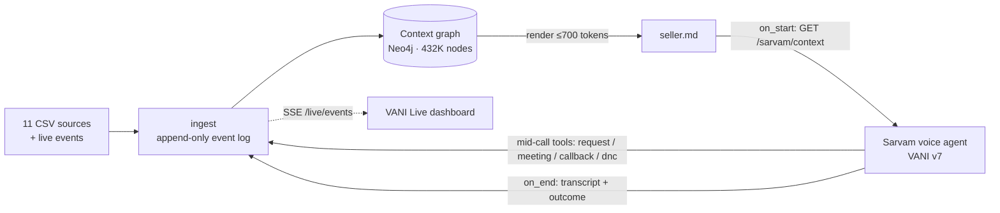

# VANI with memory: a context layer for IndiaMART's seller voice agent

**Problem statement 02: Global Context.** IndiaMART's VANI calls sellers cold. It does not know that a buyer is waiting for this seller's reply, that the seller asked for a callback, or that they already said "stop calling". So sellers repeat themselves and every call starts from zero.

> The full technical README (architecture, data model, agent, API, configuration, operations, security, results) is [`context_layer/README.md`](../README.md). This page is the submission summary.

**Our solution:**
- **One memory per seller.** The memory is a graph keyed by the seller's GLID and built from all 11 data sources.
- **A short `seller.md`.** It is rendered from that graph, stays under 700 tokens, and is the only thing the voice agent reads before it speaks.
- **A Sarvam voice agent (VANI).** It runs on the Sarvam Voice Agents platform. It loads that file when the call starts and opens with the most useful thing for this seller. It writes every outcome (a reply to a buyer, a catalogue change, a complaint, a visit, a callback, a do-not-call request) back into the graph **during the call**.
- **Instant updates.** The seller's file is re-rendered in milliseconds, so the next call, on any channel, continues from where this one stopped.

| | |
|---|---|
| Sarvam agent ID | `VANI-Seller-6921b562-b28e` (committed **version 7**) |
| Agent on the platform | https://agents.sarvam.ai/samvaad/build/update-agent/VANI-Seller-6921b562-b28e |
| Agent name in the dashboard | "VANI Seller Meeting Booker" (the name dates from v1–v5; the behaviour since v6 is the Seller Assistant) |
| Team | _fill in: team name, members, emails_ |

## What the data says, and what VANI does about it

These numbers come from the dataset: 5,000 sellers, 1 Apr – 2 Oct 2026.

| Finding | VANI's response |
|---|---|
| 80% of buyer enquiries (26,265 of 33,006) got no seller reply | opens with the waiting buyer (city and product, never the name), takes price, MOQ and delivery, and records the reply |
| 38% of buyer calls (7,310 of 19,238) were missed | tells the seller which buyer city and product, and asks them to call back today |
| median catalogue quality score is 16/100; 1,279 sellers list fewer than 10 products | explains what is missing and records the products to add |
| ~9,000 WhatsApp photo uploads were rejected (smaller than 500×500) | explains the rule and records photo help |
| `call_dropped` is the most common past VANI disposition | opens with help, not a pitch |

## Architecture



- **Memory tiers.** The graph has three:
  - long-term (who the seller is)
  - short-term (every interaction)
  - reasoning (facts with evidence and expiry, plus the bot's decisions)
- **Open loops.** These are unfinished business, such as a buyer waiting, a promise, or a request the seller made. They are ranked, and the top one becomes `call_reason`, the call's opening.
- **Tunnel.** The agent reaches the local service through a Cloudflare tunnel. Every tool sends a shared secret header. Through the tunnel only the six agent routes are reachable; everything else returns 403.

## Run it

Prerequisites:
- Node 20
- Docker (for Neo4j)
- a `.env` file with:
  - `NEO4J_PASSWORD`
  - `GC_SARVAM_TOKEN`
  - `SARVAM_ORG_ID`, `SARVAM_WORKSPACE_ID`, `SARVAM_APP_ID`, `SARVAM_APP_VERSION=7`
  - `SARVAM_AGENTS_API_KEY`, for the browser call (Sarvam agents dashboard → Settings → API Key; not the `sk_` speech key)

```bash
cd context_layer
npm install
npm run neo4j:up                                   # Neo4j on bolt 7687, browser http://localhost:7474
GC_STORE=neo4j npm run build                       # CSVs + event log -> Neo4j + 5,000 seller.md (~1 min)
GC_STORE=neo4j node cli.js serve --port 8787       # context service
npm run tunnel                                     # public URL for the agent's tools (see README §14.1)
```

Then open:
- **http://localhost:8787/live**: the live dashboard. Pick a seller, click **Call VANI**, and talk.
- http://localhost:8787/: the developer console.

Tests: `npm test` (26 tests).

## The live dashboard (`/live`)

One screen shows a real Sarvam voice call next to everything the context layer does:

| Panel | What it shows |
|---|---|
| Conversation | the live transcript from the Sarvam Web SDK, with every tool call in line: what the agent sent, the answer it spoke from, and the round-trip time |
| Agent's memory | the opening VANI chose and why, the ranked open loops, and a cold-vs-context comparison |
| Write-back pipeline | agent → tunnel → route → event → Neo4j → seller.md, lighting up step by step with timings |
| seller.md diff | the seller's file since the call started (green lines added, red removed) |
| Graph diff | the seller's graph in Neo4j; nodes written by this call pulse green, plus a table of nodes, properties and relationships with the Cypher, and a link to the same nodes in Neo4j Browser |
| Next call will open with | recomputed after every write |
| Call report | facts remembered, nodes written, lines changed, median write time, next opening |

How it connects:
- **Transcript.** It appears when the call ends: Sarvam's runtime does not stream transcript messages for this agent. Tool calls appear live.
- **Browser calls.** They use `sarvam-conv-ai-sdk` (vendored in `src/vendor/sarvam-sdk.js`). The seller is chosen with `agent_variables: {glid}`.
- **The API key stays on the server.** The server proxy (`/sarvam/runtime/*`) adds it, so it never reaches the page.
- **Phone calls.** The dashboard updates for those as well, because it listens to the server, not to the browser.
- **Replay.** Sessions can be saved and replayed (💾 / ⟲).

## Folder guide

| Path | What |
|---|---|
| `src/` | the context layer (ingest, graph, render, Sarvam routes, live dashboard) |
| `src/sarvam.js` | the agent's HTTP tools and the prompt's input variables |
| `sarvam/assistant_prompt.md` | the agent's prompt (v6/v7) |
| `test/` | unit and real-data tests |
| `submission/sample_outputs/` | one tool call, end to end (see below) |
| `submission/skills.md` | build journey and tools used |
| `submission/DEMO_SCRIPT.md` | the video script |

### Sample outputs (`sample_outputs/`)

One real `log_seller_request` call for seller 245234426, captured from the live feed, plus a Sarvam text chat:

1. `01_context_served_to_agent.json`: what the agent received at call start, including `call_reason` and the open loops.
2. `02_seller_before.md`: the seller's file before the call.
3. `03_tool_call_from_agent.json`: the tool body and the answer the agent spoke from.
4. `04_vani_session_event.json`: the event appended to the log.
5. `05_neo4j_graph_diff.json`: the nodes and relationships written to Neo4j.
6. `06_seller_after.md` and `07_seller_md.diff`: the file after the call, and the diff.
7. `08_next_call_opening.json`: the next call now opens by following up on the request.
8. `09_sarvam_chat_live_feed.json`: a real Sarvam v7 chat through the tunnel, as the dashboard saw it.
9. `10_agent_prompt_v7.md` and `11_agent_tools_v7.json`: the agent's prompt and tools.

## Limits

- Requests are recorded in the context layer. They do not reach a real IndiaMART ticketing system, and the buyer is not sent the reply.
- The tunnel is a Cloudflare quick tunnel, so its URL changes when it restarts and the six tool URLs have to be updated.
- Post-call output variables arrive empty at the end-of-call tool. The mid-call tools carry the outcomes.
